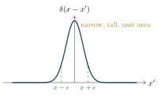

# 3 Dirac Delta Function and the Position and Momentum Bases

## 3.1 Continuous Generalization and Normalization of $|x\rangle$

For a discrete orthonormal basis, $|f\rangle=\sum_nf_n|a_n\rangle$ with $\langle a_n|a_m\rangle=\delta_{nm}$. For a continuous label the sum becomes an integral,

$$
|f\rangle=\int dx\,f(x)\,|x\rangle,\qquad
\langle g|f\rangle=\int dx\,\langle g|x\rangle\langle x|f\rangle=\int dx\,g^*(x)f(x).
$$

What is the normalization of the basis kets $|x\rangle$? Project the expansion onto $\langle x'|$:

$$
\langle x'|f\rangle=\int dx\,f(x)\langle x'|x\rangle .
$$

Since $\langle x'|f\rangle=f(x')$ (the value of the function at $x'$), the object $\langle x'|x\rangle$ must pick out $f(x')$ from the integral. Writing $\langle x'|x\rangle=\delta(x'-x)$ does exactly that: $\int dx\,f(x)\delta(x'-x)=f(x')$.

!!! thm "Normalization of the Position Basis"

    $$
    \langle x'|x\rangle=\delta(x'-x),\qquad \int dx\,|x\rangle\langle x|=\mathbb 1 .
    $$

!!! solution "Complete Solution"

    *(the value at $x'=x$, left as “?” in the notebook):* Insert the completeness relation, $\langle x|f\rangle=\int dx'\langle x|x'\rangle\langle x'|f\rangle$, i.e. $f(x)=\int dx'\,\delta(x,x')f(x')$. The kernel $\delta(x,x')=\langle x|x'\rangle$ therefore vanishes for $x'\neq x$, but its integral over any small window around $x$ must equal $1$. A function that is zero except at one point cannot have unit integral unless its value there is infinite: $\langle x|x\rangle=\delta(0)=\infty$. The kets $|x\rangle$ are therefore not normalizable to $1$, only to a delta function, and are not physical states by themselves; physical states are superpositions $\int dx\,\psi(x)|x\rangle$.

## 3.2 Definition of the Dirac Delta

Inside a window $[x-\epsilon,x+\epsilon]$ the function $f(x')$ is essentially constant, $f(x')\simeq f(x)$, so

$$
\lim_{\epsilon\to0}\int_{x-\epsilon}^{x+\epsilon}\delta(x,x')\,f(x')\,dx'=f(x)\quad\Longrightarrow\quad
\int_{x-\epsilon}^{x+\epsilon}\delta(x,x')\,dx'=1 .
$$

!!! thm "Dirac Delta"

    $$
    \delta(x-x')=0\ \ \text{for }x\neq x',\qquad \int_{x-\epsilon}^{x+\epsilon}\delta(x-x')\,dx'=1,\qquad
    \int dx'\,\delta(x-x')f(x')=f(x).
    $$

{ .fig }

!!! studynote "Study Note"

    *(the notebook’s “$=0$ for $x\neq x'$”):* The statement $\int dx'\,\delta(x-x')=0$ for $x\ne x'$ means the integration window does *not* contain the singular point; with the window around $x'=x$ the integral is $1$. The delta function is not an ordinary function but a distribution: it acquires meaning only under an integral. A standard picture is a spike of width $\to0$ and height $\to\infty$ with area fixed at $1$, e.g. a Gaussian of vanishing width.

!!! memory "Memory Rule"

    “Delta picks out the value.” $\int dx'\,\delta(x-x')f(x')=f(x)$ replaces $x'$ by $x$ and removes the integral. The same rule gives $x'\delta(x-x')=x\,\delta(x-x')$.

## 3.3 Derivative of the Delta Function

Define $\delta'(x-x')=\dfrac d{dx}\delta(x-x')$. Acting on a function under the integral,

\begin{align*}
\int dx'\,\delta'(x-x')f(x')&=\int dx'\Big[\frac d{dx}\delta(x-x')\Big]f(x')
=\frac d{dx}\int dx'\,\delta(x-x')f(x')=\frac d{dx}f(x)=f'(x).
\end{align*}

!!! thm "Derivative of the Delta"

    \begin{gather*}
    \int dx'\,\delta'(x-x')f(x')=f'(x)=\int dx'\,\delta(x-x')f'(x'),\\
    \text{i.e.}\quad \delta'(x-x')\ \equiv\ \delta(x-x')\frac d{dx'}\ \ (\text{under the integral}).
    \end{gather*}

!!! verification "Verification"

    Since $\delta(x-x')$ depends on $x-x'$, $\dfrac d{dx}\delta(x-x')=-\dfrac d{dx'}\delta(x-x')$. Integrating by parts (the boundary terms vanish because $\delta$ is zero away from $x'=x$), $\int dx'\big[-\partial_{x'}\delta(x-x')\big]f(x')=\int dx'\,\delta(x-x')f'(x')=f'(x)$, in agreement with the boxed identity.

## 3.4 Eigenstates of Momentum

The momentum matrix elements were postulated as $\langle x|\hat p|x'\rangle=-i\hbar\,\delta'(x-x')$. Write $\hat p=\hbar\hat k$ and denote the eigenfunction by $\langle x|k\rangle=\psi_k(x)$, so that $\langle x|\hat k|x'\rangle=-i\,\delta'(x-x')$ and $\hat k|k\rangle=k|k\rangle$. Then

\begin{align*}
\langle x|\hat k|k\rangle&=k\langle x|k\rangle\ \Rightarrow\ \int dx'\,\langle x|\hat k|x'\rangle\langle x'|k\rangle=k\,\langle x|k\rangle\\
&\Rightarrow\ \int dx'\,(-i)\,\delta'(x-x')\,\psi_k(x')=k\,\psi_k(x)\ \Rightarrow\ -i\int dx'\,\delta(x-x')\frac d{dx'}\psi_k(x')=k\,\psi_k(x),
\end{align*}

that is,

$$
-i\,\frac{d\psi_k(x)}{dx}=k\,\psi_k(x)\quad\Longrightarrow\quad\psi_k(x)=A\,e^{ikx}.
$$

To fix $A$, require $\langle k|k'\rangle=\delta(k-k')$ and insert $\int dx\,|x\rangle\langle x|=\mathbb 1$:

$$
\langle k|k'\rangle=\int dx\,\langle k|x\rangle\langle x|k'\rangle=|A|^2\int dx\,e^{-ikx}e^{ik'x}=|A|^2\int dx\,e^{-i(k-k')x}=|A|^2\,2\pi\,\delta(k-k').
$$

!!! thm "Momentum Eigenfunctions"

    $$
    \psi_k(x)=\langle x|k\rangle=\frac1{\sqrt{2\pi}}\,e^{ikx},\qquad \langle k|k'\rangle=\delta(k-k').
    $$

!!! solution "Complete Solution (the delta function as a Fourier integral)"

    The identity used above, $\dfrac1{2\pi}\displaystyle\int_{-\infty}^\infty dx\,e^{-i(k-k')x}=\delta(k-k')$, is the statement that $\{e^{ikx}/\sqrt{2\pi}\}$ is a complete orthonormal set in the continuum sense. It is the same relation as $\delta(x-x')=\frac1{2\pi}\int dk\,e^{ik(x-x')}$. Choosing $A=1/\sqrt{2\pi}$ (a phase is arbitrary) gives the boxed normalization.

## 3.5 Operators in the Position and Momentum Bases

**Position basis.** Using $\int dx'\,|x'\rangle\langle x'|=\mathbb 1$ and the postulated matrix elements,

\begin{align*}
\langle x|\hat x|f\rangle&=\int dx'\,\langle x|\hat x|x'\rangle\langle x'|f\rangle=\int dx'\,x'\,\delta(x-x')f(x')=x\,f(x),\\
\langle x|\hat p|f\rangle&=\int dx'\,(-i\hbar)\,\delta'(x-x')f(x')=-i\hbar\,f'(x).
\end{align*}

Equivalently the matrix elements may be written

!!! thm "Position Basis"

    \begin{gather*}
    \langle x|\hat x|x'\rangle=x'\,\delta(x-x'),\qquad
    \langle x|\hat p|x'\rangle=-i\hbar\,\delta(x-x')\frac d{dx'}\\
    (\text{acting to the right on a function of }x'),
    \end{gather*}

    and in the $|x\rangle$ basis$\hat x\equiv x,\quad \hat k\equiv-i\dfrac d{dx}\ (\hat p\equiv-i\hbar\dfrac d{dx})$.

**Momentum basis.** Insert $\mathbb 1=\int dx\,|x\rangle\langle x|$ on both sides of $\hat x$:

\begin{align*}
\langle k|\hat x|k'\rangle&=\iint dx\,dx'\,\langle k|x\rangle\langle x|\hat x|x'\rangle\langle x'|k'\rangle
=\iint dx\,dx'\,\frac{e^{-ikx}}{\sqrt{2\pi}}\,x'\delta(x-x')\,\frac{e^{ik'x'}}{\sqrt{2\pi}}\\
&=\frac1{2\pi}\int dx\,e^{-ikx}\,x\,e^{ik'x}
=i\frac d{dk}\Big[\frac1{2\pi}\int dx\,e^{i(k'-k)x}\Big]=i\frac d{dk}\delta(k'-k)=i\,\delta'(k-k').
\end{align*}

!!! thm "Momentum Basis"

    In the $|k\rangle$ basis$\hat k\equiv k,\qquad \hat x\equiv i\dfrac d{dk}=i\hbar\dfrac d{dp}\quad(p=\hbar k)$.

!!! studynote "Study Note"

    *(the $\hbar$ in the conversion):* Since $p=\hbar k$, $\dfrac d{dk}=\hbar\dfrac d{dp}$, so $i\dfrac d{dk}=i\hbar\dfrac d{dp}$. The position operator is a derivative in momentum space, just as the momentum operator is a derivative in position space. The notebook’s conversion is written with an ambiguous $\hbar$; $i\hbar\,d/dp$ is the dimensionally correct form (position has the dimension of $\hbar/p$).

## 3.6 The Canonical Commutator

In the position representation, $\hat x|f\rangle\equiv x f(x)$ and $\hat p|f\rangle\equiv-i\hbar\dfrac{df}{dx}$. Then

$$
\hat x\hat p|f\rangle=-i\hbar\,x\frac{df}{dx},\qquad
\hat p\hat x|f\rangle=-i\hbar\frac d{dx}\big(xf\big)=-i\hbar f-i\hbar\,x\frac{df}{dx},
\qquad
(\hat x\hat p-\hat p\hat x)|f\rangle=i\hbar\,f .
$$

!!! thm "Canonical Commutation Relation"

    $$
    [\hat x,\hat p]=i\hbar,\qquad\text{hence}\qquad\Delta x\,\Delta p\ \ge\ \frac\hbar2 .
    $$

!!! verification "Verification (momentum representation)"

    With $\hat k\equiv k$ and $\hat x\equiv i\,d/dk$, $[\hat x,\hat k]f=i\dfrac d{dk}(kf)-k\,i\dfrac{df}{dk}=i f$, so $[\hat x,\hat p]=\hbar\,[\hat x,\hat k]=i\hbar$ in either basis, as it must be since a commutator is basis independent.

!!! examtip "Exam Tip"

    For any problem with a free particle, plane waves $e^{ikx}/\sqrt{2\pi}$ with $\hat p=\hbar\hat k$ are the basis, with $\langle k|k'\rangle=\delta(k-k')$. To change a wavefunction from position to momentum space, use $\phi(k)=\langle k|\psi\rangle=\int dx\,\langle k|x\rangle\psi(x)=\frac1{\sqrt{2\pi}}\int dx\,e^{-ikx}\psi(x)$.
