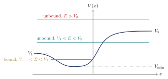

# 5 The One-Dimensional Time-Independent Schrödinger Equation

## 5.1 The Equation and the Classification of Spectra

For a time-independent one-dimensional potential $V(x)$ and total energy $E$,

\begin{gather*}
-\frac{\hbar^2}{2m}\frac{d^2\psi(x)}{dx^2}+V(x)\,\psi(x)=E\,\psi(x),\\
\psi(x,t)=\psi(x,0)\,e^{-iEt/\hbar},\qquad |\psi(x,t)|^2=|\psi(x,0)|^2\ \ (\text{stationary state}).
\end{gather*}

Consider a potential with different asymptotic values, $V(-\infty)=V_1$ and $V(+\infty)=V_2$ with $V_1<V_2$, and a minimum $V_{\min}$.

{ .fig }

## 5.2 (A) Discrete Spectrum: Bound States

Bound states occur whenever the particle cannot move to infinity: it is confined, at that energy, to a finite region of space bounded by the classical turning points. This requires

$$
V_{\min}<E<V_1,\qquad \psi(x)\to0\ \text{ at }x=\pm\infty,
$$

i.e. the energy is below the asymptotic value of the potential on both sides. For bound states to exist, $V(x)$ must have at least one minimum lower than $V_1$. The energy spectrum is then discrete.

!!! thm "Theorem 1 (bound states)"

    In a one-dimensional problem the energy levels of bound states are discrete and non-degenerate.

!!! thm "Theorem 2 (nodes)"

    The wavefunction $\psi_n(x)$ of a one-dimensional bound-state system has $n$ nodes if $n=0$ labels the ground state, and $(n-1)$ nodes if $n=1$ labels the ground state.

!!! solution "Complete Solution (non-degeneracy, Theorem 1)"

    Let $\psi_1,\psi_2$ be two bound-state solutions with the same $E$. From $\psi''=\frac{2m}{\hbar^2}(V-E)\psi$,

    $$
    \psi_1''\psi_2-\psi_2''\psi_1=0\ \Longrightarrow\ \frac d{dx}\big(\psi_1'\psi_2-\psi_2'\psi_1\big)=0 ,
    $$

    so the Wronskian $W=\psi_1'\psi_2-\psi_2'\psi_1$ is constant. Both functions vanish at $x\to\infty$, so $W=0$ everywhere. Then $\psi_1'/\psi_1=\psi_2'/\psi_2$, hence $\psi_2=c\,\psi_1$: the two solutions are the same state. Discreteness has a physical origin: a solution that decays at $+\infty$ and one that decays at $-\infty$ can be joined smoothly only for special energies, so the allowed $E$ form a discrete set.

!!! verification "Verification (nodes)"

    For the infinite square well of width $L$, $\psi_n=\sqrt{2/L}\sin(n\pi x/L)$ with $n=1,2,\dots$ (ground state $n=1$) has $n-1$ interior nodes. For the harmonic oscillator ([Section 6](06-linear-harmonic-oscillator-ladder-operator-method.md)) with ground state $n=0$, $\psi_n$ has $n$ nodes. Both agree with Theorem 2, the first with the “$n=1$ is the ground state” labelling and the second with “$n=0$”.

!!! intuition "Intuition"

    Higher energy means shorter local wavelength, so the wavefunction oscillates more and picks up more zeros. The ground state is always nodeless and every state above it gains one node.

## 5.3 (B) Continuous Spectrum: Unbound States

-   $V_1<E<V_2$: the particle can escape only to $x\to-\infty$ (on the right it is in a classically forbidden region). The energy spectrum is continuous and non-degenerate.

-   $E>V_2$: the particle can escape in both directions. The energy spectrum is continuous and doubly degenerate.

!!! solution "Complete Solution (why the degeneracies differ)"

    For $E>V_2$ both asymptotic regions are classically allowed, so at each end the wavefunction is oscillatory and may be a combination of left- and right-moving waves, giving two independent solutions (e.g. a wave incident from the left and a wave incident from the right) at the same energy: doubly degenerate. For $V_1<E<V_2$ the solution must decay on the right, which removes one of the two independent solutions and leaves a single one at each $E$: non-degenerate.

!!! examtip "Exam Tip"

    Quick classification: compare $E$ with $V(\pm\infty)$. Below both: discrete and non-degenerate (bound). Between the two limits: continuous and non-degenerate. Above both: continuous and doubly degenerate.
