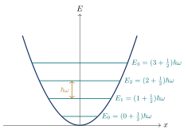

# 6 The Linear Harmonic Oscillator: Ladder-Operator Method

## 6.1 Hamiltonian and the Operators $\hat a,\hat a^\dagger$

$$
\hat H=\frac{\hat p^2}{2m}+\frac12m\omega^2\hat x^2,\qquad \hat H|\psi\rangle=E|\psi\rangle .
$$

Define the *annihilation* and *creation* operators

$$
\hat a=\frac1{\sqrt{2m\hbar\omega}}\big(m\omega\hat x+i\hat p\big),\qquad
\hat a^\dagger=\frac1{\sqrt{2m\hbar\omega}}\big(m\omega\hat x-i\hat p\big),
$$

which invert to

$$
\hat x=\sqrt{\frac\hbar{2m\omega}}\,\big(\hat a+\hat a^\dagger\big),\qquad
\hat p=i\sqrt{\frac{m\hbar\omega}2}\,\big(\hat a^\dagger-\hat a\big).
$$

**Commutator.** Starting from $[\hat x,\hat p]=i\hbar$,

\begin{align*}
[\hat x,\hat p]&=\Big[\sqrt{\tfrac\hbar{2m\omega}}(\hat a^\dagger+\hat a),\ i\sqrt{\tfrac{m\hbar\omega}2}(\hat a^\dagger-\hat a)\Big]
=\frac{i\hbar}2\big[(\hat a^\dagger+\hat a),(\hat a^\dagger-\hat a)\big]\\
&=\frac{i\hbar}2\Big\{[\hat a,\hat a^\dagger]-[\hat a,\hat a]+[\hat a^\dagger,\hat a^\dagger]-[\hat a^\dagger,\hat a]\Big\}
=\frac{i\hbar}2\cdot2[\hat a,\hat a^\dagger]=i\hbar\,[\hat a,\hat a^\dagger].
\end{align*}

!!! thm "Ladder-Operator Algebra"

    $$
    [\hat a,\hat a^\dagger]=1,\qquad [\hat a,\hat a]=[\hat a^\dagger,\hat a^\dagger]=0 .
    $$

!!! studynote "Study Note"

    Here $[\hat a^\dagger,\hat a]=-[\hat a,\hat a^\dagger]=-1$ was used in the line above to combine the first and last terms. The whole algebra of the oscillator follows from this single commutator.

## 6.2 The Hamiltonian in Terms of $\hat a^\dagger\hat a$

\begin{align*}
\hat a^\dagger\hat a&=\frac1{2m\hbar\omega}\big(m\omega\hat x-i\hat p\big)\big(m\omega\hat x+i\hat p\big)
=\frac{m\omega\hat x^2}{2\hbar}+\frac{\hat p^2}{2m\hbar\omega}+\frac i{2\hbar}[\hat x,\hat p]
=\frac{\hat H}{\hbar\omega}-\frac12\mathbb 1 .
\end{align*}

!!! thm "Oscillator Hamiltonian"

    $$
    \hat H=\Big(\hat a^\dagger\hat a+\frac12\Big)\hbar\omega,\qquad\text{or in units of }\hbar\omega:\quad
    \hat{\mathcal H}\equiv\frac{\hat H}{\hbar\omega}=\hat a^\dagger\hat a+\frac12,\quad \hat{\mathcal H}|\epsilon\rangle=\epsilon|\epsilon\rangle .
    $$

!!! studynote "Study Note"

    The cross terms $\hat x\hat p$ and $\hat p\hat x$ combine into $\frac i{2\hbar}[\hat x,\hat p]=\frac i{2\hbar}(i\hbar)=-\frac12$, which is the origin of the $\frac12$. The “zero-point” term $\frac12\hbar\omega$ is a purely quantum effect coming from $[\hat x,\hat p]\neq0$.

## 6.3 Raising and Lowering the Energy

Compute the commutators with $\hat{\mathcal H}=\hat a^\dagger\hat a+\frac12$:

$$
[\hat a,\hat{\mathcal H}]=[\hat a,\hat a^\dagger\hat a]=[\hat a,\hat a^\dagger]\hat a+\hat a^\dagger[\hat a,\hat a]=\hat a,\qquad
[\hat a^\dagger,\hat{\mathcal H}]=[\hat a^\dagger,\hat a^\dagger\hat a]=\hat a^\dagger[\hat a^\dagger,\hat a]=-\hat a^\dagger .
$$

Hence, using $\hat{\mathcal H}\hat a=\hat a\hat{\mathcal H}-[\hat a,\hat{\mathcal H}]$,

$$
\hat{\mathcal H}\,\hat a|\epsilon\rangle=\big(\hat a\hat{\mathcal H}-\hat a\big)|\epsilon\rangle=(\epsilon-1)\,\hat a|\epsilon\rangle,
\qquad\text{and similarly}\qquad
\hat{\mathcal H}\,\hat a^\dagger|\epsilon\rangle=(\epsilon+1)\,\hat a^\dagger|\epsilon\rangle .
$$

!!! thm "Ladder Property"

    $$
    \hat a|\epsilon\rangle=c_\epsilon|\epsilon-1\rangle\ \ (\text{lowering operator}),\qquad
    \hat a^\dagger|\epsilon\rangle=c'_\epsilon|\epsilon+1\rangle\ \ (\text{raising operator}).
    $$

!!! intuition "Intuition"

    $\hat a$ takes an energy eigenstate to another eigenstate one quantum $\hbar\omega$ lower; $\hat a^\dagger$ takes it one quantum higher. Like climbing a ladder with equal rungs, one only needs the bottom rung and the rule for stepping up.

## 6.4 The Ground State and the Spectrum

Let $|\epsilon_0\rangle$ be the lowest state, so that lowering cannot go further: $\hat a|\epsilon_0\rangle=0$. Then $\hat a^\dagger\hat a|\epsilon_0\rangle=0$, i.e. $\big(\hat{\mathcal H}-\frac12\big)|\epsilon_0\rangle=0$, so

$$
\hat{\mathcal H}|\epsilon_0\rangle=\tfrac12|\epsilon_0\rangle\ \Longrightarrow\ \epsilon_0=\tfrac12,\qquad E_0=\tfrac12\hbar\omega .
$$

Applying the raising operator repeatedly gives $\epsilon_1=\big(1+\frac12\big)\hbar\omega=\frac32\hbar\omega$, and so on.

!!! solution "Complete Solution (why a lowest state must exist)"

    For any eigenstate, $\langle\epsilon|\hat a^\dagger\hat a|\epsilon\rangle=\|\hat a|\epsilon\rangle\|^2\ge0$, i.e. $\epsilon-\frac12\ge0$, so $\epsilon\ge\frac12$. If repeated lowering never terminated, $\epsilon-1,\epsilon-2,\dots$ would eventually fall below $\frac12$, a contradiction. So lowering must stop at a state with $\hat a|\epsilon_0\rangle=0$, which fixes $\epsilon_0=\frac12$; the allowed values are then $\epsilon_0+n$ with $n=0,1,2,\dots$ (no values in between, since one cannot stop lowering at any other $\epsilon$).

!!! thm "Energy Spectrum"

    $$
    E_n=\Big(n+\frac12\Big)\hbar\omega,\qquad n=0,1,2,\dots,\qquad
    \hat H|n\rangle=\Big(n+\frac12\Big)\hbar\omega|n\rangle .
    $$

{ .fig }

!!! studynote "Study Note (figure)"

    The levels are equally spaced by $\hbar\omega$, with the lowest at $\frac12\hbar\omega$, not $0$. Each level $E_n$ is non-degenerate, as Theorem 1 of [Section 5](05-one-dimensional-time-independent-schrodinger-equation.md) requires for a bound state in one dimension.

## 6.5 Normalization of the Ladder Action

Write $\hat a|n\rangle=c_n|n-1\rangle$ (so $\hat a^\dagger$ has the adjoint action $\langle n|\hat a^\dagger=c_n^*\langle n-1|$). Then

$$
\langle n|\hat a^\dagger\hat a|n\rangle=|c_n|^2\ \Rightarrow\ \langle n|\big(\hat{\mathcal H}-\tfrac12\big)|n\rangle=|c_n|^2\ \Rightarrow\ n\langle n|n\rangle=|c_n|^2\ \Rightarrow\ c_n=\sqrt n
$$

(taking the phase of $|n-1\rangle$ so that $c_n$ is real and positive).

!!! thm "Action of $\hat a,\hat a^\dagger$ and the Number Operator"

    $$
    \hat a|n\rangle=\sqrt n\,|n-1\rangle,\qquad \hat a^\dagger|n\rangle=\sqrt{n+1}\,|n+1\rangle,\qquad
    \hat a^\dagger\hat a|n\rangle=n|n\rangle .
    $$

    $\hat N\equiv\hat a^\dagger\hat a$ is the *number operator*, $\hat H=\hbar\omega\big(\hat N+\frac12\big)$ and $[\hat H,\hat N]=0$.

!!! verification "Verification (the raising coefficient)"

    $\langle n+1|\hat a^\dagger|n\rangle=\langle n|\hat a|n+1\rangle^*=\sqrt{n+1}$, so $\hat a^\dagger|n\rangle=\sqrt{n+1}|n+1\rangle$. Combining, $\hat a^\dagger\hat a|n\rangle=\sqrt n\sqrt n|n\rangle=n|n\rangle$ .

### Matrix representation

$$
\langle n'|\hat a|n\rangle=\sqrt n\,\delta_{n',n-1},\qquad \langle n'|\hat a^\dagger|n\rangle=\sqrt{n+1}\,\delta_{n',n+1}.
$$

!!! solution "Complete Solution (the matrix the notebook starts)"

    In the basis $|0\rangle,|1\rangle,|2\rangle,|3\rangle,\dots$ (rows $n'$, columns $n$),

    $$
    \hat a^\dagger=\begin{pmatrix}0&0&0&0&\cdots\\ 1&0&0&0&\cdots\\ 0&\sqrt2&0&0&\cdots\\ 0&0&\sqrt3&0&\cdots\\ \vdots&\vdots&\vdots&\vdots&\ddots\end{pmatrix},\qquad
    \hat a=(\hat a^\dagger)^T=\begin{pmatrix}0&1&0&0&\cdots\\ 0&0&\sqrt2&0&\cdots\\ 0&0&0&\sqrt3&\cdots\\ 0&0&0&0&\cdots\\ \vdots&\vdots&\vdots&\vdots&\ddots\end{pmatrix}.
    $$

In the notebook’s table the first listed column is $|1\rangle$ (the state $|0\rangle$ is not shown), which is why the first row is $0$ and the next entry is $\sqrt2$: the table starts one step up the ladder. With $|0\rangle$ included the first sub-diagonal entry is $\langle1|\hat a^\dagger|0\rangle=1$.

## 6.6 Constructing All States from the Ground State

From $\hat a^\dagger|0\rangle=|1\rangle$, $\hat a^\dagger|1\rangle=\sqrt2\,|2\rangle$:

$$
|2\rangle=\frac1{\sqrt2}\hat a^\dagger|1\rangle=\frac1{\sqrt{2\cdot1}}(\hat a^\dagger)^2|0\rangle=\frac1{\sqrt{2!}}(\hat a^\dagger)^2|0\rangle .
$$

!!! thm "Number States from the Vacuum"

    $$
    |n\rangle=\frac1{\sqrt{n!}}\big(\hat a^\dagger\big)^n|0\rangle=\frac1{\sqrt{n!}}\Big[\frac1{\sqrt{2m\hbar\omega}}\big(m\omega\hat x-i\hat p\big)\Big]^n|0\rangle .
    $$

## 6.7 Wavefunctions in the Position Basis

**Ground state.** Use $\hat a|0\rangle=0$ and project onto $\langle x|$, with $\hat p\to-i\hbar\,d/dx$:

\begin{align*}
\langle x|\big(m\omega\hat x+i\hat p\big)|0\rangle&=\int dx'\,\langle x|m\omega\hat x|x'\rangle\langle x'|0\rangle+i\!\int dx'\,\langle x|\hat p|x'\rangle\langle x'|0\rangle\\
&=\Big[m\omega x+i\Big(-i\hbar\frac d{dx}\Big)\Big]\langle x|0\rangle=0
\ \Longrightarrow\ \Big(m\omega x+\hbar\frac d{dx}\Big)\psi_0(x)=0 .
\end{align*}

Separating variables, $\dfrac{d\psi_0}{\psi_0}=-\dfrac{m\omega}\hbar x\,dx$, so

$$
\psi_0(x)=N\exp\Big(-\frac{m\omega}{2\hbar}x^2\Big),\qquad N=\Big(\frac{m\omega}{\pi\hbar}\Big)^{1/4},
$$

where $N$ follows from $\int|\psi_0|^2dx=N^2\sqrt{\pi\hbar/m\omega}=1$.

**Excited states.** Substituting $\hat p\to-i\hbar\,d/dx$ in $|n\rangle=\frac1{\sqrt{n!}}(\hat a^\dagger)^n|0\rangle$:

!!! thm "Oscillator Eigenfunctions"

    $$
    \langle x|n\rangle=\psi_n(x)=\frac1{(2m\hbar\omega)^{n/2}}\Big(m\omega x-\hbar\frac d{dx}\Big)^n\frac{\psi_0(x)}{\sqrt{n!}}
    $$

    These are the Hermite functions: $\psi_n$ is a polynomial of degree $n$ (a Hermite polynomial) times the Gaussian $e^{-m\omega x^2/2\hbar}$.

!!! solution "Complete Solution (first excited state)"

    Since $\hbar\psi_0'=-m\omega x\,\psi_0$, we get $\big(m\omega x-\hbar\frac d{dx}\big)\psi_0=2m\omega x\,\psi_0$, hence

    $$
    \psi_1(x)=\frac{2m\omega\,x}{\sqrt{2m\hbar\omega}}\psi_0(x)=\sqrt{\frac{2m\omega}\hbar}\;x\,\psi_0(x)=\sqrt{\frac{2m\omega}\hbar}\Big(\frac{m\omega}{\pi\hbar}\Big)^{1/4}x\,e^{-m\omega x^2/2\hbar},
    $$

    which is odd, has one node at $x=0$ (consistent with Theorem 2 of [Section 5](05-one-dimensional-time-independent-schrodinger-equation.md)), and is normalized: $\int|\psi_1|^2dx=\frac{2m\omega}\hbar N^2\int x^2e^{-m\omega x^2/\hbar}dx=\frac{2m\omega}\hbar N^2\cdot\frac{\hbar}{2m\omega}\sqrt{\frac{\pi\hbar}{m\omega}}=1$ .

## 6.8 Moments and the Uncertainty Product

In the state $|n\rangle$, $\langle\hat x\rangle=\sqrt{\frac\hbar{2m\omega}}\langle n|\hat a+\hat a^\dagger|n\rangle=0$ since $\hat a,\hat a^\dagger$ change $n$, and likewise $\langle\hat p\rangle=0$. Hence $(\Delta p)^2=\langle\hat p^2\rangle$ and $(\Delta x)^2=\langle\hat x^2\rangle$. Squaring the definitions,

\begin{align*}
\langle\hat p^2\rangle&=-\frac{m\hbar\omega}2\big\langle n\big|\hat a^\dagger\hat a^\dagger-\hat a^\dagger\hat a-\hat a\hat a^\dagger+\hat a\hat a\big|n\big\rangle
=\frac{m\hbar\omega}2\big\langle n\big|\hat a^\dagger\hat a+\hat a\hat a^\dagger\big|n\big\rangle\\
&=\frac{m\hbar\omega}2\big\langle n\big|2\hat a^\dagger\hat a+1\big|n\big\rangle=\frac{m\hbar\omega}2(2n+1)=m\hbar\omega\Big(n+\frac12\Big),
\end{align*}

because $\hat a^\dagger\hat a^\dagger$ and $\hat a\hat a$ change $n$ by $\pm2$ and have zero diagonal elements, and $\hat a\hat a^\dagger=\hat a^\dagger\hat a+1$. In the same way

$$
\langle\hat x^2\rangle=\frac\hbar{2m\omega}\langle n|\hat a^\dagger\hat a+\hat a\hat a^\dagger|n\rangle=\frac\hbar{m\omega}\Big(n+\frac12\Big).
$$

!!! thm "Uncertainty in the Oscillator States"

    $$
    \Delta x\,\Delta p=\Big(n+\frac12\Big)\hbar,\qquad\text{ground state }(n=0):\ \ \Delta x\,\Delta p=\frac\hbar2\ \ (\text{minimum uncertainty}).
    $$

!!! verification "Verification (virial theorem)"

    $\langle T\rangle=\dfrac{\langle\hat p^2\rangle}{2m}=\dfrac12\hbar\omega\big(n+\frac12\big)$ and $\langle V\rangle=\dfrac12m\omega^2\langle\hat x^2\rangle=\dfrac12\hbar\omega\big(n+\frac12\big)$, so $\langle T\rangle=\langle V\rangle=\frac12E_n$ and their sum is $E_n$ .

!!! memory "Memory Rule"

    Ladder rules: $\hat a|n\rangle=\sqrt n|n-1\rangle$ (the factor is $\sqrt{\text{the larger index}}$ in both $\hat a$ and $\hat a^\dagger$ matrix elements), $\hat a^\dagger|n\rangle=\sqrt{n+1}|n+1\rangle$, $\hat N=\hat a^\dagger\hat a$, and $[\hat a,\hat a^\dagger]=1$.

!!! examtip "Exam Tip"

    For any matrix element of $\hat x^k\hat p^l$ between number states, replace $\hat x,\hat p$ by $\hat a,\hat a^\dagger$, expand, and keep only terms with equal numbers of $\hat a$ and $\hat a^\dagger$ (diagonal elements) or the right net difference (off-diagonal). Reorder with $\hat a\hat a^\dagger=\hat a^\dagger\hat a+1$.
