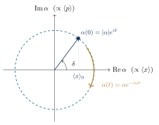

# 7 Classical Limit of the Oscillator: Coherent States

## 7.1 Construction and Eigenvalue Property

The number states $|n\rangle$ have $\langle x\rangle=0$ at all times and no classical motion, so they do not resemble a classical oscillator. A state that does is built as a superposition of all number states with Poisson-like weights.

!!! thm "Coherent State"

    $$
    |\alpha\rangle=\exp\Big(-\frac12|\alpha|^2\Big)\sum_{n=0}^\infty\frac{\alpha^n}{\sqrt{n!}}\,|n\rangle,\qquad\alpha\in\mathbb C .
    $$

    $|\alpha\rangle$ is an eigenstate of the annihilation operator: $\ \hat a|\alpha\rangle=\alpha|\alpha\rangle$.

**Proof.** Using $\hat a|n\rangle=\sqrt n|n-1\rangle$ (the $n=0$ term is killed by $\hat a$),

\begin{align*}
\hat a|\alpha\rangle&=e^{-|\alpha|^2/2}\sum_{n=0}^\infty\frac{\alpha^n}{\sqrt{n!}}\hat a|n\rangle
=e^{-|\alpha|^2/2}\sum_{n=1}^\infty\frac{\alpha^n}{\sqrt{n!}}\sqrt n\,|n-1\rangle\\
&=\alpha\,e^{-|\alpha|^2/2}\sum_{n=1}^\infty\frac{\alpha^{n-1}}{\sqrt{(n-1)!}}|n-1\rangle=\alpha|\alpha\rangle .\ \blacksquare
\end{align*}

**Normalization.** Using $\langle m|n\rangle=\delta_{mn}$,

$$
\langle\alpha|\alpha\rangle=e^{-|\alpha|^2}\sum_{m,n}\frac{(\alpha^*)^m\alpha^n}{\sqrt{m!\,n!}}\langle m|n\rangle=e^{-|\alpha|^2}\sum_{n=0}^\infty\frac{|\alpha|^{2n}}{n!}=e^{-|\alpha|^2}e^{|\alpha|^2}=1 .
$$

!!! intuition "Intuition"

    $\hat a$ is not Hermitian, so its eigenvalue $\alpha$ is a complex number, with no restriction. The real and imaginary parts of $\alpha$ will turn out to encode the mean position and mean momentum, so $\alpha$ is a point in classical phase space.

!!! solution "Complete Solution (photon-number statistics)"

    The probability of finding $n$ quanta is $P(n)=|\langle n|\alpha\rangle|^2=e^{-|\alpha|^2}\dfrac{|\alpha|^{2n}}{n!}$, a Poisson distribution with mean $\bar n=\langle\alpha|\hat a^\dagger\hat a|\alpha\rangle=|\alpha|^2$ and width $\Delta n=|\alpha|$. The energy is $\langle\hat H\rangle=\hbar\omega(|\alpha|^2+\frac12)$. For large $|\alpha|$ the relative spread $\Delta n/\bar n=1/|\alpha|\to0$, which is the classical limit of a well-defined energy.

## 7.2 Position, Momentum and Uncertainty

Since $\hat a|\alpha\rangle=\alpha|\alpha\rangle$, taking the adjoint gives $\langle\alpha|\hat a^\dagger=\langle\alpha|\alpha^*$. With $\hat x=\sqrt{\frac\hbar{2m\omega}}(\hat a^\dagger+\hat a)$ and $\hat p=i\sqrt{\frac{m\hbar\omega}2}(\hat a^\dagger-\hat a)$:

\begin{align*}
\langle\hat x\rangle&=\langle\alpha|\hat x|\alpha\rangle=\sqrt{\frac\hbar{2m\omega}}\,\langle\alpha|\hat a^\dagger+\hat a|\alpha\rangle=\sqrt{\frac\hbar{2m\omega}}\,(\alpha+\alpha^*),\\
\langle\hat x^2\rangle&=\frac\hbar{2m\omega}\langle\alpha|\hat a^{\dagger2}+\hat a^2+\hat a\hat a^\dagger+\hat a^\dagger\hat a|\alpha\rangle\\
&=\frac\hbar{2m\omega}\langle\alpha|\hat a^{\dagger2}+\hat a^2+2\hat a^\dagger\hat a+1|\alpha\rangle
=\frac\hbar{2m\omega}\big(\alpha^{*2}+\alpha^2+2\alpha^*\alpha+1\big).
\end{align*}

Therefore $(\Delta x)^2=\langle\hat x^2\rangle-\langle\hat x\rangle^2=\dfrac\hbar{2m\omega}$, since $\langle\hat x\rangle^2=\frac\hbar{2m\omega}(\alpha^2+\alpha^{*2}+2\alpha^*\alpha)$.

!!! solution "Complete Solution (momentum, left out in the notebook)"

    \begin{align*}
    \langle\hat p\rangle&=i\sqrt{\tfrac{m\hbar\omega}2}\,(\alpha^*-\alpha)=\sqrt{2m\hbar\omega}\,\mathrm{Im}\,\alpha,\\
    \langle\hat p^2\rangle&=-\frac{m\hbar\omega}2\big(\alpha^{*2}+\alpha^2-2|\alpha|^2-1\big),\qquad
    \langle\hat p\rangle^2=-\frac{m\hbar\omega}2\big(\alpha^{*2}+\alpha^2-2|\alpha|^2\big),
    \end{align*}

    so $(\Delta p)^2=\dfrac{m\hbar\omega}2$. The same $\Delta x$ and $\Delta p$ hold for every $\alpha$ and equal the ground-state values.

!!! thm "Coherent States are Minimum-Uncertainty States"

    $$
    (\Delta x)^2=\frac\hbar{2m\omega},\qquad(\Delta p)^2=\frac{m\hbar\omega}2,\qquad(\Delta x)^2(\Delta p)^2=\frac{\hbar^2}4,\qquad
    \boxed{\Delta x\,\Delta p=\frac\hbar2}\ \text{ for coherent states.}
    $$

Coherent states saturate the uncertainty bound, so they are as close to a classical point in phase space as quantum mechanics permits.

!!! studynote "Study Note"

    The ground state is the special case $\alpha=0$, i.e. $|\alpha=0\rangle=|0\rangle$. A general coherent state is the ground-state Gaussian displaced in phase space: it has the same width but its centre sits at $\langle x\rangle,\langle p\rangle$ set by $\alpha$.

!!! solution "Complete Solution (the wavefunction)"

    In the position basis $\hat a|\alpha\rangle=\alpha|\alpha\rangle$ becomes $\big(m\omega x+\hbar\frac d{dx}\big)\psi_\alpha=\sqrt{2m\hbar\omega}\,\alpha\,\psi_\alpha$, whose solution is

    $$
    \psi_\alpha(x)\propto\exp\Big[-\frac{m\omega}{2\hbar}(x-x_0)^2+\frac i\hbar p_0x\Big],\qquad
    x_0=\sqrt{\frac{2\hbar}{m\omega}}\,\mathrm{Re}\,\alpha,\quad p_0=\sqrt{2m\hbar\omega}\,\mathrm{Im}\,\alpha ,
    $$

    which is the ground-state Gaussian centred at $x_0$ with mean momentum $p_0$, in agreement with $\langle\hat x\rangle=x_0$ and $\langle\hat p\rangle=p_0$ above.

!!! studynote "Study Note (overlaps)"

    Coherent states are not orthogonal. From the definition, $\langle\beta|\alpha\rangle=\exp\big(-\tfrac12|\alpha|^2-\tfrac12|\beta|^2+\beta^*\alpha\big)$ and $|\langle\beta|\alpha\rangle|^2=e^{-|\alpha-\beta|^2}$, which is small only when $|\alpha-\beta|$ is large. They form an overcomplete set. The notebook marks further work on coherent states as an exercise from Sakurai; the overlap and the photon-number distribution above are the standard first parts of it.

## 7.3 Time Evolution of a Coherent State

Apply the time-evolution operator $\hat U(t)=e^{-i\hat Ht/\hbar}$, which acts on $|n\rangle$ as $e^{-i(n+\frac12)\omega t}$:

$$
|\alpha(t)\rangle=\hat U(t)|\alpha\rangle=e^{-|\alpha|^2/2}\sum_{n=0}^\infty\frac{\alpha^n}{\sqrt{n!}}\,e^{-i(n+\frac12)\omega t}|n\rangle
=e^{-i\omega t/2}\,\big|\alpha e^{-i\omega t}\big\rangle .
$$

!!! thm "A Coherent State Stays Coherent"

    $$
    |\alpha(t)\rangle=e^{-i\omega t/2}\,|\alpha e^{-i\omega t}\rangle .
    $$

Up to a global phase, the label $\alpha$ simply rotates clockwise in the complex plane with angular frequency $\omega$.

!!! verification "Verification"

    In the last step, $e^{-|\alpha|^2/2}\sum\frac{\alpha^n}{\sqrt{n!}}e^{-in\omega t}|n\rangle=e^{-|\alpha e^{-i\omega t}|^2/2}\sum\frac{(\alpha e^{-i\omega t})^n}{\sqrt{n!}}|n\rangle$ because $|\alpha e^{-i\omega t}|=|\alpha|$.

**Expectation value of $\hat x$.** The direct double sum gives (using $\langle m|\hat a^\dagger|n\rangle=\sqrt{n+1}\,\delta_{m,n+1}$ and $\langle m|\hat a|n\rangle=\sqrt n\,\delta_{m,n-1}$)

\begin{align*}
\langle x(t)\rangle&=\langle\alpha(t)|\hat x|\alpha(t)\rangle
=\sqrt{\frac\hbar{2m\omega}}\,e^{-|\alpha|^2}\sum_{m,n}\frac{\alpha^{*m}\alpha^n}{\sqrt{m!\,n!}}\langle m|\hat a^\dagger+\hat a|n\rangle\,e^{-i\omega t(n-m)}\\
&=\sqrt{\frac\hbar{2m\omega}}\,e^{-|\alpha|^2}\Big[\sum_n\frac{\alpha^{*(n-1)}\alpha^n}{(n-1)!}e^{-i\omega t}+\sum_n\frac{\alpha^{*(n+1)}\alpha^n}{n!}e^{i\omega t}\Big]\\
&=\sqrt{\frac\hbar{2m\omega}}\,e^{-|\alpha|^2}\Big[\alpha\,e^{|\alpha|^2}e^{-i\omega t}+\alpha^*\,e^{|\alpha|^2}e^{i\omega t}\Big].
\end{align*}

Write $\alpha=|\alpha|e^{i\delta}$. Then $\alpha e^{-i\omega t}=|\alpha|e^{-i(\omega t-\delta)}$ and

!!! thm "Classical Motion of the Mean Position"

    $$
    \langle x(t)\rangle=\sqrt{\frac\hbar{2m\omega}}\,|\alpha|\Big[e^{-i(\omega t-\delta)}+e^{i(\omega t-\delta)}\Big]=2\sqrt{\frac\hbar{2m\omega}}\,|\alpha|\cos(\omega t-\delta)=A\cos(\omega t-\delta),
    $$

    $$
    \frac{d^2}{dt^2}\langle x(t)\rangle=-\omega^2\langle x(t)\rangle .
    $$

Here $A=2\sqrt{\hbar/2m\omega}\,|\alpha|$ is the classical amplitude and $\delta$ a phase constant: the mean position obeys the equation of the classical harmonic oscillator.

{ .fig }

!!! studynote "Study Note (figure)"

    The point $\alpha(t)$ circles the origin clockwise with angular frequency $\omega$; its projections on the two axes are (up to constants) $\langle x(t)\rangle$ and $\langle p(t)\rangle$, which is the classical phase-space ellipse of the oscillator. The width of the packet does not change, so the quantum state follows the classical trajectory without spreading, which is the sense in which coherent states are the closest quantum analogue of a classical oscillator.

!!! verification "Verification (Ehrenfest)"

    From [Section 4](04-time-evolution-stationary-states-schrodinger-heisenberg.md), $\frac d{dt}\langle\hat x\rangle=\frac1{i\hbar}\langle[\hat x,\hat H]\rangle=\langle\hat p\rangle/m$ and $\frac d{dt}\langle\hat p\rangle=-m\omega^2\langle\hat x\rangle$, so $\frac{d^2}{dt^2}\langle\hat x\rangle=-\omega^2\langle\hat x\rangle$ for *every* state. The new content for a coherent state is that the packet stays a minimum-uncertainty Gaussian while this happens.

!!! examtip "Exam Tip"

    Three quick facts to quote: (i) $\hat a|\alpha\rangle=\alpha|\alpha\rangle$ with $\alpha$ complex; (ii) $\Delta x\,\Delta p=\hbar/2$ for all $\alpha$; (iii) $|\alpha(t)\rangle=e^{-i\omega t/2}|\alpha e^{-i\omega t}\rangle$, so $\langle x(t)\rangle=A\cos(\omega t-\delta)$. For the time-evolution calculation, it is faster to use $\langle x\rangle=\sqrt{\hbar/2m\omega}\,(\alpha(t)+\alpha^*(t))$ than the double sum.
