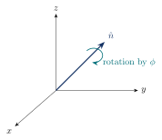

# 10 Rotations, Isotropy of Space and Angular Momentum Conservation

## 10.1 Rotation of a State

The state vector is $|\psi\rangle$ and its position-space representation is $\langle\vec r|\psi\rangle=\psi(\vec r)$. A rotation takes a point to $\vec r'=\hat R(\phi)\vec r$, and the state to $\psi'(\vec r)=\hat U_R(\phi)\psi(\vec r)$ (the notes use $U_R(\phi)\equiv D_R(\phi)$ for the same operator). Isotropy of space means the wavefunction value travels with the point:

$$
\psi'(\vec r')=\psi(\vec r)\quad\Longrightarrow\quad \hat U_R(\phi)\psi(\vec r)=\psi\big(\hat R^{-1}(\phi)\vec r\big).
$$

For a rotation about the $z$-axis by the angle $\phi$,

$$
\begin{pmatrix}x'\\y'\\z'\end{pmatrix}=\underbrace{\begin{pmatrix}\cos\phi&-\sin\phi&0\\ \sin\phi&\cos\phi&0\\0&0&1\end{pmatrix}}_{\hat R_z(\phi)}\begin{pmatrix}x\\y\\z\end{pmatrix}.
$$

## 10.2 Rotation About the $z$-Axis

For an infinitesimal angle $\delta\phi$ the matrix and its inverse are

$$
\hat R_z(\delta\phi)=\begin{pmatrix}1&-\delta\phi&0\\ \delta\phi&1&0\\0&0&1\end{pmatrix},\qquad
\hat R_z^{-1}(\delta\phi)=\begin{pmatrix}1&\delta\phi&0\\-\delta\phi&1&0\\0&0&1\end{pmatrix}.
$$

Therefore

\begin{align*}
\hat U_{R_z}(\delta\phi)\psi(\vec r)&=\psi\big(\hat R_z^{-1}(\delta\phi)\vec r\big)=\psi(x+\delta\phi\,y,\,-\delta\phi\,x+y,\,z)\\
&=\psi(x,y,z)+\delta\phi\Big(y\frac{\partial}{\partial x}-x\frac{\partial}{\partial y}\Big)\psi(x,y,z)\\
&=\Big[\mathbb 1-\frac i\hbar\,\delta\phi\,(x\hat p_y-y\hat p_x)\Big]\psi(x,y,z).
\end{align*}

The combination $x\hat p_y-y\hat p_x$ is $\hat L_z$, which therefore generates rotations about $z$.

!!! thm "Infinitesimal Rotation About $z$"

    $$
    \hat U_{R_z}(\delta\phi)=\mathbb 1-\frac i\hbar\,\delta\phi\,\hat L_z .
    $$

With $\delta\phi=\phi/N$,

$$
\hat U_{R_z}(\phi)=\lim_{N\to\infty}\Big(\mathbb 1-\frac i\hbar\frac\phi N\hat L_z\Big)^N=\exp\!\Big(-\frac i\hbar\,\hat L_z\phi\Big).
$$

## 10.3 Rotation About a General Axis

For a rotation about the unit vector $\hat n$ through a small angle,

$$
\vec r'=\hat R_{\hat n}(\delta\phi)\vec r=\vec r+\delta\phi\,(\hat n\times\vec r),
$$

so

\begin{align*}
\hat U_{R_{\hat n}}(\delta\phi)\psi(\vec r)&=\psi\big(\hat R_{\hat n}^{-1}\vec r\big)=\psi\big(\vec r-\delta\phi\,(\hat n\times\vec r)\big)\\
&=\Big[\mathbb 1-\delta\phi\ \hat n\cdot(\vec r\times\vec\nabla)\Big]\psi(\vec r)=\Big[\mathbb 1-\frac i\hbar\,\delta\phi\ \hat n\cdot\hat{\vec L}\Big]\psi(\vec r),
\end{align*}

using $\hat n\cdot(\vec r\times\vec\nabla)=\tfrac i\hbar\,\hat n\cdot\hat{\vec L}$ with $\hat{\vec L}=\vec r\times\hat{\vec p}$.

{ .fig }

!!! thm "Rotation Operators"

    $$
    \hat U_{R_{\hat n}}(\delta\phi)=\mathbb 1-\frac i\hbar\,\delta\phi\ \hat n\cdot\hat{\vec L},\qquad
    \hat U_{R_{\hat n}}(\phi)=\exp\!\Big(-\frac i\hbar\,\phi\ \hat n\cdot\hat{\vec L}\Big).
    $$

    Angular momentum is the generator of rotations.

## 10.4 Isotropy and Conservation of Angular Momentum

Under a rotation $\hat H'=\hat U_{R_{\hat n}}\hat H\hat U_{R_{\hat n}}^\dagger$. For an infinitesimal rotation,

$$
\hat H'=\Big[\mathbb 1-\frac i\hbar\,\delta\phi\,\hat n\cdot\hat{\vec L}\Big]\hat H\Big[\mathbb 1+\frac i\hbar\,\delta\phi\,\hat n\cdot\hat{\vec L}\Big]=\hat H+\frac i\hbar\,\delta\phi\ \hat n\cdot[\hat H,\hat{\vec L}\,]+O(\delta\phi^2).
$$

If $\hat H$ is invariant, $\hat H'=\hat H$ for every $\hat n$, so

!!! thm "Isotropy of Space $\Rightarrow$ Angular Momentum Conservation"

    $$
    [\hat H,\hat{\vec L}\,]=0\quad\Longrightarrow\quad \langle\hat{\vec L}\,\rangle\ \text{is conserved.}
    $$

## 10.5 Non-Commutation of Rotations: the Angular Momentum Algebra

Rotations about different axes do not commute, and this fixes the commutators of the generators. Take two infinitesimal rotations of equal angle $\delta\phi$, about $x$ and about $y$, with unit vectors $\hat e_1$ and $\hat e_2$. First,

\begin{align*}
\hat U_y(\delta\phi)\hat U_x(\delta\phi)\psi(\vec r)&=\psi\big((\hat R_y\hat R_x)^{-1}\vec r\big)=\psi\big(\hat R_x^{-1}\hat R_y^{-1}\vec r\big)\\
&=\psi\big(\hat R_x^{-1}[\vec r-\delta\phi(\hat e_2\times\vec r)]\big)\\
&=\psi\Big[\vec r-\delta\phi(\hat e_2\times\vec r)-\delta\phi\,\hat e_1\times\{\vec r-\delta\phi(\hat e_2\times\vec r)\}\Big]\\
&=\psi\Big[\vec r-\delta\phi(\hat e_1+\hat e_2)\times\vec r+\delta\phi^2\,\hat e_1\times(\hat e_2\times\vec r)\Big].
\end{align*}

Similarly, with the order reversed,

$$
\hat U_x(\delta\phi)\hat U_y(\delta\phi)\psi(\vec r)=\psi\Big[\vec r-\delta\phi(\hat e_1+\hat e_2)\times\vec r+\delta\phi^2\,\hat e_2\times(\hat e_1\times\vec r)\Big].
$$

Subtract the two and keep terms to order $\delta\phi^2$:

\begin{align*}
\big[\hat U_x(\delta\phi),\hat U_y(\delta\phi)\big]\psi(\vec r)&=\delta\phi^2\big[\hat e_2\times(\hat e_1\times\vec r)-\hat e_1\times(\hat e_2\times\vec r)\big]\cdot\vec\nabla\psi\\
&=\delta\phi^2\,[\,y\,\hat e_1-x\,\hat e_2\,]\cdot\vec\nabla\psi=-\delta\phi^2\,\frac i\hbar\,\hat L_z\,\psi(\vec r).\tag{I}
\end{align*}

On the other hand, expanding the operators directly,

\begin{align*}
\big[\hat U_x,\hat U_y\big]\psi&=\Big[\Big(\mathbb 1-\tfrac i\hbar\delta\phi\hat L_x\Big)\Big(\mathbb 1-\tfrac i\hbar\delta\phi\hat L_y\Big)-\Big(\mathbb 1-\tfrac i\hbar\delta\phi\hat L_y\Big)\Big(\mathbb 1-\tfrac i\hbar\delta\phi\hat L_x\Big)\Big]\psi\\
&=-\frac{\delta\phi^2}{\hbar^2}[\hat L_x,\hat L_y]\,\psi(\vec r).\tag{II}
\end{align*}

Equating (I) and (II) yields $[\hat L_x,\hat L_y]=i\hbar\hat L_z$.

!!! verification "Verification"

    Checking with $\hat L_i=\epsilon_{ijk}r_j\hat p_k$ and $[r_i,\hat p_j]=i\hbar\delta_{ij}$: $[\hat L_x,\hat L_y]=[y\hat p_z-z\hat p_y,\,z\hat p_x-x\hat p_z]=y\hat p_x[\hat p_z,z]+\hat p_yx[z,\hat p_z]=i\hbar(x\hat p_y-y\hat p_x)=i\hbar\hat L_z$.

!!! thm "Angular Momentum Algebra"

    For any angular momentum operator $\hat{\vec J}$ with $\hat U_{\hat n}(\phi)=\exp(-\tfrac i\hbar\,\phi\,\hat n\cdot\hat{\vec J})$,

    $$
    [\hat J_x,\hat J_y]=i\hbar\hat J_z,\quad [\hat J_y,\hat J_z]=i\hbar\hat J_x,\quad [\hat J_z,\hat J_x]=i\hbar\hat J_y,
    \qquad\text{i.e.}\qquad [\hat J_i,\hat J_j]=i\hbar\,\epsilon_{ijk}\hat J_k .
    $$

!!! studynote "Study Note"

    The notes now promote this algebra to the *definition* of angular momentum: any triplet of Hermitian operators obeying $[\hat J_i,\hat J_j]=i\hbar\epsilon_{ijk}\hat J_k$ is an angular momentum, whether or not it comes from $\vec r\times\vec p$. This is what allows spin, which has no classical position-space form, to be treated in the same framework.
