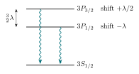

# 18 Spin-Orbit Coupling: the Doublet in Sodium

## 18.1 The Effective Hamiltonian

Sodium has the configuration $1s^22s^22p^63s^1$. The ten electrons of the closed shells form the $\mathrm{Na}^+$ core, and the single valence electron moves in an effective central potential in which the nuclear charge is screened by the core, for example

$$
V(r)=-\frac{Ze^2}r\,e^{-r/r_0}\quad(\text{the exponential is the screening effect}).
$$

The complication comes from the *spin* of the electron. In the rest frame of the electron the radial electric field $\vec E$ of the core appears as a magnetic field

$$
\vec B\propto-\frac{\vec v\times\vec E}{c^2}\ \ (\propto\hat{\vec L}),
$$

and the electron spin (magnetic moment $\propto\hat{\vec S}$) interacts with it, $\vec B\cdot\tfrac\hbar2\hat{\vec\sigma}=\lambda\,\hat{\vec L}\cdot\hat{\vec S}$.

!!! thm "Effective Hamiltonian for Sodium"

    $$
    \hat H_{\mathrm{eff}}=-\frac{\hbar^2}{2m}\nabla^2+V(r)+\lambda\,\hat{\vec L}\cdot\hat{\vec S}.
    $$

Without the $\lambda$ term, $\{\hat H,\hat L^2,\hat L_z\}$ (together with $\hat S^2,\hat S_z$) is a complete set of commuting operators. The question is which basis is good when $\lambda\neq0$.

## 18.2 Choice of Basis

Two bases are available:

-   **Uncoupled:** $\{\hat L^2,\hat S^2,\hat L_z,\hat S_z\}$ with states $|\ell,s,m_\ell,m_s\rangle$.

-   **Coupled:** with $\hat{\vec J}=\hat{\vec L}+\hat{\vec S}$, $\{\hat J^2,\hat J_z,\hat L^2,\hat S^2\}$ with states $|j,m,\ell,s\rangle\equiv|j,m\rangle$.

If there were no $\lambda\hat{\vec L}\cdot\hat{\vec S}$ term, both bases would commute with $\hat H_{\mathrm{eff}}$. With it, check the $z$-components:

\begin{align*}
[\hat L_z,\hat{\vec L}\cdot\hat{\vec S}]&=[\hat L_z,\hat L_x]\hat S_x+[\hat L_z,\hat L_y]\hat S_y=i\hbar\hat L_y\hat S_x-i\hbar\hat L_x\hat S_y,\\
[\hat S_z,\hat{\vec L}\cdot\hat{\vec S}]&=\hat L_x[\hat S_z,\hat S_x]+\hat L_y[\hat S_z,\hat S_y]=i\hbar\hat L_x\hat S_y-i\hbar\hat L_y\hat S_x .
\end{align*}

Neither is zero, so $\hat H_{\mathrm{eff}}$ does not commute with $\hat L_z$ or $\hat S_z$, and the uncoupled basis is *not good*. But the sum cancels, $[\hat J_z,\hat{\vec L}\cdot\hat{\vec S}]=0$ (and likewise for $\hat J^2$, $\hat L^2$, $\hat S^2$).

!!! thm "Good Basis for Spin-Orbit Coupling"

    $$
    \{\hat H_{\mathrm{eff}},\hat J^2,\hat J_z,\hat L^2,\hat S^2\}\quad\text{commute; the good basis is }|j,m,\ell,s\rangle.
    $$

## 18.3 Energy Shifts

With $\hat{\vec J}=\hat{\vec L}+\hat{\vec S}$, $\hat J^2=\hat L^2+\hat S^2+2\hat{\vec L}\cdot\hat{\vec S}$, hence

$$
\hat{\vec L}\cdot\hat{\vec S}=\tfrac12\big(\hat J^2-\hat L^2-\hat S^2\big),\qquad
\lambda\hat{\vec L}\cdot\hat{\vec S}\,|j,m,\ell,s\rangle=\frac\lambda2\hbar^2\big[j(j+1)-\ell(\ell+1)-s(s+1)\big]|j,m,\ell,s\rangle,
$$

with $s=\tfrac12$ for the electron. The triangle rule gives $\ell-\tfrac12\le j\le\ell+\tfrac12$:

\begin{align*}
j=\ell+\tfrac12:&\quad\frac\lambda2\hbar^2\Big[(\ell+\tfrac12)(\ell+\tfrac32)-\ell(\ell+1)-\tfrac34\Big]=\frac{\lambda\hbar^2\,\ell}2,\\
j=\ell-\tfrac12:&\quad\frac\lambda2\hbar^2\Big[(\ell-\tfrac12)(\ell+\tfrac12)-\ell(\ell+1)-\tfrac34\Big]=-\frac{\lambda\hbar^2(\ell+1)}2 .
\end{align*}

!!! thm "Spin-Orbit Shifts for $s=\tfrac12$"

    $$
    \Delta E=\begin{cases}+\dfrac{\lambda\hbar^2\ell}2&j=\ell+\tfrac12,\\[6pt]-\dfrac{\lambda\hbar^2(\ell+1)}2&j=\ell-\tfrac12.\end{cases}
    $$

!!! verification "Verification"

    The weighted average of the shifts vanishes: $(2j_++1)\frac{\ell}2+(2j_-+1)\big(-\frac{\ell+1}2\big)=(2\ell+2)\frac\ell2-2\ell\frac{\ell+1}2=0$ (in units of $\lambda\hbar^2$), so the multiplet’s centre of gravity is unshifted.

**Ground state, $\ell=0$:** no spin-orbit coupling ($\hat{\vec L}=0$), a single level $3S_{1/2}$.

**First excited state, $\ell=1$:** the level splits into $3P_{1/2}$ (shift $-\lambda$) and $3P_{3/2}$ (shift $+\lambda/2$), in the notebook’s units where $\hbar^2$ is absorbed into $\lambda$. The splitting is $\tfrac32\lambda$.

{ .fig }

The two transitions $3P_{3/2}\to3S_{1/2}$ and $3P_{1/2}\to3S_{1/2}$ give the **two lines of sodium** (the yellow doublet).

## 18.4 Spectroscopic Notation

The level label is $n\,L_j$: $n$ the principal quantum number, $L$ a letter for the orbital angular momentum, and $j$ the total angular momentum:

$$
\ell=0\Rightarrow S,\qquad \ell=1\Rightarrow P,\qquad \ell=2\Rightarrow D,\ \dots
$$

!!! studynote "Study Note"

    The full term symbol is $n^{2s+1}L_j$; for a single electron the multiplicity superscript $2s+1=2$ is conventionally omitted when $s=\tfrac12$ is understood. The doublet in the name of the effect is exactly the $j=\ell\pm\tfrac12$ splitting.

## 18.5 Magnetic Field: Two Limits

The magnetic moments from the orbital motion and from the intrinsic spin are

$$
\vec\mu_L=-\frac{e\hbar}{2mc}\,\frac{\hat{\vec L}}\hbar,\qquad \vec\mu_S=-\frac{e\hbar}{2mc}\,\frac{2\hat{\vec S}}\hbar ,
$$

(the factor 2 in the spin moment is the electron $g$-factor). Apply $\vec B=B\hat e_z$. The effective Hamiltonian becomes

$$
\hat H_{\mathrm{eff}}=-\frac{\hbar^2}{2m}\nabla^2+V(r)+\lambda\,\hat{\vec L}\cdot\hat{\vec S}+\frac{e\hbar}{2mc}B\,\big(\hat L_z+2\hat S_z\big),
$$

where, as in the notes, $\hat L_z,\hat S_z$ in the last term are measured in units of $\hbar$. Neither of the two bases commutes with this Hamiltonian in general, so two limits are considered.

!!! thm "Zeeman and Paschen-Back Limits"

    **(i) Zeeman limit** (spin-orbit coupling strong): $\ \lambda\hat{\vec L}\cdot\hat{\vec S}\gg\dfrac{e\hbar B}{2mc}(\hat L_z+2\hat S_z)$. Use the coupled basis $|j,m,\ell,s\rangle$; the field is a small perturbation.

    **(ii) Paschen-Back limit** (spin-orbit coupling weak): $\ \lambda\hat{\vec L}\cdot\hat{\vec S}\ll\dfrac{e\hbar B}{2mc}(\hat L_z+2\hat S_z)$. Use the uncoupled basis $|\ell,s,m_\ell,m_s\rangle$; the spin-orbit term is a small perturbation.

!!! solution "Complete Solution"

    In the Paschen-Back limit, the zeroth-order energy shift from the field is $\dfrac{e\hbar B}{2mc}(m_\ell+2m_s)$. The first-order spin-orbit correction is the expectation value of $\lambda\hat{\vec L}\cdot\hat{\vec S}=\lambda\big(\hat L_z\hat S_z+\tfrac12(\hat L_+\hat S_-+\hat L_-\hat S_+)\big)$, where only the diagonal term $\lambda\hbar^2m_\ell m_s$ contributes. In the Zeeman limit the field splits each $j$-level into $2j+1$ sublevels, $\Delta E=g_J\,\mu_BBm$.

!!! examtip "Exam Tip"

    A common question is *which basis, and why*. The answer is a comparison of the two terms: whichever of the two perturbation terms dominates picks the basis in which it is diagonal, and the weaker term is treated as a perturbation.
