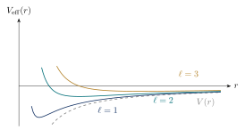

# 19 Central Potentials

## 19.1 Separation of the Schrödinger Equation

For a central potential $V(\vec r)=V(r)$ the time-independent Schrödinger equation is

$$
\Big(-\frac{\hbar^2}{2m}\nabla^2+V(r)\Big)\psi(\vec r)=E\,\psi(\vec r).
$$

In spherical coordinates the Laplacian splits into a radial part and an angular part, giving

$$
\Big[-\frac{\hbar^2}{2m}\,\frac1r\frac{\partial^2}{\partial r^2}\,r+\frac{\hat L^2}{2mr^2}+V(r)\Big]\psi(\vec r)=E\,\psi(\vec r).
$$

The potential depends on $r$ only, so the Hamiltonian is rotation invariant and $[\hat H,\hat L^2]=0=[\hat H,\hat L_z]$ ([Section 10](10-rotations-isotropy-space-angular-momentum-conservation.md)). Therefore the eigenfunctions are simultaneous eigenfunctions of $\hat H,\hat L^2,\hat L_z$:

$$
\psi(\vec r)=\langle\vec r|n,\ell,m\rangle=R_{n\ell}(r)\,Y_{\ell m}(\theta,\phi).
$$

## 19.2 The Radial Equation

Substitute this form into the equation and use $\hat L^2Y_{\ell m}=\hbar^2\ell(\ell+1)Y_{\ell m}$. The angular function factors out:

$$
Y_{\ell m}\Big[-\frac{\hbar^2}{2m}\frac1r\frac{d^2}{dr^2}\big(rR_{n\ell}\big)+\big(V(r)-E\big)R_{n\ell}+\frac{\hbar^2\ell(\ell+1)}{2mr^2}R_{n\ell}\Big]=0 .
$$

Multiplying by $r$:

$$
-\frac{\hbar^2}{2m}\frac{d^2}{dr^2}\big(rR_{n\ell}\big)+\Big[V(r)+\frac{\ell(\ell+1)\hbar^2}{2mr^2}\Big]rR_{n\ell}=E\,rR_{n\ell}.
$$

Choose

$$
u_{n\ell}(r)=r\,R_{n\ell}(r),\qquad V_{\mathrm{eff}}(r)=V(r)+\frac{\ell(\ell+1)\hbar^2}{2mr^2}.
$$

!!! thm "Radial Equation"

    $$
    -\frac{\hbar^2}{2m}\frac{d^2u_{n\ell}}{dr^2}+V_{\mathrm{eff}}(r)\,u_{n\ell}(r)=E_n\,u_{n\ell}(r),\qquad \lim_{r\to0}u_{n\ell}(r)=\lim_{r\to0}rR_{n\ell}(r)=0 .
    $$

This is a one-dimensional Schrödinger equation on the half line $r>0$ in the effective potential $V_{\mathrm{eff}}$, with the condition $u(0)=0$ imposed because $R_{n\ell}$ must stay finite at the origin.

!!! intuition "Intuition"

    The extra term $\ell(\ell+1)\hbar^2/2mr^2$ is the *centrifugal barrier*. It repels the particle from the origin, more strongly for larger $\ell$, so higher-$\ell$ states sit farther out.

{ .fig }

As $\ell$ increases the effective potential becomes higher and its minimum moves outward, away from the origin.

!!! studynote "Study Note"

    The notebook’s caption for this figure says the minima shift “farther to the origin”. From $V_{\mathrm{eff}}=V+\ell(\ell+1)\hbar^2/2mr^2$ the barrier grows with $\ell$, so the minimum moves *away from* the origin (to larger $r$), which is also what the sketch shows, with the $\ell=3$ curve having its minimum farthest to the right.

!!! studynote "Study Note"

    The energy $E_n$ does not depend on $m$ (it appears nowhere in the radial equation), so every level is at least $(2\ell+1)$-fold degenerate. For potentials such as the Coulomb one there is additional $\ell$-degeneracy, but that is not generic.

!!! prob "Free Particle Check, $V=0$, $\ell=0$"

    !!! solution "Complete Solution"

        The radial equation is $-\frac{\hbar^2}{2m}u''=Eu$ with $u(0)=0$, giving $u(r)=A\sin kr$ with $k=\sqrt{2mE}/\hbar$. Then $R_{k0}=A\sin(kr)/r$, which is finite at the origin, and $\psi=R\,Y_{00}$. The alternative $\cos kr$ is excluded by $u(0)=0$ (it would give $R\sim1/r$).
