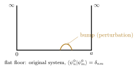

# 26 Time-Independent Perturbation Theory: Non-Degenerate Case

## 26.1 Setting Up the Problem

Very few Hamiltonians can be solved exactly. The idea of perturbation theory is to start from a **solvable (original) system** and treat the difference to the real system as a small deviation. For example, a particle in an infinite square well with a small bump on the floor cannot be solved exactly, but the flat-floor well can.

{ .fig }

**Known (original) problem:**

$$
\hat H^0 |\psi_n^0\rangle = E_n^0 |\psi_n^0\rangle, \qquad \langle \psi_n^0 | \psi_m^0 \rangle = \delta_{nm}
$$

**Wanted (perturbed) problem:** $\hat H|\psi_n\rangle = E_n |\psi_n\rangle$, with

$$
\hat H = \hat H^0 + \lambda \hat H' \qquad (\hat H^0 \text{ dominant},\ \lambda\hat H' \text{ a small deviation}).
$$

Expand the eigenstates and eigenvalues in powers of the bookkeeping parameter $\lambda$:

\begin{align*}
|\psi_n\rangle &= |\psi_n^0\rangle + \lambda|\psi_n^1\rangle + \lambda^2|\psi_n^2\rangle + \cdots \\
E_n &= E_n^0 + \lambda E_n^1 + \lambda^2 E_n^2 + \cdots
\end{align*}

Substituting into $\hat H|\psi_n\rangle = E_n|\psi_n\rangle$ gives

$$
(\hat H^0 + \lambda\hat H')\big[|\psi_n^0\rangle + \lambda|\psi_n^1\rangle + \lambda^2|\psi_n^2\rangle + \cdots\big] = (E_n^0 + \lambda E_n^1 + \lambda^2 E_n^2 + \cdots)\big[|\psi_n^0\rangle + \lambda|\psi_n^1\rangle + \lambda^2|\psi_n^2\rangle + \cdots\big]
$$

Collecting equal powers of $\lambda$:

\begin{align*}
\lambda^0:\quad & \hat H^0|\psi_n^0\rangle = E_n^0|\psi_n^0\rangle \\
\lambda^1:\quad & \hat H^0|\psi_n^1\rangle + \hat H'|\psi_n^0\rangle = E_n^1|\psi_n^0\rangle + E_n^0|\psi_n^1\rangle \\
\lambda^2:\quad & \hat H^0|\psi_n^2\rangle + \hat H'|\psi_n^1\rangle = E_n^0|\psi_n^2\rangle + E_n^1|\psi_n^1\rangle + E_n^2|\psi_n^0\rangle
\end{align*}

!!! intuition "Intuition"

    $\lambda$ only keeps track of the order of smallness; it is set to $1$ at the end (it is absorbed in $\hat H'$ below). Each order gives one equation that is solved by projecting onto the known states $|\psi_m^0\rangle$.

!!! studynote "Study Note (normalization)"

    The first-order state is expanded in the complete basis, $|\psi_n^1\rangle = \sum_{m\ne n} c_m^{(n)}|\psi_m^0\rangle + c_n^{(n)}|\psi_n^0\rangle$. The $|\psi_n^0\rangle$ component drops out of the first-order equation (its coefficient is $E_n^0-E_n^0=0$), so it is fixed by the normalization choice $\langle\psi_n^0|\psi_n^1\rangle=0$, i.e. $c_n^{(n)}=0$. This is used below.

## 26.2 First-Order Correction to the Energy

Take the inner product of the $\lambda^1$ equation with $\langle\psi_n^0|$:

$$
\langle\psi_n^0|\hat H^0|\psi_n^1\rangle + \langle\psi_n^0|\hat H'|\psi_n^0\rangle = E_n^1\langle\psi_n^0|\psi_n^0\rangle + E_n^0\langle\psi_n^0|\psi_n^1\rangle
$$

Since $\hat H^0$ is Hermitian, $\langle\psi_n^0|\hat H^0|\psi_n^1\rangle = E_n^0\langle\psi_n^0|\psi_n^1\rangle$, which cancels the last term. Hence

!!! thm "First-Order Energy Correction"

    $$
    E_n^{1} = \langle\psi_n^0|\hat H'|\psi_n^0\rangle
    $$

!!! intuition "Intuition"

    To first order the energy shift is just the *expectation value of the perturbation in the unperturbed state*; the state itself has not yet had time to adjust.

## 26.3 First-Order Correction to the Wavefunction

Rewrite the $\lambda^1$ equation as

$$
(\hat H^0 - E_n^0)|\psi_n^1\rangle = -(\hat H' - E_n^1)|\psi_n^0\rangle \qquad (\text{everything on the right is known}).
$$

Expand $|\psi_n^1\rangle = \sum_{m\ne n} c_m^{(n)}|\psi_m^0\rangle$ (the $m=n$ term has coefficient zero). The left side becomes $\sum_{m\ne n} c_m^{(n)}(E_m^0 - E_n^0)|\psi_m^0\rangle$. Take the inner product with $\langle\psi_\ell^0|$, $\ell\neq n$:

$$
(E_\ell^0 - E_n^0)\,c_\ell^{(n)} = -\langle\psi_\ell^0|\hat H'|\psi_n^0\rangle + E_n^1\underbrace{\langle\psi_\ell^0|\psi_n^0\rangle}_{\delta_{\ell n}=0}
$$

!!! thm "First-Order Wavefunction Correction"

    $$
    c_m^{(n)} = \frac{\langle\psi_m^0|\hat H'|\psi_n^0\rangle}{E_n^0 - E_m^0}, \qquad
    |\psi_n^1\rangle = \sum_{m\ne n}\frac{\langle\psi_m^0|\hat H'|\psi_n^0\rangle}{E_n^0 - E_m^0}\,|\psi_m^0\rangle
    $$

!!! intuition "Intuition"

    The perturbation mixes in the other unperturbed states. The mixing is strong when the matrix element $\langle m|\hat H'|n\rangle$ is large and when the unperturbed levels are close ($E_n^0 - E_m^0$ small).

!!! studynote "Study Note (validity)"

    The expansion is trustworthy only if $\big|\langle\psi_m^0|\hat H'|\psi_n^0\rangle\big| \ll |E_n^0 - E_m^0|$. If two levels are degenerate the denominator vanishes and the formula breaks down; that case needs the degenerate theory of [Section 27](27-time-independent-perturbation-theory-degenerate-case.md).

## 26.4 Second-Order Correction to the Energy

Take the inner product of the $\lambda^2$ equation with $\langle\psi_n^0|$. The $\hat H^0$ term cancels the $E_n^0\langle\psi_n^0|\psi_n^2\rangle$ term as before, leaving

$$
\langle\psi_n^0|\hat H'|\psi_n^1\rangle = E_n^1\langle\psi_n^0|\psi_n^1\rangle + E_n^2\langle\psi_n^0|\psi_n^0\rangle
$$

Now $\langle\psi_n^0|\psi_n^1\rangle = \sum_{m\ne n}c_m^{(n)}\delta_{nm} = 0$, so

\begin{align*}
E_n^2 = \langle\psi_n^0|\hat H'|\psi_n^1\rangle
&= \sum_{m\ne n} c_m^{(n)}\langle\psi_n^0|\hat H'|\psi_m^0\rangle
= \sum_{m\ne n}\langle\psi_n^0|\hat H'|\psi_m^0\rangle\,\frac{\langle\psi_m^0|\hat H'|\psi_n^0\rangle}{E_n^0 - E_m^0}
\end{align*}

!!! thm "Second-Order Energy Correction"

    $$
    E_n^{(2)} = \sum_{m\ne n}\frac{\big|\langle\psi_m^0|\hat H'|\psi_n^0\rangle\big|^2}{E_n^0 - E_m^0},
    \qquad
    E_n = E_n^{(0)} + E_n^{(1)} + E_n^{(2)} + \cdots
    $$

    Here $E_n^{(0)}$ is the unperturbed energy, $E_n^{(1)}$ the first-order and $E_n^{(2)}$ the second-order correction.

!!! memory "Memory Rule"

    First order: one matrix element on the diagonal. Second order: $|\text{off-diagonal element}|^2$ divided by the energy gap, summed over all other states, with the denominator $E_n^0 - E_m^0$ (state $n$ first).

!!! studynote "Study Note"

    For the **ground state** every denominator $E_0^0 - E_m^0$ is negative, so $E_0^{(2)}\le 0$: second-order perturbation always *lowers* the ground-state energy (levels repel; the state is pushed away from the levels above it). Conversely, a level is pushed up by states below it and down by states above it.

!!! examtip "Exam Tip"

    Before computing an infinite sum, check selection rules: most matrix elements vanish by parity or angular momentum, often leaving only two terms (see the oscillator example below).

!!! prob "Example: Charged Oscillator in a Weak Electric Field || Griffiths, Problem 7.6"

    A particle of charge $q$ and mass $m$, moving in a 1D harmonic potential of frequency $\omega$, is subject to a “weak” electric field $E$ in the $x$-direction. Calculate the eigenvalues of the Hamiltonian (and compare with perturbation theory).

    **Solution:** $\hat H = \hat H^0 + \hat H'$ with

    $$
    \hat H^0 = -\frac{\hbar^2}{2m}\frac{d^2}{dx^2} + \frac12 m\omega^2x^2, \qquad \hat H' = qEx
    $$

    **Exact route.** Change variable $y = x + \dfrac{qE}{m\omega^2}$. Completing the square,

    $$
    \hat H = -\frac{\hbar^2}{2m}\frac{d^2}{dy^2} + \frac12 m\omega^2y^2 - \frac{q^2E^2}{2m\omega^2}
    $$

    so the oscillator spectrum is simply shifted:

    $$
    \boxed{E_n = \Big(n+\tfrac12\Big)\hbar\omega - \frac{q^2E^2}{2m\omega^2}}
    $$

    **Perturbation theory.** First order: $E_n^{1} = qE\langle n|\hat x|n\rangle = 0$ (odd integrand). Second order:

    $$
    E_n^{2} = q^2E^2\sum_{m\ne n}\frac{|\langle m|\hat x|n\rangle|^2}{E_n^0 - E_m^0} = -\frac{q^2E^2}{2m\omega^2}
    $$

    Only $m = n-1$ and $m = n+1$ contribute.

!!! prob "Example: Charged Oscillator in a Weak Electric Field (continued) || Griffiths, Problem 7.6"

    !!! solution "Complete Solution of the second-order sum"

        Use $\hat x = \sqrt{\hbar/2m\omega}\,(\hat a + \hat a^\dagger)$, so

        $$
        \langle n-1|\hat x|n\rangle = \sqrt{\frac{\hbar}{2m\omega}}\sqrt n, \qquad \langle n+1|\hat x|n\rangle = \sqrt{\frac{\hbar}{2m\omega}}\sqrt{n+1}
        $$

        with $E_n^0 - E_{n-1}^0 = +\hbar\omega$ and $E_n^0 - E_{n+1}^0 = -\hbar\omega$:

        \begin{align*}
        E_n^{2} &= q^2E^2\,\frac{\hbar}{2m\omega}\left[\frac{n}{\hbar\omega} + \frac{n+1}{-\hbar\omega}\right]
        = q^2E^2\,\frac{\hbar}{2m\omega}\cdot\frac{-1}{\hbar\omega} = -\frac{q^2E^2}{2m\omega^2}
        \end{align*}

        which agrees with the exact result.

    !!! studynote "Study Note"

        The shift is the same for every level and the series stops at second order here, so perturbation theory reproduces the exact answer; this is a useful test case for any new formula. Physically the oscillator is polarized by the field and its equilibrium moves to $x_0 = -qE/m\omega^2$.

!!! book "See also: Griffiths, Introduction to Quantum Mechanics (3rd ed.), Example 7.1"

    A quick sanity check of the formulas: raise the floor of the infinite square well by a constant $V_0$. Then $E_n^{1}=V_0$, and since $\hat H'=V_0\mathbb 1$ has no off-diagonal elements, every higher order vanishes and the exact shift is $V_0$.
