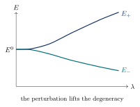
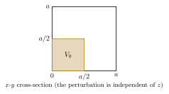

# 27 Time-Independent Perturbation Theory: Degenerate Case

## 27.1 Two-Fold Degeneracy

If the unperturbed states are degenerate, the non-degenerate formulas fail because of the vanishing denominators $E_n^0-E_m^0$. Take a 2-fold degenerate level:

$$
\hat H^0|\psi_a^0\rangle = E^0|\psi_a^0\rangle, \qquad \hat H^0|\psi_b^0\rangle = E^0|\psi_b^0\rangle, \qquad \langle\psi_a^0|\psi_b^0\rangle = 0
$$

Any combination is also an eigenstate of $\hat H^0$ with the same energy:

$$
|\psi^0\rangle = \alpha|\psi_a^0\rangle + \beta|\psi_b^0\rangle, \qquad \hat H^0|\psi^0\rangle = E^0|\psi^0\rangle
$$

The perturbation breaks the degeneracy: as it is switched on, the single level splits into two (figure below). The zeroth-order state that the perturbed state tends to is a *particular* combination ($\alpha,\beta$ fixed by $\hat H'$), which the theory must determine.

{ .fig }

The $\lambda^1$ equation is

$$
\hat H'|\psi^0\rangle + \hat H^0|\psi^1\rangle = E^0|\psi^1\rangle + E^1|\psi^0\rangle
$$

Take the inner product with $\langle\psi_a^0|$. By Hermiticity $\langle\psi_a^0|\hat H^0|\psi^1\rangle = E^0\langle\psi_a^0|\psi^1\rangle$, which cancels, leaving

$$
\langle\psi_a^0|\hat H'|\psi^0\rangle = E^1\langle\psi_a^0|\psi^0\rangle
\;\Longrightarrow\;
\alpha\langle\psi_a^0|\hat H'|\psi_a^0\rangle + \beta\langle\psi_a^0|\hat H'|\psi_b^0\rangle = E^1\alpha \tag{I}
$$

Taking the inner product with $\langle\psi_b^0|$ instead:

$$
\alpha\langle\psi_b^0|\hat H'|\psi_a^0\rangle + \beta\langle\psi_b^0|\hat H'|\psi_b^0\rangle = E^1\beta \tag{II}
$$

Define the matrix elements of the perturbation inside the degenerate subspace:

$$
W_{aa} = \langle\psi_a^0|\hat H'|\psi_a^0\rangle,\quad W_{bb} = \langle\psi_b^0|\hat H'|\psi_b^0\rangle,\quad W_{ab} = \langle\psi_a^0|\hat H'|\psi_b^0\rangle,\quad W_{ba} = \langle\psi_b^0|\hat H'|\psi_a^0\rangle
$$

Then (I) and (II) read

$$
\alpha(W_{aa} - E^1) + \beta W_{ab} = 0, \qquad \alpha W_{ba} + \beta(W_{bb} - E^1) = 0
$$

A nontrivial solution $(\alpha,\beta)$ exists only if the determinant vanishes:

!!! thm "Secular Equation (Two-Fold Degeneracy)"

    $$
    \det\begin{pmatrix} W_{aa}-E^1 & W_{ab} \\ W_{ba} & W_{bb}-E^1 \end{pmatrix} = 0
    $$

    Using $W_{ab} = W_{ba}^*$ this is $(E^1)^2 - (W_{aa}+W_{bb})E^1 + W_{aa}W_{bb} - |W_{ab}|^2 = 0$, with roots

    $$
    E^1_{\pm} = \frac12\left[(W_{aa}+W_{bb}) \pm \sqrt{(W_{aa}-W_{bb})^2 + 4|W_{ab}|^2}\right]
    $$

!!! studynote "Study Note"

    The discriminant is non-negative, so both roots are real, and they are distinct unless $W_{aa}=W_{bb}$ and $W_{ab}=0$ (then the degeneracy survives at first order). If $W_{ab}=0$ the roots are simply $W_{aa}$ and $W_{bb}$, and $|\psi_a^0\rangle,|\psi_b^0\rangle$ are already the “good” states. In general the ratio is fixed by $\beta/\alpha = (E^1_\pm - W_{aa})/W_{ab}$.

!!! intuition "Intuition"

    Degenerate perturbation theory says: *inside the degenerate subspace, diagonalize the perturbation*. The eigenvalues are the first-order energy shifts, the eigenvectors are the correct zeroth-order states.

## 27.2 $n$-Fold Degeneracy

For an $n$-fold degenerate level write $|\psi^0\rangle = c_1|\psi_1^0\rangle + \cdots + c_n|\psi_n^0\rangle$. The same steps give the eigenvalue problem for the $W$-matrix, $W_{ij} = \langle\psi_i^0|\hat H'|\psi_j^0\rangle$:

!!! thm "$W$-Matrix Equation"

    $$
    \begin{pmatrix} W_{11} & W_{12} & \cdots & W_{1n}\\ W_{21} & W_{22} & \cdots & W_{2n}\\ \vdots & & \ddots & \vdots\\ W_{n1} & W_{n2} & \cdots & W_{nn}\end{pmatrix}
    \begin{pmatrix} c_1\\ \vdots\\ c_n\end{pmatrix} = E^1\begin{pmatrix} c_1\\ \vdots\\ c_n\end{pmatrix}
    $$

    The $n$ roots of $\det(W - E^1\mathbb{1}) = 0$ are the first-order shifts; each eigenvector gives the corresponding good zeroth-order state.

!!! examtip "Exam Tip"

    Procedure: (1) list the degenerate states, (2) compute *all* $W_{ij}$, (3) write the $W$-matrix, (4) solve $\det(W-E^1)=0$, (5) quote $E = E^0 + E^1$. Use $\operatorname{tr}W=\sum E^1_i$ as a check.

## 27.3 Example: Infinite Cubic Well

!!! prob "Example: 3D Infinite Cubic Well with a Perturbation"

    \begin{gather*}
    V(x,y,z) = \begin{cases} 0, & 0<x<a,\ 0<y<a,\ 0<z<a\\ \infty, & \text{otherwise}\end{cases}\\
    \psi^0_{n_xn_yn_z} = \Big(\frac2a\Big)^{3/2}\sin\frac{n_x\pi x}{a}\sin\frac{n_y\pi y}{a}\sin\frac{n_z\pi z}{a}
    \end{gather*}

    $$
    E^0_{n_xn_yn_z} = \frac{\pi^2\hbar^2}{2ma^2}\,(n_x^2+n_y^2+n_z^2), \qquad n_x,n_y,n_z = 1,2,\ldots
    $$

    The perturbation is

    $$
    \hat H' = \begin{cases} V_0, & 0<x<\tfrac a2,\ 0<y<\tfrac a2\ (\text{any } z)\\ 0, & \text{otherwise}\end{cases}
    $$

    { .fig }

!!! prob "Example: 3D Infinite Cubic Well (continued): Ground State and First Excited Level"

    **Ground state** $E_0^0 = E^0_{111} = \dfrac{3\pi^2\hbar^2}{2ma^2}$ is non-degenerate:

    $$
    E_0^{(1)} = \langle\psi^0_{111}|\hat H'|\psi^0_{111}\rangle = \Big(\frac2a\Big)^3V_0\int_0^{a/2}\!\sin^2\frac{\pi x}{a}dx\int_0^{a/2}\!\sin^2\frac{\pi y}{a}dy\int_0^a\!\sin^2\frac{\pi z}{a}dz = \frac14 V_0
    $$

    This is the correction to the ground-state energy.

    **First excited level:** $(n_x,n_y,n_z) = (1,2,1),(2,1,1),(1,1,2)$, 3-fold degenerate with $E_1^0 = E^0_{121} = \dfrac{3\pi^2\hbar^2}{ma^2}$. Write

    $$
    |\psi^0\rangle = c_1|\psi^0_{112}\rangle + c_2|\psi^0_{121}\rangle + c_3|\psi^0_{211}\rangle
    $$

    and build $W_{ij}=\langle\psi^0_i|\hat H'|\psi^0_j\rangle=\int d^3r\,\psi_i^{0*}\hat H'\psi_j^0$. The result is $W_{11}=W_{22}=W_{33}=\tfrac14V_0$ and a single non-zero off-diagonal pair $W_{23}=W_{32}=\dfrac{16}{9\pi^2}V_0$, so

    $$
    \det\begin{pmatrix}\tfrac14V_0 - E^1 & 0 & 0\\ 0 & \tfrac14V_0 - E^1 & \tfrac{16}{9\pi^2}V_0\\ 0 & \tfrac{16}{9\pi^2}V_0 & \tfrac14V_0 - E^1\end{pmatrix} = 0
    $$

!!! prob "Example: 3D Infinite Cubic Well (completed solution)"

    !!! studynote "Study Note (ordering of the states)"

        The notebook lists the states in the order $121,\,211,\,112$ and then states $W_{12}=W_{13}=0$, $W_{23}=\frac{16}{9\pi^2}V_0$. That statement matches the matrix above only if the *decoupled* state ($112$) is labelled first. With the order $121,211,112$ the correct elements are $W_{12}\neq 0$ and $W_{13}=W_{23}=0$. The matrix, eigenvalues and conclusions are unchanged; the ordering $112,121,211$ is used here.

    !!! solution "Complete Solution"

        Diagonal elements, for example $|112\rangle$:

        $$
        W_{11} = \frac{8}{a^3}V_0\underbrace{\int_0^{a/2}\!\sin^2\tfrac{\pi x}{a}dx}_{a/4}\underbrace{\int_0^{a/2}\!\sin^2\tfrac{\pi y}{a}dy}_{a/4}\underbrace{\int_0^{a}\!\sin^2\tfrac{2\pi z}{a}dz}_{a/2} = \frac{V_0}{4}
        $$

        and in the same way $W_{22}=W_{33}=V_0/4$ (over $[0,a/2]$ both $\sin^2(\pi u/a)$ and $\sin^2(2\pi u/a)$ integrate to $a/4$).

    Off-diagonal elements. $W_{12}=\langle 112|\hat H'|121\rangle$ contains $\int_0^a\sin\frac{2\pi z}{a}\sin\frac{\pi z}{a}\,dz=0$ (orthogonality), so $W_{12}=W_{13}=0$. For $W_{23}=\langle121|\hat H'|211\rangle$ the $z$-integral is $\int_0^a\sin^2\frac{\pi z}{a}dz = \frac a2$, and with $\sin A\sin 2A = 2\sin^2A\cos A$:

    $$
    \int_0^{a/2}\sin\frac{\pi x}{a}\sin\frac{2\pi x}{a}\,dx = \frac a\pi\Big[\tfrac23\sin^3u\Big]_0^{\pi/2} = \frac{2a}{3\pi}
    $$

    The $y$-integral is the same. Therefore

    $$
    W_{23} = \frac{8}{a^3}V_0\Big(\frac{2a}{3\pi}\Big)^2\frac a2 = \frac{16}{9\pi^2}V_0
    $$

    Eigenvalues: $\big(\tfrac14V_0-E^1\big)\Big[\big(\tfrac14V_0-E^1\big)^2 - \big(\tfrac{16}{9\pi^2}V_0\big)^2\Big]=0$, hence

    $$
    E^1 = \tfrac14V_0, \qquad E^1 = \Big(\tfrac14 \pm \tfrac{16}{9\pi^2}\Big)V_0 \approx 0.430\,V_0,\ 0.070\,V_0
    $$

    Good zeroth-order states: $|112\rangle$ for $E^1=\frac14V_0$, and $\frac1{\sqrt2}\big(|121\rangle \pm |211\rangle\big)$ for $E^1 = \frac14V_0 \pm \frac{16}{9\pi^2}V_0$. The three-fold degeneracy is completely lifted:

    $$
    E = \frac{3\pi^2\hbar^2}{ma^2} + E^1
    $$

    !!! verification "Verification"

        $\operatorname{tr}W = \frac34V_0 = \frac14V_0 + \big(\frac14+\frac{16}{9\pi^2}\big)V_0 + \big(\frac14-\frac{16}{9\pi^2}\big)V_0$.

    !!! intuition "Intuition"

        $\hat H'$ is symmetric under $x\leftrightarrow y$, so the symmetric and antisymmetric combinations of $|121\rangle,|211\rangle$ are the natural good states, while $|112\rangle$ (which is itself symmetric and has a different $z$-dependence) decouples.

## 27.4 Good States and Commuting Operators

!!! thm "Theorem: Good States from a Commuting Operator"

    Let $\hat A$ be a Hermitian operator that commutes with $\hat H^0$ and with $\hat H'$. If $|\psi_a^0\rangle$ and $|\psi_b^0\rangle$ (the degenerate eigenfunctions of $\hat H^0$) are also eigenfunctions of $\hat A$ with **distinct eigenvalues**, then

    $$
    \langle\psi_a^0|\hat H'|\psi_b^0\rangle = 0
    $$

    **Proof:** Let $\hat A|\psi_a^0\rangle = \mu|\psi_a^0\rangle$, $\hat A|\psi_b^0\rangle = \nu|\psi_b^0\rangle$, $\mu\ne\nu$, and $[\hat A,\hat H']=0$. Then

    $$
    0 = \langle\psi_a^0|(\hat A\hat H' - \hat H'\hat A)|\psi_b^0\rangle = (\mu-\nu)\langle\psi_a^0|\hat H'|\psi_b^0\rangle
    $$

    and since $\mu\ne\nu$, $\langle\psi_a^0|\hat H'|\psi_b^0\rangle = 0$. ∎

In that case the energies are simply $E^1_+ = \langle\psi_a^0|\hat H'|\psi_a^0\rangle$ and $E^1_- = \langle\psi_b^0|\hat H'|\psi_b^0\rangle$ (no matrix diagonalization needed).

!!! memory "Memory Rule"

    Look for an operator that commutes with *both* $\hat H^0$ and $\hat H'$ (a symmetry of the full problem) and label the degenerate states by its eigenvalues. For hydrogen with spin-orbit coupling these are $\hat J^2,\hat J_z$, not $\hat L_z,\hat S_z$ (see [Section 28](28-applications-to-hydrogen-fine-structure-zeeman.md)).

!!! mistakes "Common mistakes"

    \(a\) using the non-degenerate formula $E^{(2)}$ when two levels coincide, (b) forgetting that off-diagonal $W_{ij}$ matter even when the diagonal ones are equal, (c) taking the basis states themselves as good states without checking $W_{ab}=0$, (d) dropping the factor $E_n^0-E_m^0$ order (it is $n$ first).
