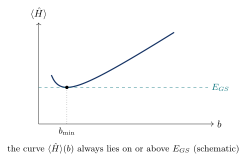
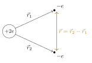
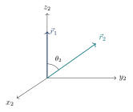

# 29 The Variational Method

## 29.1 The Variational Principle

**Goal:** calculate the ground-state energy $E_{GS}$ of a system whose Hamiltonian we cannot solve in the time-independent Schrödinger equation. The variational method provides an **upper bound** to the ground-state energy: guess a wavefunction $|\psi\rangle$ (the *trial wavefunction*) and compute $\langle\hat H\rangle$.

!!! thm "Variational Principle"

    For any normalized trial state $|\psi\rangle$,

    $$
    E_{GS} \le \langle\psi|\hat H|\psi\rangle = \langle\hat H\rangle
    $$

    (for an unnormalized state use $\langle\hat H\rangle = \langle\psi|\hat H|\psi\rangle/\langle\psi|\psi\rangle$).

**Proof:** Let $\hat H|\phi_n\rangle = E_n|\phi_n\rangle$ (the eigenstates are unknown but exist and form a complete set) with $E_0\equiv E_{GS}\le E_1\le\cdots$. Expand $|\psi\rangle = \sum_nc_n|\phi_n\rangle$. Normalization gives

$$
\langle\psi|\psi\rangle = \sum_m\sum_nc_m^*c_n\underbrace{\langle\phi_m|\phi_n\rangle}_{\delta_{mn}} = \sum_n|c_n|^2 = 1
$$

and therefore

\begin{align*}
\langle\hat H\rangle &= \sum_m\sum_nc_m^*c_nE_n\delta_{mn} = \sum_nE_n|c_n|^2 = E_0|c_0|^2 + E_1|c_1|^2 + \cdots\\
&\ge E_0\sum_n|c_n|^2 = E_0 \qquad\blacksquare
\end{align*}

!!! intuition "Intuition"

    $\langle\hat H\rangle$ is a weighted average of the true energies $E_n$ with weights $|c_n|^2$ summing to one, so it can never fall below the smallest one.

!!! examtip "Exam Tip (recipe)"

    1.  Choose a trial function with a free parameter (or two) and with the right qualitative shape (no nodes for the ground state, correct behaviour at infinity and at boundaries, correct symmetry).

    2.  Normalize it (fixes the constant).

    3.  Compute $\langle\hat H\rangle = \langle T\rangle + \langle V\rangle$ as a function of the parameter.

    4.  Minimize: $\dfrac{d\langle\hat H\rangle}{d(\text{parameter})}=0$, and substitute back.

!!! studynote "Study Note"

    If the trial function contains the exact ground state for some value of the parameter, the minimum equals $E_{GS}$ exactly (the oscillator below). Because $\langle\hat H\rangle - E_0 = \sum_{n\ge1}(E_n-E_0)|c_n|^2$ and $|c_n|\sim$ the error of the wavefunction, the *energy* error is second order in the *wavefunction* error, which is why even a crude trial function gives a good energy.

## 29.2 Example: Harmonic Oscillator

!!! prob "Example: Variational Treatment of the Harmonic Oscillator || Griffiths, Example 8.1"

    $\hat H = -\dfrac{\hbar^2}{2m}\dfrac{d^2}{dx^2} + \dfrac12m\omega^2x^2$, with the exactly known $E_{GS} = \tfrac12\hbar\omega$. Use the trial function $\psi(x) = A\exp(-bx^2)$.

    **Normalization:**

    $$
    \int_{-\infty}^{\infty}\psi^*\psi\,dx = A^2\int_{-\infty}^{\infty}e^{-2bx^2}dx = A^2\sqrt{\frac{\pi}{2b}} = 1 \;\Longrightarrow\; A = \Big(\frac{2b}{\pi}\Big)^{1/4}
    $$

    **Kinetic and potential energy:**

    $$
    \langle T\rangle = -\frac{\hbar^2}{2m}|A|^2\int_{-\infty}^{\infty}e^{-bx^2}\frac{d^2}{dx^2}e^{-bx^2}dx = \frac{\hbar^2b}{2m}, \qquad
    \langle V\rangle = \frac12m\omega^2|A|^2\int_{-\infty}^{\infty}x^2e^{-2bx^2}dx = \frac{m\omega^2}{8b}
    $$

    $$
    \langle\hat H\rangle = \frac{\hbar^2b}{2m} + \frac{m\omega^2}{8b} \;\ge\; E_{GS}
    $$

    **Minimize:** $\dfrac{d}{db}\langle\hat H\rangle = \dfrac{\hbar^2}{2m} - \dfrac{m\omega^2}{8b^2} = 0 \Rightarrow b^2 = \dfrac{m^2\omega^2}{4\hbar^2}\Rightarrow b = \dfrac{m\omega}{2\hbar}$. Then

    $$
    \langle\hat H\rangle_{\min} = \frac{\hbar^2}{2m}\frac{m\omega}{2\hbar} + \frac{m\omega^2}{8}\frac{2\hbar}{m\omega} = \frac{\hbar\omega}{4} + \frac{\hbar\omega}{4} \;\;\Rightarrow\;\; \boxed{\langle\hat H\rangle_{\min} = \tfrac12\hbar\omega = E_{GS}}
    $$

!!! solution "Complete Solution (the two integrals)"

    Using $\frac{d^2}{dx^2}e^{-bx^2} = (4b^2x^2-2b)e^{-bx^2}$ and $\int x^2e^{-2bx^2}dx = \frac1{4b}\sqrt{\frac{\pi}{2b}}$:

    $$
    \langle T\rangle = -\frac{\hbar^2}{2m}A^2\Big[4b^2\frac1{4b} - 2b\Big]\sqrt{\frac\pi{2b}} = \frac{\hbar^2b}{2m}, \qquad
    \langle V\rangle = \frac12m\omega^2A^2\frac1{4b}\sqrt{\frac\pi{2b}} = \frac{m\omega^2}{8b}
    $$

At the minimum the two contributions are equal, $\langle T\rangle = \langle V\rangle = \frac14\hbar\omega$, as required by the virial theorem for a quadratic potential. The trial function is the exact ground state, hence the bound is saturated.

{ .fig }

## 29.3 Example: Delta-Function Potential

!!! prob "Example: Variational Treatment of the Attractive Delta Potential || Griffiths, Example 8.2"

    $\hat H = -\dfrac{\hbar^2}{2m}\dfrac{d^2}{dx^2} - \alpha\delta(x)$, with exactly known $E_{GS} = -\dfrac{m\alpha^2}{2\hbar^2}$. Trial function $\psi(x) = A\exp(-bx^2)$ with $A = (2b/\pi)^{1/4}$.

    **Kinetic energy** (same as before): $\langle T\rangle = \dfrac{\hbar^2b}{2m}$.  
    **Potential energy:**

    $$
    \langle V\rangle = -\alpha|A|^2\int_{-\infty}^{\infty}dx\,\delta(x)\,e^{-2bx^2} = -\alpha|A|^2 = -\alpha\sqrt{\frac{2b}{\pi}}
    $$

    $$
    \langle\hat H\rangle = \frac{\hbar^2b}{2m} - \alpha\sqrt{\frac{2b}{\pi}}
    $$

    **Minimize:** $\dfrac{d}{db}\langle\hat H\rangle = \dfrac{\hbar^2}{2m} - \alpha\sqrt{\dfrac2\pi}\dfrac1{2\sqrt b} = 0 \Rightarrow \dfrac\alpha2\sqrt{\dfrac{2}{b\pi}} = \dfrac{\hbar^2}{2m}\Rightarrow b = \dfrac{2m^2\alpha^2}{\pi\hbar^4}$. Hence

    $$
    \boxed{\langle\hat H\rangle_{\min} = -\frac{m\alpha^2}{\pi\hbar^2} > E_{GS}}
    $$

    !!! verification "Verification"

        $-\dfrac{m\alpha^2}{\pi\hbar^2} = \dfrac2\pi E_{GS}\approx0.64\,E_{GS}$, which is higher (less negative) than $E_{GS}$ since $\pi>2$, so the upper-bound property holds. The exact ground state is $\psi=\sqrt\kappa\,e^{-\kappa|x|}$ with $\kappa=m\alpha/\hbar^2$; a Gaussian has the wrong cusp at $x=0$, which is why the energy is only about 64% of the exact binding energy.

## 29.4 Ground State of Helium

The helium atom has a nucleus of charge $+2e$ and two electrons at $\vec r_1,\vec r_2$, with $\vec r = \vec r_2-\vec r_1$ the separation.

{ .fig }

$$
\hat H = -\frac{\hbar^2}{2m}\big(\nabla_1^2+\nabla_2^2\big) - \frac{e^2}{4\pi\varepsilon_0}\Big(\frac2{r_1}+\frac2{r_2}\Big) + \frac{e^2}{4\pi\varepsilon_0}\frac1{|\vec r_1-\vec r_2|}
$$

Experimentally the ground-state energy is $E_{GS} = -78.975\ \text{eV}\approx -79$ eV.

!!! prob "Ground State of Helium: Setup and Trial Function || Griffiths, Section 8.2"

    **Step 1: neglect the electron-electron interaction.** Then $\hat H = \hat h_1+\hat h_2$ with $\hat h_i = -\frac{\hbar^2}{2m}\nabla_i^2 - \frac{e^2}{4\pi\varepsilon_0}\frac2{r_i}$, and $\phi(\vec r_1,\vec r_2) = \psi_1(\vec r_1)\psi_2(\vec r_2)$ with $\hat h_i\psi_i = \varepsilon_i\psi_i$. Each $\hat h_i$ is a hydrogen-like Hamiltonian with nuclear charge $2e$, whose Bohr radius is $a_{He} = \dfrac{4\pi\varepsilon_0\hbar^2}{m\,2e\cdot e} = \dfrac{a_H}2$. Writing $a\equiv a_H$ and $E_H$ for the hydrogen ground-state energy,

    $$
    \psi^{H}_{100}(r) = \frac1{\sqrt{\pi a^3}}e^{-r/a}, \qquad \psi^{He^+}_{100}(r) = \sqrt{\frac{8}{\pi a^3}}\,e^{-2r/a}, \qquad E_H = -\frac{m}{2\hbar^2}\Big(\frac{e^2}{4\pi\varepsilon_0}\Big)^2\approx-13.6\ \text{eV}
    $$

    The energy of a hydrogen-like ion with charge $2e$ is $4E_H$, so $\varepsilon_1=\varepsilon_2=4E_H$:

    \begin{gather*}
    \phi(\vec r_1,\vec r_2) = \frac{8}{\pi a^3}\exp\Big[-\frac2a(r_1+r_2)\Big]\\
    E = \varepsilon_1+\varepsilon_2 = 8E_H\approx-109\ \text{eV}\quad(\text{without } e^-e^-\text{ interaction})
    \end{gather*}

    !!! studynote "Study Note"

        *(sign of $E_H$):* The notebook writes $E_H=\frac{m}{2\hbar^2}\big(\frac{e^2}{4\pi\varepsilon_0}\big)^2$, but it uses $E_H$ as the (negative) hydrogen ground-state energy $-13.6$ eV (for example $8E_H=-109$ eV, $-\frac52E_H=+34$ eV). The explicit minus sign is written above.

    **Step 2: use $\phi_0=\phi(\vec r_1,\vec r_2)$ as a trial wavefunction for the full $\hat H = \hat h_1+\hat h_2+\dfrac{e^2}{4\pi\varepsilon_0}\dfrac1{|\vec r_1-\vec r_2|}$.**

    $$
    \langle\phi_0|\hat H|\phi_0\rangle = \langle\phi_0|\hat h_1+\hat h_2|\phi_0\rangle + \frac{e^2}{4\pi\varepsilon_0}\Big\langle\phi_0\Big|\frac1{|\vec r_1-\vec r_2|}\Big|\phi_0\Big\rangle = 8E_H + V_{ee}
    $$

    $$
    V_{ee} = \frac{e^2}{4\pi\varepsilon_0}\Big(\frac{8}{\pi a^3}\Big)^2\int\!\!\int\frac{\exp\!\big[-\frac4a(r_1+r_2)\big]}{|\vec r_1-\vec r_2|}\,d^3r_1\,d^3r_2
    = \frac{e^2}{4\pi\varepsilon_0}\Big(\frac{8}{\pi a^3}\Big)^2\int e^{-4r_1/a}\,I_2(r_1)\,d^3r_1
    $$

    with the inner integral $I_2(r_1) = \displaystyle\int\frac{e^{-4r_2/a}}{|\vec r_1-\vec r_2|}\,d^3r_2$. Choose the $z_2$-axis along $\vec r_1$, so that $|\vec r_1-\vec r_2| = \sqrt{r_1^2+r_2^2-2r_1r_2\cos\theta_2}$.

    { .fig }

!!! prob "Ground State of Helium (continued): the Integral $V_{ee}$ || Griffiths, Section 8.2"

    **Angular integral.** With $d^3r_2 = r_2^2\sin\theta_2\,dr_2\,d\theta_2\,d\varphi_2$ and the $\varphi_2$ integration giving $2\pi$:

    $$
    I_2 = 2\pi\int_0^\infty r_2^2e^{-4r_2/a}\,I_3\,dr_2, \qquad I_3 = \int_{-1}^{1}\frac{d(\cos\theta_2)}{\sqrt{r_1^2+r_2^2-2r_1r_2\cos\theta_2}} = \frac{1}{r_1r_2}\big(r_1+r_2-|r_1-r_2|\big)
    $$

    so that $I_3 = \dfrac{2}{r_1}$ for $r_1>r_2$ and $I_3 = \dfrac2{r_2}$ for $r_1<r_2$. Then

    $$
    I_2 = 4\pi\left[\frac1{r_1}\int_0^{r_1}e^{-4r_2/a}\,r_2^2\,dr_2 + \int_{r_1}^\infty e^{-4r_2/a}\,r_2\,dr_2\right]
    = \frac{\pi a^3}{8r_1}\left[1 - \Big(1+\frac{2r_1}{a}\Big)e^{-4r_1/a}\right]
    $$

    **Radial integral.** With $d^3r_1 = 4\pi r_1^2dr_1$:

    $$
    V_{ee} = \frac{e^2}{4\pi\varepsilon_0}\Big(\frac8{\pi a^3}\Big)^2\,4\pi\,\frac{\pi a^3}{8}\int_0^\infty r_1\Big[e^{-4r_1/a} - \Big(1+\frac{2r_1}a\Big)e^{-8r_1/a}\Big]dr_1
    $$

    !!! solution "Complete Solution"

        The three elementary integrals are $\int_0^\infty r\,e^{-4r/a}dr = \frac{a^2}{16}$, $\int_0^\infty r\,e^{-8r/a}dr = \frac{a^2}{64}$ and $\frac2a\int_0^\infty r^2e^{-8r/a}dr = \frac{a^2}{128}$, so the bracket integral is $\frac{a^2}{16}-\frac{a^2}{64}-\frac{a^2}{128} = \frac{5a^2}{128}$. The prefactor is $\big(\frac{8}{\pi a^3}\big)^2\,4\pi\,\frac{\pi a^3}{8} = \frac{32}{a^3}$, hence

    !!! thm "Electron-Electron Repulsion in the Trial State"

        $$
        V_{ee} = \frac{5}{4a}\Big(\frac{e^2}{4\pi\varepsilon_0}\Big) = -\frac52E_H \approx +34\ \text{eV}
        $$

        $$
        \langle\hat H\rangle = 8E_H - \tfrac52E_H = (-109+34)\ \text{eV} = -75\ \text{eV} > E_{GS}
        $$

    This is already within about 5% of the experimental $-78.975$ eV.

    **Even better: screening.** Each electron screens the nucleus from the other, so an electron effectively sees a charge smaller than $+2e$. Take a nuclear charge $Z$ as the **variational parameter**:

    $$
    \psi(\vec r_1,\vec r_2) = \frac{Z^3}{\pi a^3}\exp\Big[-\frac Za(r_1+r_2)\Big]
    $$

    !!! studynote "Study Note"

        The notebook writes the prefactor as $Z^3/8a^3$; the normalized prefactor is $Z^3/(\pi a^3)$ (which reduces to $8/\pi a^3$ at $Z=2$, as above).

    !!! solution "Complete Solution"

        *(the $Z$-dependence):* With hydrogen-like expectation values for charge $Z$, $\langle T\rangle = -Z^2E_H$ per electron, $\langle 1/r\rangle=Z/a$, and the true attraction to charge $2e$:

        $$
        \langle T\rangle_{\text{tot}} = -2Z^2E_H, \qquad \langle V_{Ne}\rangle_{\text{tot}} = +8ZE_H, \qquad \langle V_{ee}\rangle = \frac{5Z}{8a}\frac{e^2}{4\pi\varepsilon_0} = -\frac54ZE_H
        $$

        $$
        \langle\hat H\rangle = \Big[2Z^2 - 4(Z-2)Z - \tfrac54Z\Big]E_H = \Big[-2Z^2+\tfrac{27}{4}Z\Big]E_H
        $$

        (The form $2Z^2-4(Z-2)Z=-2Z^2+8Z$ is the sum of the kinetic and nuclear-attraction terms.) At $Z=2$ this gives $5.5E_H=-74.8$ eV, matching the result above. Minimize with $E_H<0$:

        $$
        \frac{d}{dZ}\langle\hat H\rangle = 0 \;\Rightarrow\; -4Z+\tfrac{27}4=0 \;\Rightarrow\; \boxed{Z=\tfrac{27}{16}=1.69}, \qquad \boxed{\langle\hat H\rangle = -77.5\ \text{eV}}
        $$

    !!! studynote "Study Note (correction)"

        The notebook has $\frac{5Z}{4a}$ in this line. The correct factor is $\frac{5Z}{8a}$: it must reduce to $\frac5{4a}\frac{e^2}{4\pi\varepsilon_0}$ at $Z=2$ (the value found above), and with $\frac{e^2}{4\pi\varepsilon_0a}=-2E_H$ it gives $-\frac54ZE_H$, which is what the next line uses. Griffiths has the same result, $\langle V_{ee}\rangle=\frac{5Z}{8a}\frac{e^2}{4\pi\varepsilon_0}=-\frac{5Z}4E_1$ (Eq. 8.32).

    !!! verification "Verification"

        $\big(-2Z^2+\frac{27}4Z\big)\big|_{Z=27/16} = \frac{729}{128}=5.69$, and $5.69\times(-13.6)=-77.5$ eV, still above (less negative than) the experimental $-78.975$ eV, within about 2%. $Z_{\text{eff}}=1.69<2$ is the screening effect.

!!! mistakes "Common mistakes"

    \(a\) forgetting to normalize the trial function, (b) using a trial function that does not satisfy the boundary conditions of the problem, (c) minimizing the wrong quantity (minimize $\langle\hat H\rangle$, not $\langle T\rangle$), (d) interpreting the minimum as an exact energy: it is only an *upper bound*, (e) confusing $E_H$ (negative) with the Rydberg energy $+13.6$ eV.

!!! book "See also: Griffiths, Introduction to Quantum Mechanics (3rd ed.), sections 8.1, 8.3 and 8.4"

    A corollary of the variational principle (Problem 8.4): if the trial function is orthogonal to the exact ground state, $\langle\psi|\psi_{GS}\rangle=0$, then $\langle\hat H\rangle\ge E_{1}$, the energy of the first excited state. The proof is the one in Section 29.1 with the $n=0$ term absent from the expansion. Sections 8.3 and 8.4 apply the method to the hydrogen molecule ion and the hydrogen molecule, which these notes do not cover.
