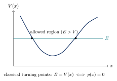
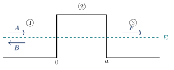
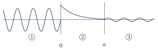
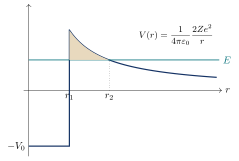
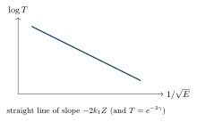
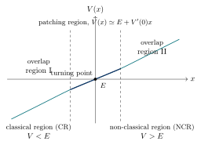
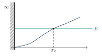
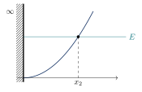

# 30 The WKB Approximation

## 30.1 Idea and Setting

The **WKB (Wentzel, Kramers, Brillouin) approximation** is applicable to one-dimensional systems. Start from the 1D Schrödinger equation

$$
-\frac{\hbar^2}{2m}\frac{d^2\psi}{dx^2} + V(x)\psi(x) = E\psi(x)
$$

**Constant potential** ($E>V$, bound-state-type problem): with $\kappa^2 = (E-V)\dfrac{2m}{\hbar^2}$ we have $\dfrac{d^2\psi}{dx^2} = -\kappa^2\psi$ and

$$
\psi(x) = A\,e^{\pm i\kappa x}, \qquad \kappa = \sqrt{\frac{2m}{\hbar^2}(E-V)}, \qquad \text{wavelength } \lambda = \frac{2\pi}{\kappa}
$$

**Classically forbidden region** ($E<V$, scattering problem): $\psi(x) = A\,e^{\pm\chi x}$ with $\chi = \dfrac1\hbar\sqrt{2m(V-E)}$, and $1/\chi$ is the length scale of the decay.

For a potential that varies slowly compared with the wavelength $\lambda$, the logic of WKB is: *rapid oscillations modulated by a gradual variation of the amplitude and of the phase*. The approximation breaks down at $E=V$, the **classical turning points**, where $p(x)=0$.

{ .fig }

With the classical momentum

$$
\frac{\hat p^2}{2m}\psi = -\frac{\hbar^2}{2m}\frac{d^2\psi}{dx^2} \;\Rightarrow\; \frac{d^2\psi}{dx^2} = -\frac1{\hbar^2}\hat p^2\psi, \qquad E = \frac{p^2}{2m}+V(x)\;\Rightarrow\; p(x) = \sqrt{2m\big(E-V(x)\big)}
$$

## 30.2 Derivation for $E>V$ (Classically Allowed Region)

Try $\psi(x) = A(x)\,e^{i\phi(x)}$ with real $A$ and $\phi$. Then

\begin{align*}
\frac{d\psi}{dx} &= \big[A'(x) + iA(x)\phi'(x)\big]e^{i\phi(x)}\\
\frac{d^2\psi}{dx^2} &= \Big[A'' + 2iA'\phi' + iA\phi'' - A(\phi')^2\Big]e^{i\phi(x)}
\end{align*}

Substituting into $\psi'' = -\frac{p^2}{\hbar^2}\psi$ and cancelling $e^{i\phi}$:

$$
-\frac{p^2}{\hbar^2}A = A'' + 2iA'\phi' + iA\phi'' - A(\phi')^2
$$

Equating the real and the imaginary parts:

\begin{align}
A'' - A(\phi')^2 &= -\frac{p^2}{\hbar^2}A \tag{i}\\
2A'\phi' + A\phi'' &= 0 \tag{ii}
\end{align}

Multiplying (ii) by $A$ gives $2AA'\phi' + A^2\phi'' = (A^2\phi')' = 0$, so $A^2\phi' = c^2$ is constant:

$$
A = \frac{c}{\sqrt{\phi'}} \qquad (c\ \text{a real constant})
$$

For a slowly varying potential assume $A''\approx0$. Equation (i) then becomes $(\phi')^2 = p^2/\hbar^2$, i.e. $\dfrac{d\phi}{dx} = \pm\dfrac p\hbar$:

$$
\phi(x) = \pm\frac1\hbar\int p(x)\,dx
$$

!!! thm "WKB Wavefunction"

    **Allowed region** ($E>V$):

    $$
    \psi_{\text{WKB}}(x) = \frac{c}{\sqrt{p(x)}}\exp\Big[\pm\frac i\hbar\int p(x)\,dx\Big], \qquad |\psi_{\text{WKB}}(x)|^2 = \frac{c^2}{p(x)}
    $$

    **Forbidden region** ($E<V$, $|p| = \sqrt{2m(V-E)}$):

    $$
    \psi_{\text{WKB}}(x) = \frac{c}{\sqrt{|p(x)|}}\exp\Big[\pm\frac1\hbar\int|p(x)|\,dx\Big]
    $$

The probability of finding the particle at $x$ is inversely proportional to its momentum, exactly as in classical mechanics (it spends more time where it moves slowly). WKB is therefore also called the **semi-classical approximation**.

!!! intuition "Intuition"

    The phase $\frac1\hbar\int p\,dx$ is the accumulated de Broglie phase (the local wave number times distance); the amplitude $1/\sqrt p$ keeps the probability flux $\propto|\psi|^2p$ constant.

!!! studynote "Study Note (validity)"

    From (i), $A''/A = (\phi')^2 - p^2/\hbar^2$. Dropping $A''$ is justified if $|A''/A|\ll p^2/\hbar^2$, which for $A\propto p^{-1/2}$ amounts to the de Broglie wavelength $\lambda_{dB}=2\pi\hbar/p$ changing little over one wavelength, $|d\lambda_{dB}/dx|\ll1$, i.e. $\hbar|p'|\ll p^2$. This fails at the turning points ($p\to0$), where the WKB wavefunction blows up as $1/\sqrt p$; the connection formulas of [Section 30.6](#ap-sec-conn) repair this.

!!! memory "Memory Rule"

    Allowed region: oscillating with phase $\frac1\hbar\int p\,dx$. Forbidden region: real exponential with $\frac1\hbar\int|p|\,dx$. Both carry the prefactor $1/\sqrt{|p|}$.

## 30.3 Bound States: Particle in a Well with a Slowly Varying Floor

!!! prob "Example: Infinite Well with a Non-Constant Bottom || Griffiths, Example 9.1"

    { .fig }

    Inside the well $E>V(x)$ and, since the solution may be written with real functions,

    \begin{gather*}
    \psi(x)\simeq\frac1{\sqrt{p(x)}}\Big[C_+e^{i\phi(x)} + C_-e^{-i\phi(x)}\Big]
    \quad\text{or}\quad
    \psi(x)\simeq\frac{1}{\sqrt{p(x)}}\Big[C_1\sin\phi(x) + C_2\cos\phi(x)\Big]\\
    \phi(x) = \frac1\hbar\int_0^xp(x')\,dx'
    \end{gather*}

    with $\phi(0)=0$. Boundary conditions: $\psi(0)=0\Rightarrow C_2=0$, so $\psi(x) = \frac{C_1}{\sqrt{p(x)}}\sin\phi(x)$; and $\psi(a)=0\Rightarrow\sin\phi(a)=0$, i.e. $\phi(a)=n\pi$ $(n=1,2,\ldots)$:

    $$
    \boxed{\int_0^ap(x)\,dx = n\pi\hbar}
    $$

    **Check with $V(x)=0$:** $p=\sqrt{2mE}$ is constant, so $\sqrt{2mE}\,a = n\pi\hbar$ and

    $$
    E_n = \frac{n^2\pi^2\hbar^2}{2ma^2}\qquad(\text{particle in a box})
    $$

    which is exact.

!!! studynote "Study Note"

    The rule $\int p\,dx = n\pi\hbar$ for two hard walls is the Bohr–Sommerfeld condition: the phase accumulated across the well equals $n\pi$, so that a half-integer number of wavelengths fits.

## 30.4 Tunneling

!!! prob "Example: Tunneling Through a Barrier || Griffiths, Section 9.2"

    A particle with energy $E$ is incident from the left on a barrier occupying $0<x<a$, where $V>E$.

    { .fig }

    **Region 1** ($x<0$): $\psi(x) = Ae^{ikx}+Be^{-ikx}$, with $k=\sqrt{2mE/\hbar^2}$. **Region 3** ($x>a$): $\psi(x) = Fe^{ikx}$. The transmission probability is

    $$
    T = \frac{|F|^2}{|A|^2}
    $$

    **Region 2** (tunneling region, $0<x\le a$):

    $$
    \psi_{\text{WKB}}(x) = \frac{C}{\sqrt{|p(x)|}}\exp\Big[\frac1\hbar\int_0^x|p(x')|\,dx'\Big] + \frac{D}{\sqrt{|p(x)|}}\exp\Big[-\frac1\hbar\int_0^x|p(x')|\,dx'\Big]
    $$

    { .fig }

    Only the decaying exponential is attached to the outgoing wave, so the amplitude ratio is controlled by the decay across the barrier,

    $$
    \frac{|F|}{|A|}\sim\exp\Big[-\frac1\hbar\int_0^a|p(x')|\,dx'\Big]\;\Rightarrow\;\frac{|F|^2}{|A|^2}\sim e^{-2\gamma}=T
    $$

!!! thm "WKB Tunneling Probability"

    $$
    T = \Big|\frac FA\Big|^2 = e^{-2\gamma}, \qquad \gamma = \frac1\hbar\int_0^a|p(x)|\,dx
    $$

!!! intuition "Intuition"

    $e^{-\gamma}$ is the amplitude suppression, accumulated slice by slice, across the barrier of the decay rate $|p|/\hbar$. The result is reliable in its exponent when $\gamma\gg1$ (a thick or high barrier); the $O(1)$ prefactor is ignored.

## 30.5 Application: $\alpha$-Decay (Gamow)

Let $Ze$ be the nuclear charge (of the daughter nucleus) and $2e$ the charge of the $\alpha$ particle (He$^{2+}$). For example $^{239}_{\ 94}\text{Pu}\to{}^{235}_{\ 92}\text{U}+{}^{4}_{2}\text{He}$.

{ .fig }

The $\alpha$ particle with energy $E$ sits in the attractive nuclear well ($r<r_1$) and must tunnel through the Coulomb barrier from $r_1$ to the exit point $r_2$, where

$$
E = V(r_2) = \frac1{4\pi\varepsilon_0}\frac{2Ze^2}{r_2}
$$

\begin{align*}
\gamma &= \frac1\hbar\int_{r_1}^{r_2}|p(r)|\,dr = \frac1\hbar\int_{r_1}^{r_2}\sqrt{2m\Big(\frac1{4\pi\varepsilon_0}\frac{2Ze^2}{r}-E\Big)}\,dr = \frac1\hbar\int_{r_1}^{r_2}dr\sqrt{2mE\Big(\frac{r_2}{r}-1\Big)}
\end{align*}

Substitute $r = r_2\sin^2u$ (see the completed integral below) to get the final answer

!!! thm "Gamow Exponent"

    $$
    \gamma = \frac{\sqrt{2mE}}{\hbar}\left[r_2\Big(\frac\pi2-\sin^{-1}\sqrt{\frac{r_1}{r_2}}\Big) - \sqrt{r_1(r_2-r_1)}\right]
    $$

    For $r_1\ll r_2$:

    $$
    \gamma\simeq\frac{\sqrt{2mE}}{\hbar}\Big[\frac\pi2r_2 - 2\sqrt{r_1r_2}\Big]
    $$

    Eliminating $r_2 = 2Ze^2/(4\pi\varepsilon_0E)$ in terms of $E$:

    \begin{gather*}
    \gamma\simeq k_1\frac{Z}{\sqrt E} - k_2\sqrt{Zr_1}\\
    k_1 = \Big(\frac{e^2}{4\pi\varepsilon_0}\Big)\pi\frac{\sqrt{2m}}\hbar\simeq1.98\ \text{MeV}^{1/2},\qquad
    k_2 = \Big(\frac{e^2}{4\pi\varepsilon_0}\Big)^{1/2}\frac{4\sqrt m}{\hbar}\simeq1.485\ \text{fm}^{-1/2}
    \end{gather*}

Here $m$ is the mass of the $\alpha$ particle.

!!! prob "$\alpha$-Decay (continued): Completed Integral and Lifetime || Griffiths, Example 9.2"

    !!! solution "Complete Solution (the integral)"

        With $r=r_2\sin^2u$, $dr = 2r_2\sin u\cos u\,du$ and $\sqrt{r_2/r-1}=\cot u$:

        $$
        \int_{r_1}^{r_2}\sqrt{\frac{r_2}r-1}\,dr = 2r_2\int_{u_1}^{\pi/2}\cos^2u\,du = r_2\Big[u+\sin u\cos u\Big]_{u_1}^{\pi/2}, \qquad \sin u_1 = \sqrt{\frac{r_1}{r_2}}
        $$

        which equals $r_2\big(\frac\pi2-u_1\big)-\sqrt{r_1(r_2-r_1)}$, since $r_2\sin u_1\cos u_1 = \sqrt{r_1(r_2-r_1)}$. (The notebook writes $r=r_2\sin u$; the substitution that works is $r=r_2\sin^2u$.) For $r_1\ll r_2$, $\sin^{-1}\sqrt{r_1/r_2}\approx\sqrt{r_1/r_2}$ and the bracket becomes $\frac\pi2r_2-\sqrt{r_1r_2}-\sqrt{r_1r_2}$.

    !!! solution "Complete Solution"

        *(eliminating $r_2$):* $\dfrac{\sqrt{2mE}}\hbar\dfrac\pi2r_2 = \dfrac{\pi\sqrt{2m}}{\hbar}\dfrac{Ze^2}{4\pi\varepsilon_0}\dfrac1{\sqrt E} = k_1\dfrac Z{\sqrt E}$ and $\dfrac{\sqrt{2mE}}\hbar2\sqrt{r_1r_2} = \dfrac{4\sqrt m}{\hbar}\Big(\dfrac{e^2}{4\pi\varepsilon_0}\Big)^{1/2}\sqrt{Zr_1} = k_2\sqrt{Zr_1}$.

    **Lifetime.** The $\alpha$ particle rattles back and forth inside the nucleus with speed $v$, hitting the barrier at the **rattling frequency** $\dfrac v{2r_1}$. Each hit has probability $e^{-2\gamma}$ of escape, so

    $$
    \text{Probability of emission per unit time} = \frac{v}{2r_1}\,e^{-2\gamma}
    $$

    !!! solution "Complete Solution (lifetime)"

        The lifetime is $\tau = \dfrac{2r_1}{v}\,e^{2\gamma}$, hence $\ln\tau\simeq\text{const}+2k_1\dfrac{Z}{\sqrt E}$: a small increase in $1/\sqrt E$ (lower energy) changes the lifetime by many orders of magnitude (Geiger–Nuttall law).

    { .fig }

    !!! studynote "Study Note"

        The notebook’s straight line is drawn decreasing in $1/\sqrt E$; this is the plot of $\log$ of the transmission (decay rate) $T=e^{-2\gamma}$, whose slope is $-2k_1Z$. The lifetime $\tau$ has the opposite (positive) slope.

## 30.6 The Connection Formulas { #ap-sec-conn }

Near a classical turning point WKB fails, but the potential is nearly *linear* there, and for a linear potential the Schrödinger equation is solved exactly by Airy functions. Matching the Airy solution to WKB on both sides of the turning point gives the connection formulas.

{ .fig }

For $x<0$ (classical region) and $x>0$ (forbidden region) the WKB solutions are

\begin{align}
\psi(x)&\simeq\frac1{\sqrt{p(x)}}\Big[B\exp\Big(\frac i\hbar\int_x^0p(x')dx'\Big) + C\exp\Big(-\frac i\hbar\int_x^0p(x')dx'\Big)\Big]\qquad(x<0)\tag{A}\\
\psi(x)&\simeq\frac1{\sqrt{|p(x)|}}\,D\exp\Big\{-\frac1\hbar\int_0^x|p(x')|dx'\Big\}\qquad(x>0)\tag{B}
\end{align}

**Patching region.** Near the origin $V(x)\simeq E+V'(0)x$ (with $V'(0)>0$). The Schrödinger equation for the patching wavefunction $\psi_p$ is

$$
-\frac{\hbar^2}{2m}\frac{d^2\psi_p}{dx^2} + \big(E+V'(0)x\big)\psi_p = E\psi_p \;\Rightarrow\; \frac{d^2\psi_p}{dx^2} = \frac{2m}{\hbar^2}V'(0)\,x\,\psi_p = \alpha^3x\,\psi_p,\qquad \alpha^3 = \frac{2mV'(0)}{\hbar^2}
$$

With $z=\alpha x$ this becomes the **Airy differential equation**

!!! thm "Airy Equation and Its Solution"

    $$
    \frac{d^2\psi_p}{dz^2} = z\,\psi_p, \qquad \psi_p(x) = a\,\mathrm{Ai}(\alpha x) + b\,\mathrm{Bi}(\alpha x)
    $$

    Asymptotic forms: for large positive $z$,

    $$
    \mathrm{Ai}(z)\sim\frac1{2\sqrt\pi}\frac1{z^{1/4}}e^{-\frac23z^{3/2}}, \qquad \mathrm{Bi}(z)\sim\frac1{\sqrt\pi}\frac1{z^{1/4}}e^{+\frac23z^{3/2}}
    $$

    and for large negative $z$,

    $$
    \mathrm{Ai}(z)\sim\frac1{\sqrt\pi}\frac1{(-z)^{1/4}}\sin\Big(\frac23(-z)^{3/2}+\frac\pi4\Big)
    $$

In the patching region the momentum is $p(x)=\sqrt{2m(E-E-V'(0)x)} = \sqrt{-2mV'(0)x}$, i.e.

$$
p(x) = \hbar\alpha^{3/2}\sqrt{-x}
$$

**Overlap region II** ($x>0$). Here $\int_0^x|p|\,dx' = \hbar\alpha^{3/2}\int_0^x\sqrt{x'}\,dx' = \frac23\hbar(\alpha x)^{3/2}$, so (B) becomes

$$
\psi(x)\simeq\frac{D}{\sqrt\hbar\,\alpha^{3/4}x^{1/4}}\exp\Big(-\frac23(\alpha x)^{3/2}\Big) \tag{C}
$$

whereas the asymptotic Airy solution is

$$
\psi_p(x) = \frac{a}{2\sqrt\pi(\alpha x)^{1/4}}\exp\Big(-\frac23(\alpha x)^{3/2}\Big) + \frac{b}{\sqrt\pi(\alpha x)^{1/4}}\exp\Big(\frac23(\alpha x)^{3/2}\Big) \tag{C$'$}
$$

Comparing (C) and (C$'$): $b=0$ (no growing exponential) and

$$
\boxed{a = \sqrt{\frac{4\pi}{\alpha\hbar}}\,D}
$$

**Overlap region I** ($x<0$). Now $\int_x^0p\,dx' = \frac23\hbar(-\alpha x)^{3/2}$, and (A) becomes

$$
\psi(x)\simeq\frac{1}{\sqrt\hbar\,\alpha^{3/4}(-x)^{1/4}}\Big[B\exp\Big\{i\tfrac23(-\alpha x)^{3/2}\Big\} + C\exp\Big\{-i\tfrac23(-\alpha x)^{3/2}\Big\}\Big] \tag{D}
$$

The Airy solution with $b=0$ and the large negative $z$ asymptotics (the notebook calls it the “small $z$” form) is

\begin{align*}
\psi_p(x) &= \frac{a}{\sqrt\pi(-\alpha x)^{1/4}}\sin\Big[\frac23(-\alpha x)^{3/2}+\frac\pi4\Big]\\
&= \frac{a}{\sqrt\pi(-\alpha x)^{1/4}}\frac1{2i}\Big[e^{i\pi/4}e^{i\frac23(-\alpha x)^{3/2}} - e^{-i\pi/4}e^{-i\frac23(-\alpha x)^{3/2}}\Big] \tag{D$''$}
\end{align*}

Matching (D) and (D$''$):

$$
\frac{B}{\sqrt{\hbar\alpha}} = \frac a{2i\sqrt\pi}e^{i\pi/4}, \qquad \frac C{\sqrt{\hbar\alpha}} = -\frac a{2i\sqrt\pi}e^{-i\pi/4}
$$

Solving with $a=\sqrt{4\pi/\hbar\alpha}\,D$:

!!! thm "Connection Formulas"

    $$
    B = -i\,e^{i\pi/4}\,D, \qquad C = i\,e^{-i\pi/4}\,D
    $$

Inserting these into (A) the two exponentials combine into a sine:

$$
\psi(x)\simeq\frac D{\sqrt{p(x)}}\Big[-ie^{i\pi/4}e^{\frac i\hbar\int_x^0p\,dx'} + ie^{-i\pi/4}e^{-\frac i\hbar\int_x^0p\,dx'}\Big]
$$

!!! thm "Wavefunctions at a Turning Point"

    **Left side, classical turning point at $x=0$ (allowed region $x<0$):**

    \begin{gather*}
    \psi(x)\simeq\frac{2D}{\sqrt{p(x)}}\sin\Big[\frac1\hbar\int_x^0p(x')\,dx' + \frac\pi4\Big]\quad(x<0)\\
    \psi(x)\simeq\frac D{\sqrt{|p(x)|}}\exp\Big[-\frac1\hbar\int_0^x|p(x')|\,dx'\Big]\quad(x>0)
    \end{gather*}

    **Right-hand turning point at $x=x_2$ (allowed region $x<x_2$):**

    \begin{gather*}
    \psi(x)\simeq\frac{2D}{\sqrt{p(x)}}\sin\Big[\frac1\hbar\int_x^{x_2}p(x')\,dx' + \frac\pi4\Big]\quad(x<x_2)\\
    \psi(x)\simeq\frac D{\sqrt{|p(x)|}}\exp\Big[-\frac1\hbar\int_{x_2}^x|p(x')|\,dx'\Big]\quad(x>x_2)
    \end{gather*}

!!! intuition "Intuition"

    A decaying exponential in the forbidden region connects to a sine with a phase offset $\pi/4$ in the allowed region, with amplitude $2D$ against $D$ (the standing wave is the superposition of an incident and a reflected wave of equal strength). The offset $\pi/4$ is a built-in phase shift of the reflection at a soft turning point (compare a hard wall, where the offset is $0$).

!!! studynote "Study Note"

    These formulas apply only when the forbidden-region solution is purely *decaying* (the case $b=0$ used above). Which sign of $V'(0)$ occurs decides on which side the allowed region lies; the second set above is the mirror image (decreasing potential).

!!! verification "Verification"

    Combining $-ie^{i\pi/4}e^{i\theta}+ie^{-i\pi/4}e^{-i\theta} = -i\big(e^{i(\theta+\pi/4)}-e^{-i(\theta+\pi/4)}\big) = 2\sin(\theta+\pi/4)$ with $\theta=\frac1\hbar\int_x^0p\,dx'$ reproduces the boxed sine.

## 30.7 Quantization with Turning Points

!!! prob "Potential Well with One Vertical Wall || Griffiths, Example 9.3"

    { .fig }

    For $x<x_2$ the WKB wavefunction is

    $$
    \psi(x)\simeq\frac{2D}{\sqrt{p(x)}}\sin\Big[\frac1\hbar\int_x^{x_2}p(x')\,dx'+\frac\pi4\Big]
    $$

    The wall imposes $\psi(0)=0$:

    $$
    \sin\Big[\frac1\hbar\int_0^{x_2}p(x')\,dx'+\frac\pi4\Big]=0\;\Rightarrow\;\frac1\hbar\int_0^{x_2}p(x')\,dx'+\frac\pi4 = n\pi
    $$

    $$
    \boxed{\int_0^{x_2}p(x')\,dx' = \Big(n-\frac14\Big)\pi\hbar\qquad(n=1,2,3,\ldots)}
    $$

!!! prob "Example: Half-Harmonic Oscillator || Griffiths, Example 9.3"

    { .fig }

    $$
    V(x) = \begin{cases}\tfrac12m\omega^2x^2, & x>0\\ \infty, & x<0\end{cases}
    \qquad\Big(E=\tfrac12m\omega^2x_2^2\Big)
    $$

    $$
    p(x) = \sqrt{2m\Big(E-\tfrac12m\omega^2x^2\Big)} = \sqrt{2m\cdot\tfrac12m\omega^2(x_2^2-x^2)} = m\omega\sqrt{x_2^2-x^2}
    $$

    \begin{align*}
    \int_0^{x_2}p(x)\,dx &= m\omega\int_0^{x_2}\sqrt{x_2^2-x^2}\,dx = m\omega\Big[\frac x2\sqrt{x_2^2-x^2}+\frac{x_2^2}{2}\sin^{-1}\frac x{x_2}\Big]_0^{x_2}\\
    &= \frac\pi4m\omega x_2^2 = \frac{\pi E}{2\omega}
    \end{align*}

    Setting this equal to $\big(n-\frac14\big)\pi\hbar$:

    $$
    \frac{\pi E_n}{2\omega} = \Big(n-\frac14\Big)\pi\hbar\;\Rightarrow\; E_n = \hbar\omega\cdot2\Big(n-\frac14\Big)
    $$

    $$
    \boxed{E_n = \Big(2n-\frac12\Big)\hbar\omega\qquad(n=1,2,3,\ldots)}\qquad[\text{for the half-harmonic oscillator}]
    $$

!!! verification "Verification"

    Writing $n=k+1$, $E=\big(2k+\tfrac32\big)\hbar\omega$, $k=0,1,2,\ldots$, which are exactly the odd-parity levels $\big(N+\tfrac12\big)\hbar\omega$ with $N=1,3,5,\ldots$ of the full oscillator; these are the full-oscillator states that vanish at the origin, so WKB is exact here.

!!! studynote "Study Note (phase rule for the quantization condition)"

    A hard wall fixes a node ($\sin\phi$, phase $0$), a soft turning point contributes the phase $\pi/4$. Matching the solutions from two soft turning points $x_1<x_2$: $\sin\big(\phi_1+\frac\pi4\big)$ and $\sin\big(\Theta-\phi_1+\frac\pi4\big)$, with $\Theta=\frac1\hbar\int_{x_1}^{x_2}p\,dx'$, agree up to sign only if $\Theta+\frac\pi2=n\pi$. Therefore

    $$
    \int_{x_1}^{x_2}p\,dx = \begin{cases}n\pi\hbar &\text{two hard walls}\\[2pt] \big(n-\tfrac14\big)\pi\hbar &\text{one hard wall, one soft turning point}\\[2pt] \big(n-\tfrac12\big)\pi\hbar &\text{two soft turning points},\qquad n=1,2,3,\ldots\end{cases}
    $$

Check for the full oscillator: $\int_{x_1}^{x_2}p\,dx=\pi E/\omega=(n-\frac12)\pi\hbar\Rightarrow E=(n-\frac12)\hbar\omega$, i.e. $(N+\frac12)\hbar\omega$ for $N=n-1=0,1,2,\ldots$, the exact spectrum.

!!! memory "Memory Rule"

    $\int p\,dx = \big(n-\frac{\text{number of soft turning points}}{4}\big)\pi\hbar$.

!!! mistakes "Common mistakes"

    \(a\) applying WKB right at a turning point instead of using the connection formulas, (b) using $n\pi\hbar$ for a well with soft edges (forgetting the $\frac14$ or $\frac12$ corrections), (c) confusing $|p|$ (forbidden region, $\sqrt{2m(V-E)}$) with $p$, (d) forgetting the factor $2$ in $T=e^{-2\gamma}$ (amplitude gives $e^{-\gamma}$, probability gives $e^{-2\gamma}$), (e) taking $E_H$ or $\gamma$ without the correct units for the $\alpha$-decay constants $k_1,k_2$.

!!! examtip "Exam Tip"

    Choose the method by the structure of the problem: small additional term in $H$: perturbation theory (check for degeneracy); no small parameter but a good guess for the ground state: variational method; smooth potential and large quantum numbers or tunneling: WKB.
