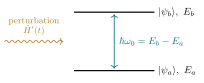
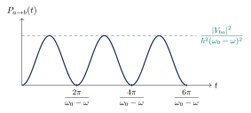

# 31 Time-Dependent Perturbation Theory: The Two-Level System

## 31.1 Why a New Theory Is Needed

If the Hamiltonian is time-independent, an energy eigenstate evolves only by a phase:

$$
\hat H|\psi\rangle = i\hbar\frac{\partial}{\partial t}|\psi\rangle \;\Longrightarrow\; |\psi(t)\rangle = \exp\Big(-\frac{iEt}{\hbar}\Big)|\psi(0)\rangle,
\qquad \langle\psi(t)|\psi(t)\rangle = \langle\psi(0)|\psi(0)\rangle
$$

All probabilities stay the same: eigenstates are **stationary states** and the state remains the same throughout time. To make a system change state (absorb or emit a photon, for example) the Hamiltonian must depend on time. We write

$$
\hat H = \hat H^0 + \hat H'(t), \qquad \hat H^0\ \text{time-independent},\quad \hat H'(t)\ \text{a small time-dependent perturbation.}
$$

!!! intuition "Intuition"

    A perturbation that oscillates at the right frequency can “pump” the system from one stationary state to another, like pushing a swing at its natural frequency. Time-independent perturbation theory finds shifted levels; time-dependent perturbation theory finds *transition probabilities between levels*.

## 31.2 Setting Up the Two-Level System

Let $\hat H^0$ have two eigenstates $|\psi_a\rangle,|\psi_b\rangle$ with $\hat H^0|\psi_a\rangle = E_a|\psi_a\rangle$ and $\hat H^0|\psi_b\rangle = E_b|\psi_b\rangle$.

{ .fig }

At $t=0$ any state is a superposition $|\psi(0)\rangle = c_a|\psi_a\rangle + c_b|\psi_b\rangle$. Without the perturbation it would evolve as

$$
|\psi(t)\rangle = c_a\exp\Big(-\frac{iE_at}{\hbar}\Big)|\psi_a\rangle + c_b\exp\Big(-\frac{iE_bt}{\hbar}\Big)|\psi_b\rangle
$$

Here $|c_a|^2$ is the probability to find the particle in state $a$, similarly $|c_b|^2$ for state $b$, and $|c_a|^2+|c_b|^2=1$.

Now include $\hat H'(t)$. The coefficients become time-dependent:

$$
|\psi(t)\rangle = c_a(t)\exp\Big(-\frac{iE_at}{\hbar}\Big)|\psi_a\rangle + c_b(t)\exp\Big(-\frac{iE_bt}{\hbar}\Big)|\psi_b\rangle
$$

Insert into $(\hat H^0+\hat H'(t))|\psi(t)\rangle = i\hbar\,\partial_t|\psi(t)\rangle$. The $E_a$ and $E_b$ terms from $\hat H^0$ cancel against the same terms from the time derivative of the phase factors, leaving

$$
c_a e^{-iE_at/\hbar}\hat H'|\psi_a\rangle + c_b e^{-iE_bt/\hbar}\hat H'|\psi_b\rangle = i\hbar\,\dot c_a\, e^{-iE_at/\hbar}|\psi_a\rangle + i\hbar\,\dot c_b\, e^{-iE_bt/\hbar}|\psi_b\rangle
$$

Take the inner product with $\langle\psi_a|$ (using $\langle\psi_a|\psi_b\rangle=0$), and define $H'_{ij}=\langle\psi_i|\hat H'|\psi_j\rangle$:

$$
c_a e^{-iE_at/\hbar}H'_{aa} + c_b e^{-iE_bt/\hbar}H'_{ab} = i\hbar\,\dot c_a e^{-iE_at/\hbar}
\;\Longrightarrow\;
\dot c_a = -\frac{i}{\hbar}\Big[c_aH'_{aa} + c_bH'_{ab}\exp\Big(-\frac{i}{\hbar}(E_b-E_a)t\Big)\Big]
$$

Taking the inner product with $\langle\psi_b|$ instead gives

$$
\dot c_b = -\frac{i}{\hbar}\Big[c_bH'_{bb} + c_aH'_{ba}\exp\Big(\frac{i}{\hbar}(E_b-E_a)t\Big)\Big]
$$

Diagonal elements are taken as zero, $H'_{aa}=H'_{bb}=0$ (they only shift the energies and are absorbed into the levels).

!!! thm "Coupled Equations for the Two-Level System"

    $$
    \dot c_a(t) = -\frac{i}{\hbar}\,H'_{ab}\,e^{-i\omega_0t}\,c_b(t), \qquad
    \dot c_b(t) = -\frac{i}{\hbar}\,H'_{ba}\,e^{i\omega_0t}\,c_a(t), \qquad \omega_0 = \frac{E_b-E_a}{\hbar}
    $$

!!! studynote "Study Note"

    These equations are *exact*; no approximation has been made yet. The approximation enters only when they are solved iteratively below. Hermiticity gives $H'_{ba}=(H'_{ab})^*$, and the exponentials $e^{\pm i\omega_0t}$ are the beating between the two levels: the coupling is effective only if $\hat H'(t)$ itself has a component oscillating near $\omega_0$.

## 31.3 Perturbative Solution Order by Order

Solve the coupled equations by iteration. Let $c^{(n)}$ denote the $n$-th iterate, i.e. the amplitude correct to order $\hat H'^{\,n}$. The initial condition fixes the zeroth iterate:

$$
c_a(0)=1,\qquad c_b(0)=0 \quad\Longrightarrow\quad c_a^{(0)}(t)=1,\quad c_b^{(0)}(t)=0
$$

Each iterate is obtained by inserting the previous iterate of the *other* level into the right-hand side:

$$
\dot c_a^{(n)}(t) = -\frac{i}{\hbar}H'_{ab}e^{-i\omega_0t}c_b^{(n-1)}(t), \qquad
\dot c_b^{(n)}(t) = -\frac{i}{\hbar}H'_{ba}e^{i\omega_0t}c_a^{(n-1)}(t)
$$

**First order.** $\dot c_a^{(1)} = -\frac i\hbar H'_{ab}e^{-i\omega_0t}c_b^{(0)}=0$, so $c_a^{(1)}$ is constant, and the initial condition $c_a(0)=1$ gives $c_a^{(1)}(t)=1$: there is no first-order correction to $c_a$. Then

$$
\dot c_b^{(1)}(t) = -\frac i\hbar H'_{ba}e^{i\omega_0t}c_a^{(0)} = -\frac i\hbar H'_{ba}e^{i\omega_0t}
\;\Longrightarrow\;
c_b^{(1)}(t) = -\frac i\hbar\int_0^t dt'\,H'_{ba}(t')\,e^{i\omega_0t'}
$$

**Second order.** Now $c_b^{(1)}\neq0$ feeds back into $c_a$:

$$
\dot c_a^{(2)}(t) = -\frac i\hbar H'_{ab}e^{-i\omega_0t}\Big[-\frac i\hbar\int_0^tdt'\,H'_{ba}e^{i\omega_0t'}\Big]
$$

Integrating, with the constant of integration fixed by $c_a(0)=1$,

$$
c_a^{(2)}(t) = 1 - \frac1{\hbar^2}\int_0^tdt'\,H'_{ab}(t')e^{-i\omega_0t'}\int_0^{t'}dt''\,H'_{ba}(t'')e^{i\omega_0t''}
$$

For $c_b$, the driving term is $c_a^{(1)}=1$, exactly as in the first iterate, so $\dot c_b^{(2)}=\dot c_b^{(1)}$ and $c_b^{(2)}(t)=c_b^{(1)}(t)$: the first correction to $c_b$ beyond $\hat H'$ appears only at third order.

!!! thm "Two-Level Amplitudes to Second Order"

    \begin{align*}
    c_b^{(1)}(t) &= -\frac i\hbar\int_0^tdt'\,H'_{ba}(t')\,e^{i\omega_0t'} \qquad (c_b^{(2)}=c_b^{(1)})\\
    c_a^{(2)}(t) &= 1-\frac1{\hbar^2}\int_0^tdt'\,H'_{ab}(t')\,e^{-i\omega_0t'}\int_0^{t'}dt''\,H'_{ba}(t'')\,e^{i\omega_0t''}
    \end{align*}

!!! verification "Verification (probability conservation)"

    To order $\hat H'^2$,

    $$
    |c_a|^2 = 1-2\,\mathrm{Re}\,\frac1{\hbar^2}\int_0^tdt'\int_0^{t'}dt''\,H'_{ab}(t')H'_{ba}(t'')\,e^{-i\omega_0(t'-t'')}
    $$

Adding the real parts of the double integral over the triangle $t''<t'$ and its mirror image gives the integral over the full square, which equals $\frac1{\hbar^2}\big|\int_0^tdt'\,H'_{ba}e^{i\omega_0t'}\big|^2=|c_b^{(1)}|^2$. Hence $|c_a|^2+|c_b|^2=1$ to second order.

!!! studynote "Study Note (notation)"

    The superscript counts iterations (amplitude correct to that order), so $c_a^{(1)}=1$; the notebook also writes “$c_a^{(1)}=0$” at one point, meaning that the first-order *correction* to $c_a$ vanishes. Both statements are the same fact.

!!! memory "Memory Rule"

    Each factor of $\hat H'$ moves the system once between the levels; an even number of kicks brings it back to $a$, an odd number to $b$. That is why, starting from $a$, the corrections to $c_a$ come only at even orders and those to $c_b$ only at odd orders.

## 31.4 Example: Sinusoidal Perturbation

!!! prob "Example: Sinusoidal Perturbation $\hat H'(\vec r,t)=V(\vec r)\cos\omega t$"

    Here $H'_{ab}=V_{ab}\cos\omega t$ and $H'_{ba}=V_{ba}\cos\omega t$. The first-order amplitude is

    \begin{align*}
    c_b(t) &= -\frac i\hbar\int_0^tdt'\,H'_{ba}e^{i\omega_0t'} = -\frac i\hbar V_{ba}\int_0^tdt'\,e^{i\omega_0t'}\cos\omega t'\\
    &= -\frac{V_{ba}}{2\hbar}\left[\frac{e^{i(\omega_0+\omega)t}-1}{\omega_0+\omega} + \frac{e^{i(\omega_0-\omega)t}-1}{\omega_0-\omega}\right]
    \end{align*}

    !!! solution "Complete Solution of the integral"

        write $\cos\omega t'=\tfrac12(e^{i\omega t'}+e^{-i\omega t'})$, so $\int_0^t e^{i\omega_0t'}\cos\omega t'\,dt' = \tfrac12\Big[\frac{e^{i(\omega_0+\omega)t}-1}{i(\omega_0+\omega)}+\frac{e^{i(\omega_0-\omega)t}-1}{i(\omega_0-\omega)}\Big]$, and the factor $-\frac i\hbar\cdot\frac1{2i}=-\frac1{2\hbar}$ gives the result above.

Let $\omega$ be the **driving frequency** and $\omega_0$ the **transition frequency**. If $\omega\approx\omega_0$, then $\omega+\omega_0\gg|\omega-\omega_0|$ and the first term (denominator $\omega_0+\omega$) is negligible compared with the second, which is large:

\begin{align*}
c_b(t) &\simeq -\frac{V_{ba}}{2\hbar}\,\frac{e^{i(\omega_0-\omega)t}-1}{\omega_0-\omega}
= -\frac{V_{ba}}{2\hbar}\,\frac{e^{\frac i2(\omega_0-\omega)t}}{\omega_0-\omega}\Big[e^{\frac i2(\omega_0-\omega)t}-e^{-\frac i2(\omega_0-\omega)t}\Big]\\
&= -\frac{iV_{ba}}{\hbar}\,\frac{\sin\!\big[\frac{\omega_0-\omega}2t\big]}{\omega_0-\omega}\,\exp\Big[\frac{i(\omega_0-\omega)t}2\Big]
\end{align*}

Hence the probability of a transition $a\to b$ is

!!! thm "Transition Probability for a Sinusoidal Perturbation"

    $$
    P_{a\to b}(t) = |c_b(t)|^2 \simeq \Big(\frac{|V_{ba}|}{\hbar}\Big)^2\frac{\sin^2\!\big[\frac{\omega_0-\omega}{2}\,t\big]}{(\omega_0-\omega)^2}
    $$

{ .fig }

!!! studynote "Study Note (sketch)"

    $P_{a\to b}(t)$ oscillates between $0$ and the fixed maximum $|V_{ba}|^2/\hbar^2(\omega_0-\omega)^2$ with zeros at $t=2\pi n/(\omega_0-\omega)$. The notebook sketch draws the successive arcs with decreasing height; for fixed $\omega$ the arcs all have the same height, as in the figure above.

!!! studynote "Study Note (rotating-wave approximation)"

    Dropping the term with denominator $\omega_0+\omega$ (the “counter-rotating” term) is the **rotating-wave approximation**. It is excellent near resonance and fails for $\omega$ far from $\omega_0$.

!!! studynote "Study Note (validity at resonance)"

    For $\omega\to\omega_0$, $\sin^2(\Delta t/2)/\Delta^2\to t^2/4$ (with $\Delta=\omega_0-\omega$), so $P_{a\to b}\to(|V_{ba}|t/2\hbar)^2$ grows quadratically and exceeds $1$ for $t\gtrsim2\hbar/|V_{ba}|$. First-order theory requires $P\ll1$, i.e. it breaks down on resonance for long times; the exact two-level solution ([Section 33](33-two-level-system-with-an-oscillating.md)) replaces the quadratic growth by bounded oscillations.

!!! examtip "Exam Tip"

    Always check the order of magnitude of the amplitude: transition probabilities from first-order theory are trustworthy only when $|V_{ba}|\ll\hbar|\omega_0-\omega|$ or the interaction time is short.
