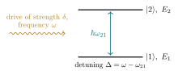
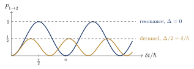

# 33 Two-Level System with an Oscillating Coupling: Exact Solution

## 33.1 The Model

Consider two levels $|1\rangle,|2\rangle$ with energies $E_1<E_2$ and a perturbation that couples them with an oscillating amplitude:

\begin{align*}
\hat H^0 &= E_1|1\rangle\langle1| + E_2|2\rangle\langle2| = \begin{pmatrix}E_1&0\\0&E_2\end{pmatrix}\\
\hat V(t) &= \delta\,e^{i\omega t}|1\rangle\langle2| + \delta\,e^{-i\omega t}|2\rangle\langle1| = \begin{pmatrix}0&\delta\,e^{i\omega t}\\ \delta\,e^{-i\omega t}&0\end{pmatrix}
\end{align*}

so that $\hat H^0+\hat V(t)=\begin{pmatrix}E_1&\delta e^{i\omega t}\\ \delta e^{-i\omega t}&E_2\end{pmatrix}$. If diagonal terms were present in $\hat V$ they would just shift $E_1,E_2$ and are neglected.

{ .fig }

!!! studynote "Study Note"

    $\hat V$ is Hermitian because $V_{21}=V_{12}^*$. The model is the standard picture of a two-level atom driven by a field of frequency $\omega$ in the rotating-wave approximation, with $\delta$ the coupling strength and $\Delta=\omega-\omega_{21}$ the detuning from resonance.

## 33.2 Equations of Motion and Their Solution

Use the interaction-picture equation $i\hbar\dot c_m=\sum_nV_{mn}e^{i\omega_{mn}t}c_n$ with $V_{11}=V_{22}=0$, $V_{12}=\delta e^{i\omega t}$, $V_{21}=\delta e^{-i\omega t}$ and $\omega_{12}=-\omega_{21}$:

$$
i\hbar\,\dot c_1(t) = V_{12}e^{i\omega_{12}t}c_2 = \delta\,e^{i\omega t}e^{-i\omega_{21}t}c_2 = \delta\,e^{i(\omega-\omega_{21})t}c_2(t)
$$

In matrix form,

$$
i\hbar\begin{pmatrix}\dot c_1(t)\\ \dot c_2(t)\end{pmatrix}
= \delta\begin{pmatrix}0&e^{i(\omega-\omega_{21})t}\\ e^{-i(\omega-\omega_{21})t}&0\end{pmatrix}\begin{pmatrix}c_1(t)\\ c_2(t)\end{pmatrix}
$$

!!! thm "Equations of Motion of the Driven Two-Level System"

    \begin{align*}
    i\hbar\,\dot c_1(t) &= \delta\,\exp\big[i(\omega-\omega_{21})t\big]\,c_2(t)\\
    i\hbar\,\dot c_2(t) &= \delta\,\exp\big[-i(\omega-\omega_{21})t\big]\,c_1(t)
    \end{align*}

    Initial condition: $c_1(0)=1,\ c_2(0)=0$.

Write $\Delta=\omega-\omega_{21}$ for the detuning. Differentiate the second equation:

\begin{align*}
i\hbar\,\ddot c_2 &= -i\Delta\,\delta e^{-i\Delta t}c_1 + \delta e^{-i\Delta t}\dot c_1
= -i\Delta\,(i\hbar\dot c_2) + \delta e^{-i\Delta t}\cdot\frac{\delta e^{i\Delta t}c_2}{i\hbar}
\end{align*}

and dividing by $i\hbar$ gives the second-order equation

$$
\ddot c_2(t) + i\Delta\,\dot c_2(t) + \Big(\frac\delta\hbar\Big)^2c_2(t)=0
$$

!!! solution "Complete Solution"

    Put $c_2(t)=e^{-i\Delta t/2}f(t)$. Then $\dot c_2=e^{-i\Delta t/2}(\dot f-\tfrac{i\Delta}2f)$, $\ddot c_2=e^{-i\Delta t/2}(\ddot f-i\Delta\dot f-\tfrac{\Delta^2}4f)$, and substituting,

    $$
    \ddot f + \Big[\frac{\Delta^2}{4}+\Big(\frac\delta\hbar\Big)^2\Big]f = \ddot f+\Omega^2f=0, \qquad
    \Omega=\Big[\Big(\frac\delta\hbar\Big)^2+\frac{(\omega-\omega_{21})^2}4\Big]^{1/2}
    $$

The conditions $c_2(0)=0\Rightarrow f(0)=0$ and $\dot c_2(0)=-\frac{i\delta}{\hbar}c_1(0)=-\frac{i\delta}\hbar$ (from the equation of motion) fix $f=-\dfrac{i\delta}{\hbar\Omega}\sin\Omega t$. Hence

!!! thm "Rabi Oscillations"

    $$
    c_2(t) = -\frac{i\delta}{\hbar\Omega}\,\exp\Big[-i(\omega-\omega_{21})\frac t2\Big]\sin\Omega t, \qquad
    \Omega=\Big[\Big(\frac\delta\hbar\Big)^2+\frac{(\omega-\omega_{21})^2}4\Big]^{1/2}\ \ (\text{Rabi frequency})
    $$

    $$
    P_{1\to2}(t)=|c_2(t)|^2 = \Big(\frac{\delta}{\hbar\Omega}\Big)^2\sin^2\Omega t
    = \frac{(\delta/\hbar)^2}{(\delta/\hbar)^2+(\omega-\omega_{21})^2/4}\,\sin^2\Omega t
    $$

!!! studynote "Study Note (correction)"

    The notebook writes $c_2(t)=\exp[-i(\omega-\omega_{21})t/2]\sin\Omega t$ and $|c_2|^2=\sin^2\Omega t$, omitting the amplitude factor $-i\delta/\hbar\Omega$. The factor is required by $\dot c_2(0)=-i\delta/\hbar$ and by normalization, and it equals $1$ only on resonance ($\omega=\omega_{21}$). Without it $|c_2|^2$ would reach $1$ for any detuning, which is false.

!!! solution "Complete Solution (the other amplitude)"

    From $i\hbar\dot c_2=\delta e^{-i\Delta t}c_1$,

    $$
    c_1(t)=e^{i\Delta t/2}\Big[\cos\Omega t-\frac{i\Delta}{2\Omega}\sin\Omega t\Big]
    $$

!!! verification "Verification"

    $|c_1|^2+|c_2|^2=\cos^2\Omega t+\dfrac{\Delta^2/4+(\delta/\hbar)^2}{\Omega^2}\sin^2\Omega t=1$ . For $\delta\to0$, $\Omega\to|\Delta|/2$ and $P_{1\to2}\to\dfrac{4\delta^2}{\hbar^2\Delta^2}\sin^2\dfrac{\Delta t}2$, which is the first-order result of [Section 31](31-time-dependent-perturbation-theory-two-level.md) (a drive $V_{ba}\cos\omega t$ corresponds to $\delta=V_{ba}/2$ in the rotating-wave approximation).

{ .fig }

!!! studynote "Study Note (figure)"

    On resonance the system is completely transferred $1\to2$ at $t=\pi\hbar/2\delta$ (a “$\pi$-pulse”) and back at $t=\pi\hbar/\delta$. Off resonance the maximum transfer is only $(\delta/\hbar\Omega)^2<1$ and the oscillation is faster (the plot uses $\Delta/2=\delta/\hbar$, giving $\Omega=\sqrt2\,\delta/\hbar$ and maximum $\tfrac12$). The probability oscillates at angular frequency $2\Omega$.

!!! examtip "Exam Tip"

    Three things to remember: (i) the Rabi frequency $\Omega=\sqrt{(\delta/\hbar)^2+\Delta^2/4}$, (ii) the maximum transfer $(\delta/\hbar\Omega)^2$ (a Lorentzian in the detuning, equal to $1$ at resonance), (iii) $P(t)=(\delta/\hbar\Omega)^2\sin^2\Omega t$ is exact; first-order theory is its small-$\delta$ limit.
