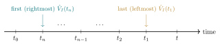
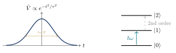

# 34 The Dyson Series and General Transition Amplitudes

## 34.1 The Time-Evolution Operator in the Interaction Picture

Define the evolution operator by

$$
|\psi(t)\rangle_I = \hat U_I(t,t_0)\,|\psi(t_0)\rangle_I
$$

Substituting in $i\hbar\,\partial_t|\psi(t)\rangle_I=\hat V_I(t)|\psi(t)\rangle_I$ gives the equation for the operator itself:

$$
i\hbar\frac\partial{\partial t}\hat U_I(t,t_0)=\hat V_I(t)\,\hat U_I(t,t_0)
\;\Longrightarrow\;
\int_{t_0}^t\partial\hat U_I(t',t_0)=-\frac i\hbar\int_{t_0}^t\hat V_I(t')\hat U_I(t',t_0)\,dt'
$$

Since $\hat U_I(t_0,t_0)=\mathbb 1$, this is the integral equation

$$
\hat U_I(t,t_0) = \mathbb 1 - \frac i\hbar\int_{t_0}^tdt'\,\hat V_I(t')\,\hat U_I(t',t_0)
$$

Insert the right-hand side into itself repeatedly (iteration):

\begin{align*}
\hat U_I(t,t_0) &= \mathbb 1 - \frac i\hbar\int_{t_0}^tdt'\,\hat V_I(t')\Big[\mathbb 1-\frac i\hbar\int_{t_0}^{t'}dt''\,\hat V_I(t'')\hat U_I(t'',t_0)\Big]\\
&= \mathbb 1 - \frac i\hbar\int_{t_0}^tdt'\,\hat V_I(t') + \Big(-\frac i\hbar\Big)^2\int_{t_0}^tdt'\int_{t_0}^{t'}dt''\,\hat V_I(t')\hat V_I(t'')\hat U_I(t'',t_0)
\end{align*}

and so on. This is the **Dyson series**:

!!! thm "Dyson Series"

    $$
    \hat U_I(t,t_0) = \sum_{n=0}^\infty\Big(-\frac i\hbar\Big)^n\int_{t_0}^tdt_1\int_{t_0}^{t_1}dt_2\cdots\int_{t_0}^{t_{n-1}}dt_n\;\hat V_I(t_1)\hat V_I(t_2)\cdots\hat V_I(t_n)
    $$

    with the time ordering $t_0<t_n<t_{n-1}<\cdots<t_2<t_1<t$. The remainder is negligible because it contains high powers of $\hat V$.

The same series is written with a **time-ordered product** $T$, which places operators at later times to the left, $\hat U_I=\sum_n(-\frac i\hbar)^nT\int_{t_0}^t dt_1\cdots dt_n\,\hat V_I(t_1)\cdots\hat V_I(t_n)$, where each “time slice” obeys the ordering above.

{ .fig }

!!! intuition "Intuition"

    The $n$-th term is the sum over all histories in which the system receives $n$ kicks of $\hat V_I$ at ordered times. Earlier kicks act first, so they stand to the *right* of later ones.

!!! memory "Memory Rule"

    Latest time on the left; nested limits $t_0<t_n<\cdots<t_1<t$ guarantee that each ordering of the same $n$ times is counted exactly once.

## 34.2 Transition Amplitudes

If the system is prepared in an initial eigenstate $|i\rangle$ of $\hat H^0$ at $t=t_0$, then at a later time it is in the final state

$$
|f\rangle = \hat U_I(t,t_0)|i(t_0)\rangle = \sum_n|n\rangle\langle n|\hat U_I(t,t_0)|i(t_0)\rangle=\sum_nc_n(t)|n\rangle,
\qquad c_n(t)=\langle n|\hat U_I(t,t_0)|i\rangle
$$

where $|n\rangle$ are the eigenstates of $\hat H^0$, $\hat H^0|n\rangle=E_n|n\rangle$. Expanding $\hat U_I$ with the Dyson series, $c_n(t)=c_n^{(0)}+c_n^{(1)}+c_n^{(2)}+\cdots$, with

\begin{align*}
c_n^{(0)}(t) &= \langle n|\mathbb 1|i\rangle = \delta_{ni}\\
c_n^{(1)}(t) &= -\frac i\hbar\int_{t_0}^tdt'\sum_m\langle n|\hat V_I(t')|m\rangle\langle m|i\rangle
\end{align*}

The matrix elements in the interaction picture are

$$
\langle n|\hat V_I(t)|m\rangle = e^{\frac i\hbar(E_n-E_m)t}\langle n|\hat V(t)|m\rangle = V_{nm}(t)\,e^{i\omega_{nm}t}
$$

so with $\langle m|i\rangle=\delta_{mi}$,

$$
c_n^{(1)}(t) = -\frac i\hbar\int_{t_0}^tdt'\,V_{ni}(t')\,e^{i\omega_{ni}t'}
$$

At second order,

\begin{align*}
c_n^{(2)}(t) &= \Big(-\frac i\hbar\Big)^2\int_{t_0}^tdt'\int_{t_0}^{t'}dt''\sum_{m,p}\langle n|\hat V_I(t')|m\rangle\langle m|\hat V_I(t'')|p\rangle\langle p|i\rangle\\
&= \Big(-\frac i\hbar\Big)^2\sum_m\int_{t_0}^tdt'\int_{t_0}^{t'}dt''\,V_{nm}(t')V_{mi}(t'')\,e^{i\omega_{nm}t'}e^{i\omega_{mi}t''}
\end{align*}

!!! thm "Transition Amplitudes and Probability"

    \begin{align*}
    c_n^{(1)}(t) &= -\frac i\hbar\int_{t_0}^tdt'\,V_{ni}(t')\,e^{i\omega_{ni}t'} \qquad\text{(first order formula)}\\
    c_n^{(2)}(t) &= \Big(-\frac i\hbar\Big)^2\sum_m\int_{t_0}^tdt'\int_{t_0}^{t'}dt''\,V_{nm}(t')V_{mi}(t'')\,e^{i\omega_{nm}t'}e^{i\omega_{mi}t''} \qquad\text{(second order formula)}\\
    P_{i\to n}(t) &= \Big|c_n^{(0)}(t)+c_n^{(1)}(t)+c_n^{(2)}(t)+\cdots\Big|^2 \qquad\text{(transition probability)}
    \end{align*}

!!! studynote "Study Note"

    For two levels the first-order formula reduces to $c_b^{(1)}=-\frac i\hbar\int_0^tH'_{ba}e^{i\omega_0t'}dt'$ of [Section 31](31-time-dependent-perturbation-theory-two-level.md). In the second-order formula the sum over $m$ runs over *all* intermediate states (including $m=i$ and $m=n$); the intermediate state is “virtual”: energy need not be conserved in the intermediate step.

!!! memory "Memory Rule"

    First order is the Fourier transform of the matrix element $V_{ni}(t)$ evaluated at the transition frequency $\omega_{ni}$. Second order is two such steps $i\to m\to n$, with the later step integrated over the shorter nested time.

!!! examtip "Exam Tip"

    For $n\neq i$ the zeroth-order term vanishes and the leading probability is $|c_n^{(1)}|^2$. For $n=i$ (survival) $c_i\approx1$ and one uses $1-\sum_{n\neq i}P_{i\to n}$ instead.

## 34.3 Example: Kicked Oscillator

!!! prob "Example: Kicked Harmonic Oscillator"

    $$
    \hat H^0=\hbar\omega\Big(\hat a^\dagger\hat a+\tfrac12\Big)
    $$

    Initially ($t=-\infty$) the oscillator is in its ground state $|0\rangle$. It is perturbed by a weak transient electric field,

    $$
    \hat V(t) = -e\mathcal E\,\hat x\,\exp\Big(-\frac{t^2}{\tau^2}\Big)
    $$

    What is the probability of finding the particle in the first excited state $|1\rangle$ at $t=\infty$?

    **Solution.** $P_{0\to1}=|c_1^{(1)}|^2$ with

    $$
    c_1(t) = -\frac i\hbar\int_{-\infty}^{\infty}dt'\Big\{-e\mathcal E\exp\Big(-\frac{t'^2}{\tau^2}\Big)\Big\}\langle1|\hat x|0\rangle\,e^{i\omega_{10}t'},
    \qquad
    \langle1|\hat x|0\rangle=\sqrt{\frac\hbar{2m\omega}}\,\langle1|\hat a+\hat a^\dagger|0\rangle=\sqrt{\frac\hbar{2m\omega}}
    $$

    and $\omega_{10}=\omega$. The time integral is Gaussian:

    $$
    \int_{-\infty}^{\infty}e^{i\omega t'}e^{-t'^2/\tau^2}dt' = \sqrt\pi\,\tau\,\exp\Big(-\tfrac14\omega^2\tau^2\Big)
    $$

    so

    $$
    c_1(\infty) = +\frac i\hbar\sqrt{\frac\hbar{2m\omega}}\,e\mathcal E\sqrt\pi\,\tau\,\exp\Big(-\tfrac14\omega^2\tau^2\Big)
    $$

!!! prob "Example: Kicked Harmonic Oscillator (completed)"

    !!! solution "Complete Solution (Gaussian integral)"

        complete the square, $-\dfrac{t'^2}{\tau^2}+i\omega t'=-\Big(\dfrac{t'}\tau-\dfrac{i\omega\tau}2\Big)^2-\dfrac{\omega^2\tau^2}4$; the remaining integral $\int e^{-s^2/\tau^2}ds=\sqrt\pi\,\tau$ gives the result above.

    !!! solution "Complete Solution (probability)"

        $$
        \boxed{P_{0\to1}=|c_1|^2=\frac{\pi e^2\mathcal E^2\tau^2}{2m\hbar\omega}\exp\Big(-\frac{\omega^2\tau^2}2\Big)}
        $$

    !!! verification "Verification and limits"

        the combination $e^2\mathcal E^2/(m\hbar\omega^3)$ is dimensionless, as it must be (so $\omega\tau$ is the only other variable). For a very short pulse ($\omega\tau\ll1$) $P\propto\tau^2\to0$: the pulse area is small. For a very slow pulse ($\omega\tau\gg1$) the exponential makes $P$ extremely small: the oscillator follows adiabatically and returns to the ground state. The probability is largest for $\tau^2=2/\omega^2$, where $P_{\max}=\dfrac{\pi e^2\mathcal E^2}{m\hbar\omega^3}\exp(-1)$.

!!! studynote "Study Note"

    At first order only $|0\rangle\to|1\rangle$ is possible, because $\langle n|\hat x|0\rangle=0$ for $n\ge2$. The state $|2\rangle$ is reached at second order via the virtual intermediate state $|1\rangle$. The result is valid only if $P_{0\to1}\ll1$, i.e. for a weak field.

{ .fig }

!!! verification "Verification (exact result for the kicked oscillator)"

    The perturbation $-e\mathcal E\hat x\,e^{-t^2/\tau^2}$ is a driving force $F(t)=e\mathcal E\,e^{-t^2/\tau^2}$ on the oscillator, and this problem can be solved exactly. An oscillator that starts in $|0\rangle$ ends in a coherent state $|\alpha\rangle$ ([Chapter 7](../01-foundations/07-classical-limit-oscillator-coherent-states.md)) with

    $$
    |\alpha|^2=\frac1{2m\hbar\omega}\Big|\int_{-\infty}^{\infty}F(t)\,e^{i\omega t}\,dt\Big|^2,\qquad P_{0\to n}=e^{-|\alpha|^2}\frac{|\alpha|^{2n}}{n!}
    $$

    Here the integral is $e\mathcal E\sqrt\pi\,\tau\,e^{-\omega^2\tau^2/4}$, so $|\alpha|^2=\dfrac{\pi e^2\mathcal E^2\tau^2}{2m\hbar\omega}e^{-\omega^2\tau^2/2}$, which is exactly the first-order $P_{0\to1}$ found above. First-order theory is therefore the weak-force limit $P_{0\to1}\simeq|\alpha|^2$. The exact formula also gives $P_{0\to2}\simeq\tfrac12|\alpha|^4$ for weak forces, the second-order process through the virtual state $|1\rangle$ mentioned in the Study Note.

!!! book "See also: Griffiths, Introduction to Quantum Mechanics (3rd ed.), Problem 11.23"

    Griffiths motivates the Dyson series by showing why the naive guess $\exp\big[-\frac i\hbar\int\hat H\,dt\big]$ fails: $\hat H(t)$ does not commute with itself at different times, so the correct solution is the time-ordered series of [Section 34.1](#341-the-time-evolution-operator-in-the-interaction-picture), written with Dyson's time-ordered product.
