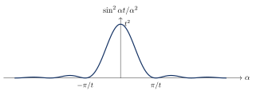
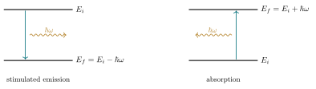

# 35 Harmonic Perturbation and Fermi’s Golden Rule

## 35.1 Transition Probability for a Harmonic Perturbation

The system starts in the initial state $|i\rangle$ and is perturbed by a periodic potential

$$
\hat V(t)=\hat v\,e^{-i\omega t}
$$

where $\hat v$ may depend on space but not on time. What is the probability that at a later time $t$ the system is in the final state $|f\rangle$? Use the first-order formula with $t_0=0$:

$$
c_f^{i\to f}(t) = -\frac i\hbar\int_0^tdt'\,\langle f|\hat v|i\rangle\,e^{i(\omega_{fi}-\omega)t'}
= -\frac i\hbar\langle f|\hat v|i\rangle\,\frac{e^{i(\omega_{fi}-\omega)t}-1}{i(\omega_{fi}-\omega)}
$$

Factor out the phase, $e^{i\Delta t}-1=e^{i\Delta t/2}\big(e^{i\Delta t/2}-e^{-i\Delta t/2}\big)=2i\,e^{i\Delta t/2}\sin(\Delta t/2)$ with $\Delta=\omega_{fi}-\omega$:

$$
c_f^{i\to f}(t) = -\frac i\hbar\langle f|\hat v|i\rangle\,\exp\Big[\frac i2(\omega_{fi}-\omega)t\Big]\,
\frac{\sin\!\big[\frac{(\omega_{fi}-\omega)t}2\big]}{(\omega_{fi}-\omega)/2}
$$

!!! thm "Transition Probability for $\hat V(t)=\hat v\,e^{-i\omega t}$"

    $$
    P_{i\to f}(t) = |c_f^{i\to f}|^2 = \frac1{\hbar^2}\,|\langle f|\hat v|i\rangle|^2\,
    \frac{\sin^2\!\big[\frac{(\omega_{fi}-\omega)t}2\big]}{\big[\frac{\omega_{fi}-\omega}2\big]^2}
    $$

Put $\alpha=(\omega_{fi}-\omega)/2$, so that $P_{i\to f}=\frac1{\hbar^2}|\langle f|\hat v|i\rangle|^2\,\dfrac{\sin^2\alpha t}{\alpha^2}$. As a function of $\alpha$ this is a sharp peak at $\alpha=0$ of height $t^2$ and width of order $\pi/t$, with small side lobes:

{ .fig }

!!! intuition "Intuition"

    A harmonic perturbation only drives transitions whose frequency $\omega_{fi}$ matches the drive frequency $\omega$ to within about $1/t$: the longer the interaction, the sharper the resonance (an energy-time uncertainty relation, $\Delta E\,t\sim\hbar$).

## 35.2 Fermi’s Golden Rule

The area under the peak is $\int_{-\infty}^\infty\frac{\sin^2\alpha t}{\alpha^2}d\alpha=\pi t$, proportional to $t$, while the peak narrows as $t$ grows. Hence for large $t$

$$
\lim_{t\to\infty}\frac1t\Big(\frac{\sin\alpha t}{\alpha}\Big)^2=\pi\,\delta(\alpha)
$$

Then

$$
\frac{P_{i\to f}}{t}=\frac1{\hbar^2}|\langle f|\hat v|i\rangle|^2\,\frac{\sin^2\alpha t}{t\,\alpha^2}
\;\xrightarrow{\,t\to\infty\,}\;\frac1{\hbar^2}|\langle f|\hat v|i\rangle|^2\,\pi\,\delta\Big(\frac{\omega_{fi}-\omega}2\Big)
$$

Using $\delta(x/2)=2\delta(x)$, this defines a constant transition rate $R^{i\to f}$ (probability per unit time):

!!! thm "Fermi’s Golden Rule"

    $$
    R^{i\to f}=\frac{2\pi}{\hbar^2}\,|\langle f|\hat v|i\rangle|^2\,\delta(\omega_{fi}-\omega)
    =\frac{2\pi}\hbar\,|\langle f|\hat v|i\rangle|^2\,\delta(E_f-E_i-\hbar\omega)
    $$

The second form follows from $\delta(\omega_{fi}-\omega)=\hbar\,\delta(E_f-E_i-\hbar\omega)$ (this is another statement of Fermi’s golden rule).

If $\omega=0$ the perturbation is constant, and $\delta(\omega_{fi})=\delta(\omega_f-\omega_i)$ allows only $E_f=E_i$: a constant perturbation causes no real transition between states of different energy. The particle stays in the same (stationary) state.

!!! studynote "Study Note (validity)"

    The rate is linear in time only if the interaction is long enough that the peak is narrow compared with the spacing of the levels and that the energy distribution of the final states is smooth, i.e. $1/t\ll$ (spread of final energies$/\hbar$); but short enough that $P\ll1$. For a single discrete final level there is no $\delta$-function: the probability oscillates as in [Section 31](31-time-dependent-perturbation-theory-two-level.md) instead of growing linearly.

!!! memory "Memory Rule"

    Golden rule in words: rate $=\dfrac{2\pi}\hbar\times|\text{matrix element}|^2\times$ (density of final states at the energy-conserving final energy).

!!! studynote "Study Note (factors of 2 against Griffiths)"

    Griffiths takes the perturbation as $\hat H'=V\cos\omega t=\tfrac12V\big(e^{i\omega t}+e^{-i\omega t}\big)$, so his matrix element $V_{if}/2$ plays the role of $\langle f|\hat v|i\rangle$ here. His long-time result, $P=\dfrac{2\pi}\hbar\Big|\dfrac{V_{if}}2\Big|^2\rho(E_f)\,t$ (Eq. 11.80), is therefore the same golden rule as above. When a problem gives the perturbation as $V\cos\omega t$, use $|V/2|^2$ in the rate.

## 35.3 Transition into a Continuum of Final States

For a continuum define the **density of final states** $\rho(E_f)$: $\rho(E_f)\,dE_f$ is the number of final states with energy between $E_f$ and $E_f+dE_f$. The total transition rate to the continuum is

\begin{align*}
W_{if}&=\int\frac{P_{i\to f}(t)}t\,\rho(E_f)\,dE_f
=\frac{2\pi}\hbar\int dE_f\,|\langle f|\hat v|i\rangle|^2\,\delta(E_f-E_i-\hbar\omega)\,\rho(E_f)
\end{align*}

The delta function removes the integral:

!!! thm "Golden Rule for a Continuum"

    $$
    W_{if}=\frac{2\pi}\hbar\,|\langle f|\hat v|i\rangle|^2\,\rho(E_i+\hbar\omega)
    $$

!!! examtip "Exam Tip"

    Whenever the final states form a continuum (ionization, decay into free particles, emission of a photon), use $W=\frac{2\pi}\hbar|\langle f|V|i\rangle|^2\rho$. The matrix element and $\rho$ must both be evaluated at the energy-conserving final energy.

## 35.4 Harmonic Perturbation with Two Terms: Absorption and Stimulated Emission

A real (Hermitian) oscillating perturbation contains both frequency signs:

$$
\hat V(t)=\hat v\,e^{i\omega t}+\hat v^\dagger e^{-i\omega t}
$$

The first-order probability is

$$
P_{i\to f}=\frac1{\hbar^2}\Big|\langle f|\hat v|i\rangle\int_0^tdt'\,e^{i(\omega_{fi}+\omega)t'}+\langle f|\hat v^\dagger|i\rangle\int_0^tdt'\,e^{i(\omega_{fi}-\omega)t'}\Big|^2
$$

The two terms peak at different frequencies ($\omega_{fi}=-\omega$ and $\omega_{fi}=+\omega$), so the cross terms are negligible:

$$
P_{i\to f}\simeq\frac4{\hbar^2}|\langle f|\hat v|i\rangle|^2\frac{\sin^2(\omega_{fi}+\omega)\frac t2}{(\omega_{fi}+\omega)^2}
+\frac4{\hbar^2}|\langle f|\hat v^\dagger|i\rangle|^2\frac{\sin^2(\omega_{fi}-\omega)\frac t2}{(\omega_{fi}-\omega)^2}
$$

$P_{i\to f}$ is maximum when $\omega_{fi}\to\pm\omega$: **resonance**. In the long-time limit the rate is

!!! thm "Rate for a Harmonic Perturbation"

    $$
    R_{i\to f}=\frac{2\pi}\hbar\,|\langle f|\hat v|i\rangle|^2\,\delta(E_f-E_i+\hbar\omega)+\frac{2\pi}\hbar\,|\langle f|\hat v^\dagger|i\rangle|^2\,\delta(E_f-E_i-\hbar\omega)
    $$

-   **First case, stimulated emission:** $E_f=E_i-\hbar\omega$. The system gives up energy $\hbar\omega$ to the field.

-   **Second case, absorption:** $E_f=E_i+\hbar\omega$. The system takes up energy $\hbar\omega$ from the field.

{ .fig }

!!! studynote "Study Note (correction)"

    The notebook writes the prefactors of this section as $2\pi/\hbar^2$ and $4\pi/\hbar^2$ (probability) and $4\pi/\hbar$ (rates). For the sum of two terms each contribution has the same form as the single-term result: the probability of each term is $\frac4{\hbar^2}|\cdot|^2\sin^2(\cdot)/(\cdot)^2$ (which is exactly $\frac1{\hbar^2}|\cdot|^2\sin^2\alpha t/\alpha^2$), and the rate of each term is $2\pi/\hbar$, not $4\pi/\hbar$. Using $\lim_{t\to\infty}\sin^2(\Delta t/2)/\Delta^2=\frac{\pi t}2\delta(\Delta)$ gives $\frac4{\hbar^2}\cdot\frac\pi2=\frac{2\pi}{\hbar^2}$, which is the golden rule above.

For a continuum of final states the two processes give

\begin{align*}
W_{fi}^{\text{Emission}}&=\frac{2\pi}\hbar\,|\langle f|\hat v|i\rangle|^2\,\rho(E_i-\hbar\omega)\\
W_{fi}^{\text{Absorption}}&=\frac{2\pi}\hbar\,|\langle f|\hat v^\dagger|i\rangle|^2\,\rho(E_i+\hbar\omega)
\end{align*}

and for $\hat v=\hat v^\dagger$ their ratio is

$$
\frac{W_{fi}^{\text{Em}}}{W_{fi}^{\text{Ab}}}=\frac{\rho(E_i-\hbar\omega)}{\rho(E_i+\hbar\omega)}\qquad\text{(condition for balance)}
$$

!!! studynote "Study Note"

    For $\hat v=\hat v^\dagger$ the matrix elements for emission and absorption are equal; the rates differ only because the density of final states is evaluated at different energies. This equality of the matrix elements is the quantum origin of $B_{ab}=B_{ba}$ in [Section 37](37-emission-absorption-radiation.md).

!!! mistakes "Common mistakes"

    \(a\) writing $\delta(E_f-E_i-\hbar\omega)$ for emission (it is absorption; emission has $E_f=E_i-\hbar\omega$), (b) a factor of $2$ error when converting $\delta(\omega_{fi}-\omega)$ to $\delta(E)$ or $\delta(x/2)$ to $\delta(x)$, (c) forgetting that the rate needs the continuum $\rho(E_f)$ or a spread of frequencies.
