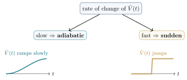

# 36 Adiabatic and Sudden Approximations: First-Order Treatment

## 36.1 Slow and Fast Perturbations

Take $\hat H=\hat H^0+\hat V(t)$, where $\hat V(t)$ is small in comparison with $\hat H^0$. The decisive question is the **rate of change** of $\hat V(t)$ compared with the natural time scale $1/\omega_{fi}$ of the system:

{ .fig }

!!! studynote "Study Note (figure)"

    The tree is from the notebook; the two small sketches of $\hat V(t)$ were added to show what “slow” and “fast” mean.

Start from the first-order amplitude (initial state $|i\rangle$, final state $|f\rangle$, $t_0=0$):

$$
c_f^{(1)}(t)=-\frac i\hbar\int_0^tdt'\,\langle f|\hat V(t')|i\rangle\,e^{i\omega_{fi}t'}
$$

Use $e^{i\omega_{fi}t'}=\dfrac1{i\omega_{fi}}\dfrac\partial{\partial t'}e^{i\omega_{fi}t'}$ and integrate by parts:

\begin{align*}
c_f^{(1)}(t)&=-\frac i\hbar\cdot\frac1{i\omega_{fi}}\int_0^tdt'\,\langle f|\hat V(t')|i\rangle\,\frac\partial{\partial t'}e^{i\omega_{fi}t'}\\
&=-\frac1{\hbar\omega_{fi}}\Big\{\big[\langle f|\hat V(t')|i\rangle e^{i\omega_{fi}t'}\big]_0^t-\int_0^tdt'\,e^{i\omega_{fi}t'}\,\frac\partial{\partial t'}\langle f|\hat V(t')|i\rangle\Big\}
\end{align*}

With the boundary condition $\langle f|\hat V(t')|i\rangle=0$ at $t'=0$ and $t'=t$ (the perturbation is switched on and off smoothly), the boundary term vanishes:

$$
c_f^{(1)}(t)=\frac1{\hbar\omega_{fi}}\int_0^tdt'\,e^{i\omega_{fi}t'}\,\frac\partial{\partial t'}\langle f|\hat V(t')|i\rangle
$$

The amplitude is controlled by the *time derivative* of the matrix element.

## 36.2 Adiabatic Approximation

For a slow process, $\dfrac\partial{\partial t}\langle f|\hat V(t)|i\rangle\to$ constant, which can be taken out of the integral:

$$
c_f^{(1)}(t)=\frac1{\hbar\omega_{fi}}\,\frac\partial{\partial t}\langle f|\hat V(t)|i\rangle\int_0^tdt'\,e^{i\omega_{fi}t'},\qquad
\Big|\int_0^tdt'\,e^{i\omega_{fi}t'}\Big|^2=\frac{\sin^2(\omega_{fi}t/2)}{(\omega_{fi}/2)^2}
$$

Then

\begin{align*}
P_{i\to f}(t)&=\frac1{\hbar^2\omega_{fi}^2}\Big|\frac\partial{\partial t}\langle f|\hat V(t)|i\rangle\Big|^2\,\frac{\sin^2(\omega_{fi}t/2)}{(\omega_{fi}/2)^2}\\
&=\frac4{\hbar^2\omega_{fi}^4}\Big|\frac\partial{\partial t}\langle f|\hat V(t)|i\rangle\Big|^2\sin^2\frac{\omega_{fi}t}2
\end{align*}

!!! thm "Adiabatic Approximation"

    $$
    P_{i\to f}^{\text{Adia}}=\frac4{\hbar^2\omega_{fi}^4}\Big|\frac\partial{\partial t}\langle f|\hat V(t)|i\rangle\Big|^2\sin^2\frac{\omega_{fi}t}2
    $$

!!! intuition "Intuition"

    If the perturbation changes slowly compared with $1/\omega_{fi}$, the system has time to adjust and stays in the instantaneous eigenstate (the adiabatic theorem); the transition probability is small, of order $(\partial_tV/\hbar\omega_{fi}^2)^2$.

!!! verification "Verification (dimensions)"

    $\partial_tV$ has units of energy per time and $\hbar\omega_{fi}^2$ has the same units, so the ratio $\partial_tV/\hbar\omega_{fi}^2$ is dimensionless and so is $P$.

## 36.3 Sudden Approximation

For a sudden (fast) change, $e^{i\omega_{fi}t'}\approx1$ during the change and cannot be pulled out as a slowly varying factor. Then the phase factor drops out of the modulus and

$$
P_{i\to f}=\frac1{\hbar^2\omega_{fi}^2}\,\big|e^{i\omega_{fi}t}\big|^2\Big|\int_0^tdt'\,\frac\partial{\partial t'}\langle f|\hat V(t')|i\rangle\Big|^2
$$

!!! thm "Sudden Approximation"

    $$
    P_{i\to f}=\frac1{\hbar^2\omega_{fi}^2}\Big|\int_0^tdt'\,\frac\partial{\partial t'}\langle f|\hat V(t')|i\rangle\Big|^2
    $$

!!! studynote "Study Note"

    The integral of a derivative is the net *change* $\Delta\langle f|\hat V|i\rangle$ of the matrix element across the rapid switching, so $P_{i\to f}\sim|\Delta\langle f|\hat V|i\rangle|^2/(\hbar\omega_{fi})^2$. The boundary term that was dropped above (it vanishes only for a smooth turn-on and turn-off) cannot be dropped for a genuine jump; keeping it only adds an oscillating factor of order unity, so the estimate stands as an order of magnitude. The complete, non-perturbative treatment of a sudden change is in [Section 38](38-sudden-approximation-overlap-eigenstates.md).

!!! examtip "Exam Tip"

    Compare the duration $T$ of the change with $1/\omega_{fi}$: $T\gg1/\omega_{fi}$ means adiabatic (no transitions, $P\propto(\partial_tV)^2$), $T\ll1/\omega_{fi}$ means sudden (the state is left unchanged and projected onto the new eigenstates).

!!! book "See also: Griffiths, Introduction to Quantum Mechanics (3rd ed.), section 11.5"

    Griffiths does not use the first-order treatment above. Section 11.5.1 calls a process adiabatic when the Hamiltonian changes gradually, and section 11.5.2 proves the **adiabatic theorem**: a particle that starts in the $n$-th eigenstate of the initial Hamiltonian is carried into the $n$-th eigenstate of the final Hamiltonian, picking up a dynamic phase and a geometric (Berry) phase. His Example 11.3 shows both limits for a particle in the ground state of an infinite well whose wall moves: if the wall moves slowly the particle stays in the ground state of the instantaneous well, and if it moves rapidly the particle is left in its initial state (the sudden limit of [Chapter 38](38-sudden-approximation-overlap-eigenstates.md)).
