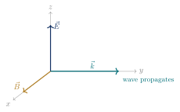
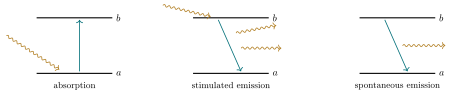
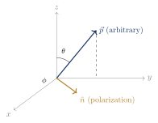

# 37 Emission and Absorption of Radiation

## 37.1 The Radiation Field and the Dipole Approximation

Consider a plane electromagnetic wave

$$
\vec E(\vec r,t)=\vec E_0\exp\{i(\vec k\cdot\vec r-\omega t)\}
$$

with the wave vector $\vec k$ along $y$, the electric field along $z$ and the magnetic field along $x$.

{ .fig }

Two simplifications follow because the wavelength is much larger than the atom:

-   The **spatial variation** of $\vec E$ does not matter on the scale of the atom, so $\vec E$ is evaluated at the position of the atom (the **dipole approximation**).

-   The **electric field** plays the crucial role here, not the magnetic field.

We take $\vec E=E_0\cos\omega t\,\hat e_3$, i.e. a wave polarized along $z$.

!!! studynote "Study Note"

    The magnetic force on an electron is smaller than the electric force by a factor $v/c\sim\alpha$, and for optical wavelengths ($\gtrsim10^3$ atomic radii) $e^{i\vec k\cdot\vec r}\approx1$ across the atom. Corrections to the dipole approximation give magnetic dipole and electric quadrupole transitions, which are much weaker.

## 37.2 Hamiltonian of the Atom in the Field

For an atom with two levels $|\psi_a\rangle,|\psi_b\rangle$ ($E_b>E_a$, $\hbar\omega_0=E_b-E_a$) the time-dependent Hamiltonian is

$$
\hat H'(t)=-qE_0\,z\cos\omega t
$$

and its matrix elements are

$$
H'_{ba}=\langle\psi_b|\hat H'(t)|\psi_a\rangle=-qE_0\cos\omega t\,\langle\psi_b|z|\psi_a\rangle=-E_0\,p\cos\omega t
$$

where $p=q\langle\psi_b|z|\psi_a\rangle$ is the **dipole moment** (the dipole matrix element). The diagonal terms are zero.

!!! solution "Complete Solution (why the diagonal terms vanish)"

    $\hat z$ is odd under parity and atomic stationary states have definite parity, so $|\psi_a|^2$ is even and $\langle\psi_a|z|\psi_a\rangle=\int z|\psi_a|^2d^3r=0$; the same holds for $b$.

## 37.3 Absorption, Stimulated Emission and Spontaneous Emission

[Section 31](31-time-dependent-perturbation-theory-two-level.md) gives, for the sinusoidal perturbation near resonance, with $V_{ba}=-E_0p$:

$$
P_{a\to b}(t)=\Big(\frac{|V_{ba}|}\hbar\Big)^2\frac{\sin^2\!\big[(\omega_0-\omega)\frac t2\big]}{(\omega_0-\omega)^2}
=\Big(\frac{pE_0}\hbar\Big)^2\frac{\sin^2\!\big[(\omega_0-\omega)\frac t2\big]}{(\omega_0-\omega)^2}
$$

-   **Absorption:** a photon is absorbed and the atom goes $a\to b$ with probability $P_{a\to b}$.

-   **Stimulated emission:** an incident photon induces $b\to a$ and a second identical photon is emitted. By symmetry $P_{b\to a}$ has the same form (with $V_{ab}$).

-   **Spontaneous emission:** the atom in $b$ drops to $a$ and emits a photon even with no field applied. It cannot come out of a classical-field calculation; it is obtained from Einstein’s argument below.

{ .fig }

!!! studynote "Study Note (factor 4)"

    The notebook first writes this probability with a prefactor $(2V_{ba}/\hbar)^2$ and a little later says “forget 4”. The prefactor consistent with [Section 31](31-time-dependent-perturbation-theory-two-level.md) is $(V_{ba}/\hbar)^2=(pE_0/\hbar)^2$, and this is what is used below.

## 37.4 Incoherent Perturbation: Broadband Radiation

A thermal (incoherent) field contains many frequencies with random phases, so the transition probabilities for different frequencies add. The **energy density** of an electromagnetic wave is

$$
u=\frac{\epsilon_0E_0^2}2 \quad\Longrightarrow\quad E_0^2=\frac{2u}{\epsilon_0}
$$

With $V_{ab}=qE_0\langle\psi_a|z|\psi_b\rangle=E_0p$ the stimulated-emission probability is

$$
P_{b\to a}=\Big(\frac{pE_0}\hbar\Big)^2\frac{\sin^2[(\omega_0-\omega)\frac t2]}{(\omega_0-\omega)^2}
=\frac{2u}{\epsilon_0\hbar^2}\,|p|^2\,\frac{\sin^2[(\omega_0-\omega)\frac t2]}{(\omega_0-\omega)^2}
$$

Replace $u$ by $\rho(\omega)\,d\omega$, where $\rho(\omega)$ is the energy density per unit frequency, and integrate over all frequencies. The **total transition probability for stimulated emission** is

$$
P_{b\to a}=\frac2{\epsilon_0\hbar^2}\,|p|^2\int_0^\infty d\omega\,\rho(\omega)\,\frac{\sin^2[(\omega_0-\omega)\frac t2]}{(\omega_0-\omega)^2}
\simeq\frac2{\epsilon_0\hbar^2}\,|p|^2\,\rho(\omega_0)\int d\omega\,\frac{\sin^2[(\omega_0-\omega)\frac t2]}{(\omega_0-\omega)^2}
$$

because the integrand is sharply peaked at $\omega\approx\omega_0$ (so $\rho$ is evaluated at $\omega_0$ and the limits may be extended to $\pm\infty$). Substitute $x=(\omega_0-\omega)t/2$, $d\omega=-\tfrac2t\,dx$, $(\omega_0-\omega)^2=4x^2/t^2$:

$$
\int d\omega\,\frac{\sin^2[\ldots]}{(\omega_0-\omega)^2}=\frac t2\int_{-\infty}^{\infty}dx\,\frac{\sin^2x}{x^2}=\frac t2\,\pi
$$

Therefore

$$
P_{b\to a}=\frac{|p|^2}{\epsilon_0\hbar^2}\,\pi\,\rho(\omega_0)\,t
$$

and the transition rate is constant:

!!! thm "Transition Rate for Stimulated Emission (Polarized Wave)"

    $$
    R_{b\to a}=\frac{P_{b\to a}}t=\frac{\pi\,|\vec p\cdot\hat n|^2\,\rho(\omega_0)}{\epsilon_0\hbar^2}, \qquad \vec p=q\langle\psi_a|\vec r|\psi_b\rangle\ \ (\text{dipole matrix element})
    $$

Here the wave propagates along $z$ and its polarization $\hat n$ lies in the $xy$-plane, $\hat n=\cos\phi\,\hat e_1+\sin\phi\,\hat e_2$; the dipole matrix element has an arbitrary direction, $\vec p=p\sin\theta\,\hat e_2+p\cos\theta\,\hat e_3$, so that $\vec p\cdot\hat n=p\sin\theta\sin\phi$.

{ .fig }

For an isotropic, unpolarized field average over directions:

$$
\big\langle|\vec p\cdot\hat n|^2\big\rangle=\frac1{4\pi}\iint|p|^2\sin^2\theta\sin^2\phi\,\sin\theta\,d\theta\,d\phi=\frac13|p|^2
$$

(the same for absorption). With this average:

!!! thm "Rate of Stimulated Emission (Isotropic Radiation) || Griffiths, Section 11.2.3"

    $$
    R_{b\to a}=\frac{\pi\,|\vec p|^2\,\rho(\omega_0)}{3\,\epsilon_0\hbar^2}
    $$

!!! solution "Complete Solution (the angular average)"

    $\int_0^\pi\sin^3\theta\,d\theta=\tfrac43$ and $\int_0^{2\pi}\sin^2\phi\,d\phi=\pi$, so $\frac1{4\pi}\cdot\frac43\cdot\pi=\frac13$ . (The notebook writes $\vec p\cdot\hat n=p\sin\theta\cos\phi$ in one line and integrates $\sin^2\phi$; the average is $\tfrac13$ either way.)

!!! verification "Verification"

    The probability grows *linearly* in $t$ here, unlike the $\sin^2$ oscillation for a single monochromatic wave. The linear growth (a rate) is exactly what the broad frequency distribution produces, as in the golden rule.

!!! memory "Memory Rule"

    Monochromatic: probability $\propto\sin^2(\cdot)/(\cdot)^2$ (oscillates); broadband: probability $\propto t$ (a constant rate).

## 37.5 Spontaneous Emission: Einstein’s $A$ and $B$ Coefficients

Let $N_b$ atoms be in the upper state $|\psi_b\rangle$ and $N_a$ in the lower state $|\psi_a\rangle$. Define the coefficient $B_{ba}$ by the rate of stimulated emission per atom, $R_{b\to a}=B_{ba}\rho(\omega_0)$, and $B_{ab}$ by the absorption rate per atom, $B_{ab}\rho(\omega_0)$. From the rate above,

$$
B_{ba}=\frac{\pi}{3\epsilon_0\hbar^2}\,|\vec p|^2
$$

-   Number of atoms leaving the excited state by stimulated emission: $N_bB_{ba}\rho(\omega_0)$.

-   Absorption: number of atoms joining the upper level $=N_aB_{ab}\rho(\omega_0)$.

-   Let $A$ be the **spontaneous emission rate**: number of atoms leaving the upper level this way $=N_bA$.

So

$$
\frac{dN_b}{dt}=-N_bA-N_bB_{ba}\rho(\omega_0)+N_aB_{ab}\rho(\omega_0)
$$

At thermal equilibrium $dN_b/dt=0$:

$$
\rho(\omega_0)=\frac A{(N_a/N_b)B_{ab}-B_{ba}},\qquad
\frac{N_a}{N_b}=\frac{e^{-E_a/k_BT}}{e^{-E_b/k_BT}}=\exp\Big(\frac{\hbar\omega_0}{k_BT}\Big)
$$

$$
\rho(\omega_0)=\frac A{\exp\big(\frac{\hbar\omega_0}{k_BT}\big)B_{ab}-B_{ba}}
$$

This must agree with Planck’s black-body law,

$$
\rho(\omega_0)=\frac{\hbar\omega_0^3}{\pi^2c^3}\;\frac1{\exp\big(\frac{\hbar\omega_0}{k_BT}\big)-1}
$$

Comparing the two (they must be equal at all temperatures):

!!! thm "Einstein Coefficients || Griffiths, Section 11.3.1"

    $$
    B_{ab}=B_{ba},\qquad A=\frac{\hbar\omega_0^3}{\pi^2c^3}\,B_{ba}\ \ (\text{rate of spontaneous emission}),\qquad B_{ba}=\frac\pi{3\epsilon_0\hbar^2}|\vec p|^2
    $$

If only spontaneous emission acts (no absorption, no stimulated emission) then

$$
\frac{dN_b}{dt}=-N_bA\;\Longrightarrow\;N_b(t)=N_b(0)\,e^{-At},\qquad\boxed{\ \tau=\frac1A\ }\ \ \text{(lifetime of an excited state)}
$$

!!! solution "Complete Solution"

    *(explicit $A$):*

    $$
    A=\frac{\hbar\omega_0^3}{\pi^2c^3}\cdot\frac{\pi|\vec p|^2}{3\epsilon_0\hbar^2}=\frac{\omega_0^3\,|\vec p|^2}{3\pi\epsilon_0\hbar c^3}
    $$

!!! verification "Verification (dimensions)"

    $[\omega_0^3|\vec p|^2]=\text{s}^{-3}\,\text{C}^2\text{m}^2$ and $[\epsilon_0\hbar c^3]=\dfrac{\text{C}^2}{\text{J m}}\cdot\text{J s}\cdot\dfrac{\text{m}^3}{\text{s}^3}=\text{C}^2\text{m}^2\text{s}^{-2}$, so $[A]=\text{s}^{-1}$ .

!!! verification "Verification"

    *(hydrogen $2p\to1s$):* here $\hbar\omega_0=\tfrac34\,(13.6\ \text{eV})$ and $|\vec p|^2=e^2\,|\langle1s|\vec r|2p\rangle|^2=e^2\,\dfrac{2^{15}}{3^{10}}\,a_0^2$. Inserting numbers in $A=\omega_0^3|\vec p|^2/(3\pi\epsilon_0\hbar c^3)$ gives $A\simeq6.3\times10^{8}\ \text{s}^{-1}$, i.e. $\tau=1/A\simeq1.6$ ns, the known lifetime of the hydrogen $2p$ state.

!!! intuition "Intuition"

    A classical radiation field only gives absorption and stimulated emission. Equilibrium with black-body radiation (Planck’s law) is impossible without a third process that occurs even in the absence of radiation, and that is spontaneous emission. Since $A\propto\omega_0^3|\vec p|^2$, high-frequency transitions with large dipole moments decay fastest.

!!! examtip "Exam Tip"

    The route to remember: rate equation $\Rightarrow$ equilibrium $\Rightarrow$ Boltzmann ratio $e^{\hbar\omega_0/k_BT}$ $\Rightarrow$ compare with Planck $\Rightarrow$ $B_{ab}=B_{ba}$ and $A=\hbar\omega_0^3B/\pi^2c^3$.

## 37.6 Selection Rules

The excited-state lifetime depends on the dipole matrix element $\langle\psi_a|\vec r|\psi_b\rangle$. When is $\langle n'l'm'|\vec r|nlm\rangle\neq0$? (The notebook poses this as a question; the answer follows.) Use the commutation relations

$$
[\hat L_z,\hat x]=i\hbar\hat y,\qquad[\hat L_z,\hat y]=-i\hbar\hat x,\qquad[\hat L_z,\hat z]=0
$$

**Selection rule for $m$.** For $\hat z$, $\langle n'l'm'|[\hat L_z,\hat z]|nlm\rangle=0$ gives $\hbar(m'-m)\langle n'l'm'|\hat z|nlm\rangle=0$. Hence

!!! thm "Selection Rule for $z$ || Griffiths, Problem 11.14"

    $$
    \langle n'l'm'|\hat z|nlm\rangle\neq0\ \Longrightarrow\ m'=m
    $$

For $\hat x$ and $\hat y$:

\begin{align*}
\langle n'l'm'|[\hat L_z,\hat x]|nlm\rangle&=i\hbar\langle n'l'm'|\hat y|nlm\rangle\ \Longrightarrow\ (m'-m)\langle n'l'm'|\hat x|nlm\rangle=i\langle n'l'm'|\hat y|nlm\rangle \tag{A}\\
\langle n'l'm'|[\hat L_z,\hat y]|nlm\rangle&=-i\hbar\langle n'l'm'|\hat x|nlm\rangle\ \Longrightarrow\ (m'-m)\langle n'l'm'|\hat y|nlm\rangle=-i\langle n'l'm'|\hat x|nlm\rangle \tag{B}
\end{align*}

Multiply (A) by $(m'-m)$ and use (B):

\begin{align*}
(m'-m)^2\langle n'l'm'|\hat x|nlm\rangle&=i(m'-m)\langle n'l'm'|\hat y|nlm\rangle=\langle n'l'm'|\hat x|nlm\rangle\\
\Longrightarrow\ \big[(m'-m)^2-1\big]\langle n'l'm'|\hat x|nlm\rangle&=0
\end{align*}

The same holds for $\hat y$.

!!! thm "Selection Rule for $x$ and $y$ || Griffiths, Problem 11.14"

    $$
    \langle n'l'm'|\hat x|nlm\rangle\neq0\ \text{(or }\hat y)\ \Longrightarrow\ m'-m=\pm1
    $$

**Selection rule for $l$.** Use the identity

$$
\big[\hat L^2,[\hat L^2,\hat{\vec r}]\big]=2\hbar^2\big[\hat{\vec r}\hat L^2+\hat L^2\hat{\vec r}\big]
$$

and take its matrix element between $\langle n'l'm'|$ and $|nlm\rangle$. The left-hand side gives $\hbar^4[l'(l'+1)-l(l+1)]^2\langle\vec r\rangle$ and the right-hand side $2\hbar^4[l(l+1)+l'(l'+1)]\langle\vec r\rangle$, where $\langle\vec r\rangle=\langle n'l'm'|\hat{\vec r}|nlm\rangle$. Hence

$$
\Big\{2\big[l(l+1)+l'(l'+1)\big]-\big[l'(l'+1)-l(l+1)\big]^2\Big\}\langle n'l'm'|\hat{\vec r}|nlm\rangle=0
$$

The bracket factorizes:

$$
\big[(l'+l+1)^2-1\big]\big[(l'-l)^2-1\big]=0
$$

so a non-zero matrix element requires $l'=l=0$ or $l'-l=\pm1$.

!!! thm "Selection Rule for $l$ (Dipole Transitions) || Griffiths, Problem 11.15"

    $$
    \langle n'l'm'|\hat{\vec r}|nlm\rangle\neq0\ \Longrightarrow\ \Delta l=l'-l=\pm1\quad(\text{and }\Delta m=0,\pm1)
    $$

!!! solution "Complete Solution (factorization)"

    Let $S=(l+l'+1)^2$ and $D=(l'-l)^2$. Then $2[l(l+1)+l'(l'+1)]=S+D-1$ and $[l'(l'+1)-l(l+1)]^2=SD$, so the bracket equals $S+D-1-SD=-(S-1)(D-1)$ . The factor $S=1$ means $l+l'=0$, i.e. $l=l'=0$.

!!! studynote "Study Note"

    *(the case $l=l'=0$):* It is allowed by the factorization but excluded by parity: $\hat{\vec r}$ is odd and states of angular momentum $l$ have parity $(-1)^l$, so $\langle l'|\vec r|l\rangle\neq0$ needs $l+l'$ odd. Together with the commutator result this leaves only $\Delta l=\pm1$.

!!! studynote "Alternate method"

    Parity alone shows that $\Delta l$ is odd; the double commutator identity (equivalently the Wigner–Eckart theorem for a vector operator) shows that it cannot exceed $1$ in magnitude.

!!! examtip "Exam Tip"

    Electric dipole selection rules: $\Delta l=\pm1$, $\Delta m=0$ for light polarized along $z$ and $\Delta m=\pm1$ for $x,y$ (circular) polarization. Examples: $2p\to1s$ is allowed ($\Delta l=-1$), $2s\to1s$ and $3d\to1s$ are forbidden. A state with no allowed dipole decay is long-lived (**metastable**), since $A\propto|\vec p|^2=0$ at this order.

!!! mistakes "Common mistakes"

    \(a\) using $E_0^2=u/\epsilon_0$ instead of $2u/\epsilon_0$ (the $\frac12$ in $u=\epsilon_0E_0^2/2$), (b) forgetting the average factor $\frac13$ for isotropic radiation, (c) taking the stimulated emission rate for a monochromatic wave (oscillating) as a constant rate, (d) forgetting that $B_{ab}=B_{ba}$ for non-degenerate levels follows from equilibrium, not from an assumption.
