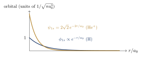

# 38 The Sudden Approximation: Overlap of Eigenstates

## 38.1 Statement of the Approximation

Now let the Hamiltonian change *suddenly*, faster than any time scale of the system, so that the change need not be small. Let

\begin{align*}
\hat H^0|\phi_i\rangle&=\epsilon_i|\phi_i\rangle \qquad\text{(unperturbed, before the change)}\\
\hat H|\psi_n\rangle&=\tilde\epsilon_n|\psi_n\rangle \qquad\text{(perturbed, after the change)}
\end{align*}

Because the change is too fast for the state to respond, the system is still in $|\phi_i\rangle$ immediately afterwards. Expand it in the eigenstates of the new Hamiltonian:

$$
|\phi_i\rangle=\sum_nc_n|\psi_n\rangle,\qquad |\langle\psi_n|\phi_i\rangle|^2=|c_n|^2
$$

!!! thm "Sudden Approximation (Overlap Form)"

    $$
    P_{i\to n}=|\langle\psi_n|\phi_i\rangle|^2
    $$

    the probability of finding the system in the eigenstate $|\psi_n\rangle$ of the new Hamiltonian.

For a weak sudden perturbation first-order perturbation theory gives the estimate

$$
P_{i\to f}\simeq\frac{|\langle\psi_f|\hat V'(t)|\psi_i\rangle|^2}{\hbar^2\omega_{fi}^2}
$$

!!! studynote "Study Note (correction)"

    The notebook writes the denominator as $\hbar^2\omega_{fi}$; the square on $\omega_{fi}$ is needed for $P$ to be dimensionless and agrees with [Section 36](36-adiabatic-sudden-approximations-first-order-treatment.md).

!!! verification "Verification"

    If the change is a weak perturbation $\hat V$, the new eigenstate is $|\psi_f\rangle\simeq|\phi_f\rangle+\sum_{m\ne f}\frac{\langle\phi_m|\hat V|\phi_f\rangle}{\epsilon_f-\epsilon_m}|\phi_m\rangle$, so $\langle\psi_f|\phi_i\rangle\simeq\frac{\langle\phi_f|\hat V|\phi_i\rangle}{\epsilon_i-\epsilon_f}$ for $f\neq i$ and $P_{i\to f}=|\langle\phi_f|\hat V|\phi_i\rangle|^2/(\hbar\omega_{fi})^2$, in agreement.

!!! intuition "Intuition"

    Sudden means “the wavefunction has no time to move”: you freeze $|\phi_i\rangle$ and ask how much of it overlaps each new eigenstate. Adiabatic is the opposite limit: the state follows the changing eigenstate and $P\approx0$.

## 38.2 Example: Beta Decay of Tritium

!!! prob "Example: Tritium to Helium, $^{3}_{1}\text{H}\to{}^{3}_{2}\text{He}$"

    Tritium $^3_1$H is hydrogen-like. Before the decay the electron is in the hydrogen ground state:

    $$
    \hat H^0=\frac{\hat p^2}{2m}-\frac{e^2}r,\qquad \phi_{1s}(\vec r)=\sqrt{\frac1{\pi a_0^3}}\,\exp\Big(-\frac r{a_0}\Big)
    $$

    The nucleus decays by beta decay,

    $$
    {}^3_1\text{H}\;\xrightarrow{\ \text{decay}\ }\;{}^3_2\text{He}+e^-+\bar\nu_e\qquad(\bar\nu_e:\ \text{antineutrino})
    $$

    The emitted electron leaves so fast that the nuclear charge changes suddenly from $Z=1$ to $Z=2$. For the one remaining electron in the helium ion,

    $$
    \hat H=\frac{\hat p^2}{2m}-\frac{2e^2}r,\qquad \psi_{1s}=\sqrt{\frac8{\pi a_0^3}}\,\exp\Big(-\frac{2r}{a_0}\Big)
    $$

    The probability to be in the ground state of the new ion is

    $$
    P=|\langle\psi_{1s}|\phi_{1s}\rangle|^2
    $$

!!! prob "Example: Tritium to Helium (completed)"

    !!! solution "Complete Solution"

        Both functions are spherically symmetric, so

        \begin{align*}
        \langle\psi_{1s}|\phi_{1s}\rangle&=4\pi\int_0^\infty r^2dr\,\sqrt{\frac8{\pi a_0^3}}\sqrt{\frac1{\pi a_0^3}}\,e^{-3r/a_0}
        =\frac{4\sqrt8}{a_0^3}\int_0^\infty r^2e^{-3r/a_0}dr\\
        &=\frac{4\sqrt8}{a_0^3}\cdot\frac{2a_0^3}{27}=\frac{8\sqrt8}{27}=\frac{16\sqrt2}{27}\simeq0.838
        \end{align*}

        using $\int_0^\infty r^2e^{-\kappa r}dr=2/\kappa^3$ with $\kappa=3/a_0$. Hence

        $$
        \boxed{P=\Big(\frac{16\sqrt2}{27}\Big)^2=\frac{512}{729}\simeq0.70}
        $$

    The remaining $217/729\simeq0.30$ goes into excited bound states and the continuum (ionization).

    !!! verification "Verification"

        Both states are normalized: $\frac4{a_0^3}\int r^2e^{-2r/a_0}dr=\frac4{a_0^3}\cdot\frac{a_0^3}4=1$ and $\frac{32}{a_0^3}\int r^2e^{-4r/a_0}dr=\frac{32}{a_0^3}\cdot\frac{a_0^3}{32}=1$ . For $1s$ orbitals of charges $Z_1\to Z_2$ the same steps give $\langle\psi|\phi\rangle=8(Z_1Z_2)^{3/2}/(Z_1+Z_2)^3$, which is $1$ for $Z_1=Z_2$ (no change) and $8\cdot2^{3/2}/27$ for $1\to2$ .

{ .fig }

!!! studynote "Study Note (figure)"

    The He$^+$ orbital is more compact (the nucleus now pulls twice as hard), so the old and new orbitals overlap only partly; this overlap, squared, is the probability $512/729$.

!!! examtip "Exam Tip"

    Sudden approximation recipe: (i) write the initial eigenstate of the old Hamiltonian, (ii) write the eigenstates of the new Hamiltonian, (iii) the probability of landing in $|\psi_n\rangle$ is $|\langle\psi_n|\phi_i\rangle|^2$. Check that $\sum_n P_n=1$ (completeness) if asked for the total.
